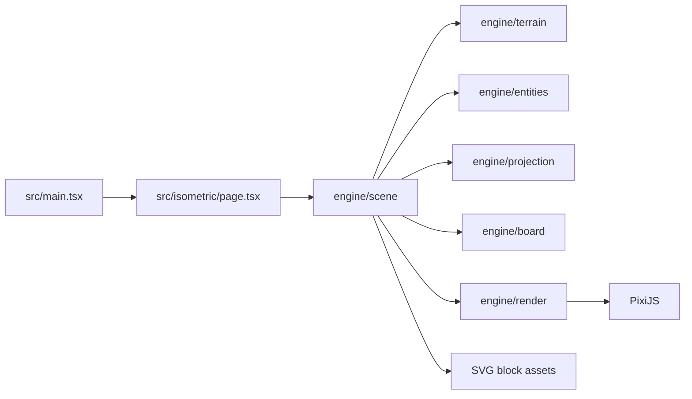

# Arquitectura de Armada Engine

## Propósito

Armada Engine dibuja un terreno discreto en una vista isométrica. El terreno se modela como columnas de bloques; cada columna tiene una coordenada de cuadrícula `(x, y)` y una elevación entera. La escena convierte esas columnas en sprites PixiJS ordenados por profundidad.

El flujo principal es:



## Arranque de la aplicación

`src/main.tsx` obtiene el elemento `#app` y monta `IsometricWorld`.

`src/isometric/page.tsx` crea una instancia de `Application` de PixiJS dentro de `useEffect`. Configura:

- ancho limitado por `WIDTH`;
- alto igual al viewport;
- resolución del dispositivo;
- densidad automática;
- fondo oscuro.

Cuando `app.init()` termina, la página añade `app.canvas` al DOM y llama a `createIsometricScene(app)`. El cleanup del efecto destruye la escena y la aplicación. Si el componente se desmonta mientras Pixi aún inicializa, la bandera `disposed` evita añadir un canvas o una escena incompletos.

## Organización de módulos

Cada responsabilidad tiene una carpeta y un barrel `index.ts`:

```text
src/isometric/core/
  engine/
    board/
      board.ts
      board.test.ts
      index.ts
    constants/
      constants.ts
      constants.test.ts
      index.ts
    entities/
      entities.ts
      entities.test.ts
      index.ts
    projection/
      projection.ts
      projection.test.ts
      index.ts
    render/
      render.ts
      render.test.ts
      index.ts
    scene/
      scene.ts
      scene.test.ts
      index.ts
    terrain/
      terrain.ts
      terrain.test.ts
      index.ts
    index.ts
  types/
    entities.ts
    iso.ts
    terrain.ts
    index.ts
```

Los archivos de tipos no contienen lógica runtime y no tienen tests propios. TypeScript y Typedoc validan esos contratos. Los módulos de comportamiento sí tienen tests co-localizados con el sufijo `.test.ts`.

## Modelo de terreno y entidades

`Box` representa exclusivamente una celda materializada de terreno. Sus coordenadas `x` e `y` son inmutables; sus datos (`type`, `walkable`, `elevation` y `metadata`) pueden actualizarse mediante `update()`.

La clase aplica datos por defecto y combina metadata de forma superficial. `getData()` devuelve una copia de los datos y una copia de `metadata`, de modo que el consumidor no puede modificar el estado interno accidentalmente.

Las entidades no son subtipos de `Box`. `Entity` implementa el contrato espacial común y contiene su identificador, asset, altura, longitud, orientación de longitud y elevación. Las definiciones viven en `engine/entities/config.ts`; `createEntitiesFromConfig()` filtra columnas por superficie y, cuando existe, por `surfaceElevation`, valida todas las celdas de una huella multi-bloque y las reserva en un `Set` para evitar solapamientos. La primera definición que reserva una coordenada tiene prioridad. Para incorporar una entidad nueva se añade una entrada de configuración y su SVG, sin modificar `scene.ts`.

## Generación del terreno

`generatePerlinTerrain(options)` produce una lista ordenada por `x` y después por `y`:

1. Normaliza `width` y `height` a enteros no negativos.
2. Usa un generador pseudoaleatorio determinista a partir de `seed`.
3. Muestrea `simplex-noise` en varias octavas.
4. Combina amplitud con `persistence` y frecuencia con `lacunarity`.
5. Normaliza el ruido a `[0, 1]` y lo convierte al rango `[minElevation, maxElevation]`.

`getOrCreateTerrain()` construye el mapa usado por la escena con las dimensiones de `TERRAIN_WIDTH` y `TERRAIN_HEIGHT`, y conserva el resultado en caché. Una segunda llamada con las mismas dimensiones devuelve la misma referencia.

## Construcción de columnas

El terreno inicial se convierte en instancias de `Box`. La escena aplica además una pequeña configuración de demostración al área central: sus bordes reciben elevación `1` y el interior elevación `0`.

`fillElevations(boxes, minElevation)` materializa todos los niveles entre `minElevation` y la elevación de cada caja. Por ejemplo:

```text
elevación final: 2
mínimo:         -3
columna:        [-3, -2, -1, 0, 1, 2]
```

Esto garantiza que una columna alta no aparezca flotando y que cada nivel pueda recibir su propio bloque visual.

## Proyección isométrica

`projectBoxesToIsometric()` conserva la caja original y añade sus coordenadas de pantalla.

Con ancho `tw`, alto `th`, origen `(ox, oy)` y paso vertical `e`, las fórmulas son:

```text
screenX    = ox + (x - y) * (tw / 2)
baseScreenY = oy - (x + y) * (th / 2)
screenY    = baseScreenY - elevation * e
```

`baseScreenY` representa el contacto con el suelo sin desplazar por elevación. Se usa para ordenar sprites de forma estable. Si no se especifica `elevationStep`, se usa `th / 2`.

Antes de renderizar, la escena calcula los extremos proyectados de todas las cajas y centra el conjunto en el viewport. Después `isWithinViewport()` descarta cajas fuera del viewport más un margen de `VIEW_CULL_MARGIN`.

## Selección de materiales y entidades

La escena carga una textura SVG por material:

```text
public/assets/grass/block.svg
public/assets/ground/block.svg
public/assets/water/block.svg
```

La selección se realiza por columna y elevación:

- elevación negativa: `water`;
- bloque con la elevación máxima de su columna: `grass`;
- cualquier bloque inferior no negativo: `ground`.

El bloque superior se identifica con un `Map` cuya clave es `${x}:${y}`. Así el material no depende de la posición absoluta en pantalla.

El agua reutiliza la misma textura SVG para todos sus niveles. `getWaterTint()` aplica un tintado más oscuro cuanto mayor es `Math.abs(elevation)`. No se generan texturas nuevas para cada profundidad.

Después de renderizar los bloques de terreno, la escena proyecta y renderiza las entidades creadas por la factory. Sus texturas, alturas, longitudes y debug se resuelven mediante la configuración; la escena no contiene reglas por entidad.

Las variantes de color SVG se generan por instancia cuando `colorReplacements` está definido. Cada clave de color puede tener un color o una lista; se selecciona una variante coherente para todo el SVG de esa instancia, se codifica como una fuente `data:image/svg+xml` y se carga como textura Pixi independiente.

## Renderizado de bloques

`renderBlock()` crea un `Sprite` a partir de una textura ya cargada:

1. Ajusta el tamaño a `TILE_WIDTH` y a la proporción del SVG cuando la entidad ocupa varios bloques.
2. Coloca el ancla en `(0.5, 0)` para alinear el centro horizontal y el borde superior.
3. Posiciona el sprite según `lengthAxis`; el eje `y` desplaza la huella hacia el lado inferior izquierdo de la proyección.
4. Aplica tint opcional.
5. Calcula `zIndex` usando `baseScreenY`, elevación y una pequeña corrección por `x`.
6. Si `debug` está activo, añade un `Graphics` con un rombo fino por bloque ocupado en los niveles inferior y superior.
7. Añade los objetos al `Container` ordenable.

Los SVG representan el bloque completo. No se deben volver a componer caras `top`, `left` y `right` en runtime.

## Ciclo de vida de recursos

`createIsometricScene()` crea primero las entidades y descubre sus assets desde `textureSource`. Después carga los SVG de terreno y las variantes de entidad con `Assets.load()` en paralelo. Cada instancia recoloreada obtiene su propia variante; las fuentes originales sin recolor pueden reutilizarse. Si la escena se desmonta, destruye el container y llama a `Assets.unload()` para cada fuente cargada. Pixi gestiona las texturas; no se debe llamar a `destroy(true)` sobre una textura administrada por `Assets`.

## Testing y calidad

Vitest ejecuta tests co-localizados mediante `src/**/*.test.ts`. La cobertura se mide con V8 y tiene umbrales obligatorios de `100%` para:

- statements;
- branches;
- functions;
- lines.

Los tests de renderer y escena mockean PixiJS. Esto permite probar selección de materiales, carga/unload, geometría y tintado sin WebGL ni navegador.

El flujo completo de validación es:

```bash
pnpm test:coverage
pnpm build
pnpm run docs
```

`pnpm run docs` genera Typedoc en `docs/`. El coverage HTML se genera en `coverage/`; ambos directorios son artefactos generados y no deben editarse manualmente.

## Puntos de extensión

Para añadir un nuevo material de terreno:

1. Crear `public/assets/<material>/block.svg` con la misma geometría del bloque.
2. Añadir una clave en `engine/constants`.
3. Cargar el SVG en `engine/scene` y añadir la regla de selección.
4. Actualizar o crear el test de escena para demostrar la selección.
5. Ejecutar coverage, build y Typedoc.

Para añadir una entidad:

1. Crear su SVG en `public/assets/<entidad>/block.svg`.
2. Añadir una entrada en `src/isometric/core/engine/entities/config.ts` con `id`, `textureSource`, `height`, `spawnChance` y `surface`; si ocupa más de un bloque, añadir `length` y `lengthAxis` según `data-tiles`.
3. Añadir o actualizar el test de la factory para demostrar la regla de colocación.
4. No añadir condiciones específicas de la entidad en `scene.ts`, `Box` o `render.ts`.
5. Ejecutar coverage, build y Typedoc.

Para añadir una nueva regla de elevación, modificar primero `projection` o la selección de materiales, según dónde pertenezca la decisión. No introducir esa lógica dentro de `render`, porque el renderer solo debe convertir una decisión ya tomada en un Sprite.

## Estado actual de entidades y assets

Las definiciones de entidad pueden exigir `surfaceElevation`, declarar una huella con `length` y `lengthAxis`, activar `debug` y proporcionar `colorReplacements`. La factory valida todas las celdas de la huella, las reserva en un `Set` y evita solapamientos entre entidades; la primera definición que reserva una coordenada tiene prioridad.

`lengthAxis: "x"` es el valor por defecto. `lengthAxis: "y"` orienta el asset hacia el eje `y` y se aplica de forma coherente a la reserva de celdas, al posicionamiento del sprite y a los rombos de debug. Los assets multi-bloque deben reflejar su atributo SVG `data-tiles` en esta configuración.

Cuando una entidad define `colorReplacements`, cada instancia obtiene una textura SVG recoloreada propia. Cada clave acepta un color o una lista; se selecciona una variante coherente para todas las apariciones de esa clave dentro del SVG. `debug: true` dibuja un rombo fino por bloque ocupado en las superficies inferior y superior.

## Regla de sincronización

Todo cambio que modifique el funcionamiento del core, sus contratos, el renderizado o el flujo de assets debe actualizar en el mismo cambio los Markdown afectados. `ARCHITECTURE.md` documenta el runtime, `CONTRIBUTING.md` el flujo práctico y `ISO_ASSET_AGENT.md` las reglas de generación e integración de SVG.