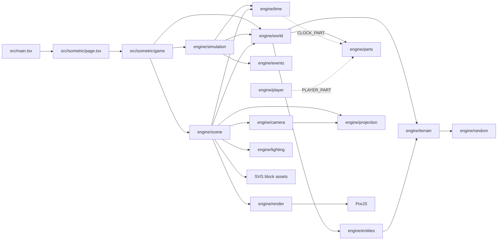

# Arquitectura de Armada Engine

## Propósito

Armada Engine dibuja un terreno discreto en una vista isométrica. El terreno se modela como columnas de bloques; cada columna tiene una coordenada de cuadrícula `(x, y)` y una elevación entera. La escena convierte esas columnas en sprites PixiJS ordenados por profundidad.

El flujo principal es:



## Sistema de coordenadas

Todo el motor (dominio, proyección, luz y render) usa **un único sistema de ejes del mundo**. Esta sección es la referencia; las demás la enlazan. `projection.test.ts` («keeps the documented axes») falla si la proyección deja de cumplirla.

### Ejes del mundo

| Eje               | Unidad            | Qué es                                                                              | En pantalla                                |
| ----------------- | ----------------- | ----------------------------------------------------------------------------------- | ------------------------------------------ |
| `x`               | columnas (entero) | primer índice de la columna                                                         | hacia **arriba a la derecha** (noreste)    |
| `y`               | columnas (entero) | segundo índice de la columna                                                        | hacia **arriba a la izquierda** (noroeste) |
| `z` = `elevation` | bloques (entero)  | nivel del bloque; `0` es el nivel del mar (la arena de la orilla), negativo es agua | hacia **arriba**, en vertical              |

**El punto `(0, 0)` es la columna más cercana a la cámara**: el vértice inferior del rombo que forma el mundo en pantalla. Al crecer `x + y` la columna se aleja de la cámara (sube en pantalla y se dibuja antes). El mundo no tiene borde: se genera por chunks de 32 × 32 columnas a medida que hace falta, y las coordenadas pueden ser negativas (`engine/grid` admite ±`MAX_GRID_COORD` por eje). Un mundo acotado (`generateWorld({ size: { width, height } })`, tests y herramientas) ocupa `x ∈ [0, width)` e `y ∈ [0, height)`, como en el dibujo.

```text
                         ◆ (W−1, H−1)        ← columna más lejana
                       ╱   ╲
                     ╱       ╲
        (0, H−1) ◆             ◆ (W−1, 0)
                   ╲         ╱
                +y  ↖       ↗  +x
                     ╲     ╱
                       ◆ (0, 0)              ← origen: columna más cercana a la cámara

                  z (elevation): ↑ en vertical
```

### Direcciones y puntos cardinales

La cámara es fija y mira al **norte**, que es la parte de arriba de la pantalla. El sol (`engine/time`), las sombras (`engine/lighting`) y la ocultación de bloques (`removeHiddenBlocks()`) usan estas mismas direcciones.

| Paso en la rejilla  | Píxeles (`TILE_WIDTH` = 40)       | Dirección en pantalla | Punto cardinal                |
| ------------------- | --------------------------------- | --------------------- | ----------------------------- |
| `+x`                | `(+20, −10)`                      | arriba a la derecha   | noreste                       |
| `+y`                | `(−20, −10)`                      | arriba a la izquierda | noroeste                      |
| `+x +y`             | `(0, −20)`                        | arriba                | norte (se aleja de la cámara) |
| `+x −y`             | `(+40, 0)`                        | derecha               | este (sale el sol)            |
| `−x −y`             | `(0, +20)`                        | abajo                 | sur (lado de la cámara)       |
| `−x +y`             | `(−40, 0)`                        | izquierda             | oeste (se pone el sol)        |
| `+1` de `elevation` | `(0, −BOX_HEIGHT)` ≈ `(0, −13.3)` | arriba                | —                             |

### Dentro de una columna

Una columna entera `(x, y)` es el cuadrado que va de `(x, y)` a `(x + 1, y + 1)`. Cuando un cálculo necesita un punto dentro de ella (oclusión ambiental, mapas de sombra) usa la fracción `(u, v)` en `[0, 1]`, con los mismos ejes:

```text
                 (x+1, y+1)   esquina norte (arriba)
                     ◆
                   ╱   ╲
       (x, y+1) ◆    ·    ◆ (x+1, y)       · centro (x+0.5, y+0.5) = (screenX, screenY)
                   ╲   ╱
                     ◆
                   (x, y)     esquina sur (abajo, la más cercana a la cámara); (u, v) = (0, 0)
```

### Espacios de coordenadas

| Espacio                    | Tipo                                     | Origen y ejes                                                                                                                                                                                                                                                                          |
| -------------------------- | ---------------------------------------- | -------------------------------------------------------------------------------------------------------------------------------------------------------------------------------------------------------------------------------------------------------------------------------------- |
| Mundo                      | `WorldCoord` (`x`, `y`) + `elevation`    | El de arriba. Es el único que se guarda (`serializeWorld()`).                                                                                                                                                                                                                          |
| Chunk                      | `ChunkCoord` (`cx`, `cy`)                | Chunk `(0, 0)` = columnas `0…31` en ambos ejes; mismos sentidos que el mundo. `toChunkCoord()` usa división hacia abajo: la columna `−1` está en el chunk `−1`.                                                                                                                        |
| Local                      | `LocalCoord` (`lx`, `ly`)                | `(0, 0)` = esquina sur del chunk; siempre en `[0, CHUNK_SIZE)`.                                                                                                                                                                                                                        |
| Pantalla                   | `screenX`, `screenY`, `baseScreenY` (px) | Los de PixiJS: origen arriba a la izquierda del canvas, `x` hacia la derecha e **`y` hacia abajo**.                                                                                                                                                                                    |
| Mapas de sombra y oclusión | texel `(u, v)`                           | Uno por chunk mostrado (cada columna muestra el nivel de su cima): texel `(0, 0)` en la esquina sur de la columna mínima del chunk menos `SHADOW_MAP_MARGIN` (1); `u` a lo largo de `+x` y `v` a lo largo de `+y`. Se ven «desde arriba», no en isométrico.                            |
| Assets SVG (`data-tiles`)  | —                                        | **Otro convenio**: en los assets `+x` va abajo a la derecha y `+y` abajo a la izquierda, al revés que en el motor. Por eso `lengthAxis: "x"` usa `data-tiles="1xN"` y `lengthAxis: "y"` usa `"Nx1"` (ver [Estado actual de entidades y assets](#estado-actual-de-entidades-y-assets)). |

### De la rejilla a la pantalla

`projectBoxesToIsometric()` (ver [Proyección isométrica](#proyección-isométrica)) convierte `(x, y, elevation)` en el punto de pantalla del **centro de la cara superior** del bloque. `originX`/`originY` son el punto de pantalla de la columna `(0, 0)` a elevación `0`; la escena los elige para centrar el mundo en el canvas, así que el `(0, 0)` del mundo **no** es el `(0, 0)` del canvas.

## Arranque de la aplicación

`src/main.tsx` obtiene el elemento `#app` y monta `IsometricWorld`.

`src/isometric/page.tsx` es declarativa: un `<section>` a pantalla completa con el contenedor del canvas y la etiqueta de hora, y un único `useEffect(() => mountGame(contenedor, { window, onClockChange: setClockLabel }).destroy, [])`. No importa Pixi ni el core. La etiqueta de hora está siempre montada después del contenedor del canvas: si fuera un primer hijo condicional, Preact reutilizaría el elemento del contenedor y movería el canvas dentro de la etiqueta.

`mountGame(container, options)` (`src/isometric/game`) es la capa de aplicación entre la página y el core: junta el core, el contenido y la entrada, y es la única parte imperativa del arranque. Crea una instancia de `Application` de PixiJS y la configura con:

- `resizeTo: window`: el canvas llena la ventana y sigue su tamaño (el `ResizePlugin` de Pixi llama a `renderer.resize()`, y la escena re-centra la cámara y vuelve a cullear en cada evento `resize` del renderer). `WIDTH` ya solo es el ancho de referencia del que sale `TILE_WIDTH`; el core sigue sin leer `window`;
- resolución del dispositivo;
- densidad automática;
- fondo oscuro.

Cuando `app.init()` termina, añade `app.canvas` al contenedor y lee las opciones de arranque de la URL con `resolveLaunchOptions(location.search, random)` (`game/launch.ts`): la semilla (`resolveWorldSeed()`, parámetro `?seed=` o una semilla nueva de `random`, por defecto `Math.random`), la hora inicial (`?hour=`), la escala de tiempo (`?timeScale=`) y dos interruptores de medida (`resolveSwitch()`: presente activa, `0`/`off`/`false` desactiva): `?perf` y `?cull=off` (ver [Medir el rendimiento](#medir-el-rendimiento)). Muestra la semilla en consola, genera el mundo con `generateWorld({ seed, entityDefinitions: ENTITY_CONFIG, parts: createWorldParts(startTick) })`, crea el bucle de simulación con `createSimulation(world, { timeScale, systems: createWorldSystems(disabledModules) })` y renderiza el mundo con `createScene(app, world, createSceneModules(disabledModules), { terrain: TERRAIN_APPEARANCE, interpolation: () => getInterpolationAlpha(simulation.stepper), stream })` (ver [Escena modular](#escena-modular)); `stream(visibles, construyendo)` llama a `world.chunks.stream([chunkOfPoint(jugador), ...visibles])`, así que el mundo carga primero el suelo alrededor del jugador y después lo que ve la cámara, esté donde esté, y descarga lo demás (ver [Modelo World](#modelo-world)): mientras la escena se construye, todo lo necesario de una vez; después, en cada frame, como mucho `CHUNKS_LOADED_PER_FRAME` (1) chunk, y si no falta ninguno de los necesarios, los de `CHUNK_PREFETCH_RADIUS` (2) por delante de la cámara que ya llegaron del worker. Esos los genera un **Web Worker** (`createChunkPrefetch(world, startChunkWorker())`, `game/chunk-prefetch.ts`, como el _chunk builder_ de Minecraft): en cada frame le pide (`prefetch.request(focos)`) los chunks cercanos que no están cargados, preparados ni pedidos, primero los necesarios y luego los de delante, como mucho `CHUNKS_IN_FLIGHT` (2) a la vez. El worker (`game/chunk-worker.ts`) corre `createChunkGenerator()` (`game/chunk-generator.ts`: `createSeededChunkSource()` con la semilla de la petición y `ENTITY_CONFIG`, como `generateWorld()`) y devuelve el chunk como datos (`ChunkData`, con las columnas en arrays tipados que se transfieren sin copiar: `chunkDataTransfer()`), que entran al mundo con `world.chunks.prepare()`: cargarlo después solo lo indexa, y la basura de generar (ruido, colocación de entidades) se queda en el worker. Lo generado es lo mismo en los dos hilos, porque solo depende de la semilla y la coordenada: si el worker no llegó a tiempo a un chunk necesario, `stream()` lo genera en el hilo principal como antes, y en los frames se llama con `prefetchPrepared: true`, que solo carga por delante lo ya preparado. Mientras la escena se construye no se pide nada al worker. `destroy()` para el worker (`terminate()`) antes de destruir la app; los tests pasan un worker falso (`GameOptions.chunkWorker`). `game/modules.ts` es la lista de módulos del juego: `createSceneModules()` (bandas del agua, terreno, entidades, viento, sombras, luz ambiente, jugador y cámara, en ese orden), `createWorldParts(startTick)` (el reloj y el jugador; ver [Partes del mundo](#partes-del-mundo)) y `createWorldSystems()` (el jugador). `?modules=-shadows,-player` deja fuera los módulos y sistemas con esos ids (`resolveDisabledModules()`), para depurar uno sin los demás. Con la escena lista conecta los controles: si la escena tiene cámara (`scene.services.camera`), `bindCameraControls(app.stage, app.renderer.screen, camera)` para arrastrar, hacer zoom con la rueda y pellizcar (ver [Cámara](#cámara)); y `bindKeyboardControls(window, { walk, jump, zoom })` (`src/isometric/input`, fuera del core, porque el core no lee el teclado): flechas o WASD **mueven al personaje** (ver [Jugador](#jugador)), la barra espaciadora lo hace **saltar** (`jump()` → `jumpPlayer()`; mantenida, la repetición de la tecla vuelve a saltar al aterrizar) y `+`/`-` hacen zoom en el centro (`KEYBOARD_ZOOM_STEP`, ×1,25). Cada pulsación o suelta de una tecla de movimiento llama a `walk(direcciones)`, que `mountGame()` pasa a `setPlayerWalk(world.parts.get(PLAYER_PART), direcciones)`; la simulación lo mueve en sus siguientes ticks y la cámara lo sigue. Las teclas con Alt, Ctrl o Meta siguen siendo atajos del navegador, y al perder el foco la ventana se sueltan todas. Por debajo, `bindKeyboard(target, bindings)` reparte las teclas entre `KeyBinding`s (`press`: una vez por pulsación; `hold`: las teclas suyas que siguen pulsadas, cada vez que cambian); caminar (`walkBinding()`), saltar (`jumpBinding()`, `JUMP_KEYS`) y el zoom (`zoomBinding()`) son bindings, y una acción nueva es un binding nuevo, sin tocar los demás. Después registra la simulación en `app.ticker` con prioridad `UPDATE_PRIORITY.HIGH` (ver [Bucle de simulación](#bucle-de-simulación)); al arrancar y en cada frame que avanza el reloj llama a `onClockChange(formatClockLabel(tick, timeScale))` (`Día N · HH:MM`, más `· ×S` si el tiempo no corre a velocidad real), y la página pinta esa etiqueta sobre el canvas. La capa `game` es el único lugar donde se usan `Math.random()`, `window`, que recibe de la página (los tests le pasan un `window` falso), y `Worker`.

### Medir el rendimiento

Con `?perf`, `mountGame()` arranca `startPerfMonitor(app, { now, log, heapBytes })` (`game/perf.ts`) antes de crear la escena y le pasa su `profiler` (`SceneOptions.profiler`). El monitor marca el inicio de cada frame con un listener del ticker en `UPDATE_PRIORITY.INTERACTION` (el primero) y el final con otro en `UPDATE_PRIORITY.UTILITY` (después del render de la `Application`, que va en `LOW`): la diferencia es el tiempo de CPU del frame, simulación, escena y envío a la GPU incluidos. Cuenta las llamadas de dibujo envolviendo los `draw*` del contexto WebGL del renderer (`countDrawCalls()`, que los restaura al desmontar), mide la memoria de las texturas subidas (`renderer.texture.managedTextures`: 4 bytes por píxel y un tercio más con mipmaps, por tipo: `svg` los SVG rasterizados, `render` los `RenderTexture` de los mapas de sombra y los atlas de sombras recibidas, `buffer` la oclusión, y los `PERF_TEXTURE_GROUPS` (3) grupos de un tipo y tamaño que más ocupan; `measureTextures()`, que ignora los huecos `null` que Pixi deja en esa lista al descargar una textura), lee el heap de JS (`performance.memory`, solo Chrome) y los chunks mostrados (`watch(scene)`, que además olvida los frames del arranque). Cada `PERF_REPORT_MS` (5 s) de frames escribe en consola, con `log`, un informe de seis líneas: fps y tiempo de frame (mediana, p95, máximo y frames de más de `PERF_SLOW_FRAME_MS`), CPU por frame y llamadas de dibujo, memoria de texturas y heap, las texturas que más ocupan (`largest textures`) y el tiempo de cada paso de la escena (medio y máximo por frame). La escena nunca lee un reloj: `SceneProfiler` le da `now()` y recibe `record(paso, ms)` de `stream`, `hide`, `show:<módulo>` (la parte síncrona de dibujar un chunk), `add` (meter sus vistas en el orden de dibujo y cullear) y `update:<módulo>`, y de las partes que un módulo cronometra con `context.profile(etiqueta, paso)` (`<módulo>:<qué>`; `shadows` separa los pasos de la reunión, `shadows:gather-maps` (siluetas de los mapas), `shadows:gather-pairs` (emparejar sombras recibidas) y `shadows:gather-received` (crear su atlas), `shadows:maps` (dibujar niveles de los mapas de sombra), `shadows:received` (dibujar atlas de sombras recibidas, #72) y `shadows:follow` (inclinar las sombras recibidas con las copas); `foliage-wind:sway` es mecer las copas y `surface-bands:draw` redibujar el atlas del agua). Sin profiler, `profile()` solo ejecuta el paso. El tiempo de GPU no lo dan los navegadores sin flags: se mide con el panel Performance de las herramientas de desarrollo (ver «Medir el rendimiento en tu equipo» en `CONTRIBUTING.md`). `?cull=off` crea la cámara con `createCameraView({ cull: false })`: nunca cullea y se dibujan todas las vistas de los chunks mostrados, para comparar con y sin culling (#44).

`mountGame()` devuelve `{ ready, destroy }`. Cada paso del arranque registra su desmontaje en cuanto existe, y `destroy()` los deshace en orden inverso: listener del ticker, teclado, controles de puntero, escena y aplicación. Si se llama mientras el juego arranca, espera a que termine el paso en curso (`app.init()` o la carga de la escena) y entonces desmonta lo creado sin seguir arrancando: así nunca se destruye una `Application` que aún no ha inicializado (en Pixi 8.22 eso lanza, porque sus plugins no existen todavía) ni se crea una escena o un bucle sobre una aplicación destruida. `ready` se resuelve al terminar de arrancar (o de parar) y se rechaza si el arranque falla. `destroy()` se puede llamar varias veces.

## Organización de módulos

Cada responsabilidad tiene una carpeta y un barrel `index.ts`:

```text
src/isometric/core/
  engine/
    ambient-light/       # módulo de escena: tinte del sol en el render group
      ambient-light.ts
      ambient-light.test.ts
      index.ts
    camera/
      camera.ts
      camera.test.ts
      index.ts
    camera-view/         # módulo de escena: cámara (mueve el contenedor y cullea) y controles de puntero
      camera.ts
      camera.test.ts
      camera-view.ts
      camera-view.test.ts
      controls.ts
      controls.test.ts
      index.ts
    constants/
      constants.ts
      constants.test.ts
      index.ts
    foliage-wind/        # módulo de escena: el viento mece la copa de los árboles
      foliage-wind.ts
      foliage-wind.test.ts
      index.ts
    grid/
      coords.ts
      coords.test.ts
      cell-map.ts
      cell-map.test.ts
      spatial-index.ts
      spatial-index.test.ts
      index.ts
    entity-view/         # módulo de escena: sprites de las entidades
      entity-view.ts
      entity-view.test.ts
      index.ts
    entities/
      entities.ts
      entities.test.ts
      formation.ts
      formation.test.ts
      validation.ts
      validation.test.ts
      variants.ts
      variants.test.ts
      index.ts
    lighting/
      shadow.ts
      shadow.test.ts
      index.ts
    parts/
      parts.ts           # WorldParts: estado de cada parte del mundo, guardado y restauración
      parts.test.ts
      index.ts
    player/
      player.ts          # sistema del jugador: aparición, marcha, colisiones, interpolación
      player.test.ts
      player-part.ts     # createPlayerPart(): el jugador como parte del mundo
      player-part.test.ts
      index.ts
    player-view/         # módulo de escena: sprite del jugador, interpolado y seguido por la cámara
      player-view.ts
      player-view.test.ts
      walk.ts            # hoja de caminar: disposición, ventana de la celda y pose por distancia
      walk.test.ts
      index.ts
    projection/
      projection.ts
      projection.test.ts
      index.ts
    random/
      random.ts
      random.test.ts
      index.ts
    render/              # primitivas Pixi: sprites, profundidad, SVG y color
      color.ts
      color.test.ts
      render.ts
      render.test.ts
      sprite-pool.ts     # SpritePool: sprites de los chunks ocultados, reutilizados por los siguientes
      sprite-pool.test.ts
      svg.ts
      svg.test.ts
      index.ts
    surface-bands/       # módulo de escena: bandas de luz que cruzan el agua (atlas animado compartido)
      band-atlas.ts      # createBandAtlas(): las 4 copias del bloque en un RenderTexture, una sola pasada por redibujado
      band-atlas.test.ts
      surface-bands.ts
      surface-bands.test.ts
      index.ts
    scene/               # compositor: contrato SceneModule, orden de dibujo, frames y destroy
      module.ts          # tipos del contrato
      module.test.ts     # comprobaciones de tipos del contrato
      draw-order.ts      # createDrawOrder(): el orden de dibujo, por franjas de profundidad
      draw-order.test.ts
      scene.ts
      scene.test.ts
      index.ts
    shadows/             # módulo de escena: mapas de sombra, oclusión y sombras recibidas
      pairs.ts           # pairShadows(): qué siluetas pueden sombrear a cada receptor, por celdas
      pairs.test.ts
      received-shadow.ts
      received-shadow.test.ts
      texture-pool.ts    # TexturePool: texturas de pares reutilizadas, nunca destruidas una a una
      texture-pool.test.ts
      shadows.ts
      shadows.test.ts
      silhouette.ts
      silhouette.test.ts
      index.ts
    time/
      clock.ts
      clock.test.ts
      clock-part.ts      # createClockPart(): el reloj como parte del mundo
      clock-part.test.ts
      sun.ts
      sun.test.ts
      index.ts
    waves/               # bandas de luz del agua como datos: perfil, deriva en el tiempo y agua honda
      waves.ts
      waves.test.ts
      index.ts
    wind/                # viento como datos: fase por entidad y desplazamiento de la copa en el tiempo
      wind.ts
      wind.test.ts
      index.ts
    events/
      bus.ts
      bus.test.ts
      index.ts
    simulation/
      simulation.ts
      simulation.test.ts
      stepper.ts
      stepper.test.ts
      index.ts
    terrain/
      box.ts
      box.test.ts
      columns.ts
      columns.test.ts
      terrain.ts
      terrain.test.ts
      surfaces.ts
      surfaces.test.ts
      noise-field.ts     # campos de ruido por semilla y etiqueta (createNoiseField)
      noise-field.test.ts
      bare-ground.ts     # parches de tierra sin pasto (ruido)
      bare-ground.test.ts
      index.ts
    terrain-view/        # módulo de escena: bloques de terreno con textura y tinte por material
      terrain-view.ts
      terrain-view.test.ts
      variants.ts        # variantes de la cima en grupos (validateTerrainVariants, createVariantPicker)
      variants.test.ts
      index.ts
    world/
      chunk-data.ts      # toChunkData()/fromChunkData()/chunkDataTransfer(): un chunk como datos planos (columnas en arrays tipados), entre hilos
      chunk-data.test.ts
      chunks.ts          # WorldChunks: chunks cargados, índices, streaming y entidades editadas
      chunks.test.ts
      sources.ts         # createSeededChunkSource() (por semilla) y createFixedChunkSource() (a mano)
      sources.test.ts
      world.ts
      world.test.ts
      index.ts
    flow-check/          # comprobaciones de varios módulos a la vez y soporte de tests
      architecture.test.ts      # capas, barrels, Pixi, módulos de escena y tests al lado de su archivo
      simulation-events.test.ts # orden de los eventos del reloj a través de la simulación
      scene-harness.ts          # mocks de Pixi y del render, app falsa y mundos para tests de módulos
    index.ts
  types/
    camera.ts
    entities.ts
    events.ts
    grid.ts
    iso.ts
    lighting.ts
    parts.ts
    player.ts
    simulation.ts
    terrain.ts
    time.ts
    index.ts
src/isometric/game/
  game.ts            # mountGame(): arranca y desmonta el juego (Pixi, mundo, simulación, escena, controles)
  game.test.ts
  chunk-generator.ts # createChunkGenerator(): los chunks del juego, como datos (lo que corre el worker)
  chunk-generator.test.ts
  chunk-worker.ts    # entrada del Web Worker de chunks
  chunk-worker.test.ts
  chunk-prefetch.ts  # createChunkPrefetch(): pide al worker los chunks de delante y los prepara en el mundo
  chunk-prefetch.test.ts
  launch.ts          # resolveLaunchOptions() de la URL y formatClockLabel()
  launch.test.ts
  perf.ts            # startPerfMonitor()/createPerfMonitor(): el informe de ?perf (frames, CPU, draw calls, texturas, pasos)
  perf.test.ts
  modules.ts         # createSceneModules(), createWorldParts() y createWorldSystems(): de qué está hecho el juego
  modules.test.ts
  index.ts
src/isometric/input/
  keyboard.ts        # teclado del juego: bindings de teclas; caminar (flechas/WASD), saltar (espacio) y zoom (+/-)
  keyboard.test.ts
  index.ts
src/isometric/content/
  entities.ts        # ENTITY_CONFIG: datos de juego, fuera del motor
  entities.test.ts
  player.ts          # PLAYER_APPEARANCE: cómo se dibuja el personaje
  player.test.ts
  terrain.ts         # TERRAIN_APPEARANCE: SVG, tinte, hundimiento y bandas de luz de cada material
  terrain.test.ts
  index.ts
```

La capa de aplicación (`src/isometric/game`) une el core, el contenido y la entrada; el motor no la importa y la página solo la monta. La lógica imperativa del arranque (crear la `Application`, generar el mundo, el bucle, los controles y su desmontaje) va aquí, probada con mocks de Pixi, y no en `page.tsx`.

La entrada del navegador que no pasa por Pixi (`src/isometric/input`, hoy el teclado) es de la aplicación: el motor no la importa, recibe `window` (o cualquier objetivo de eventos) desde `mountGame()` y solo importa tipos del core.

El contenido del juego (`src/isometric/content`) son datos: el motor no lo importa. `mountGame()` lo pasa a `generateWorld({ entityDefinitions: ENTITY_CONFIG })`, que lo valida antes de generar, a la escena (`TERRAIN_APPEARANCE`) y a sus módulos (`createPlayerView(PLAYER_APPEARANCE)`).

Responsabilidades y dependencias permitidas (entre módulos solo a través de su barrel):

| Módulo          | Responsabilidad                                                                                                                                                                      | Puede importar                                                                  |
| --------------- | ------------------------------------------------------------------------------------------------------------------------------------------------------------------------------------ | ------------------------------------------------------------------------------- |
| `constants`     | Medidas de la vista (`WIDTH`, `TILE_*`, `BOX_HEIGHT`, `TILE_METRICS`)                                                                                                                | —                                                                               |
| `random`        | Aleatoriedad con semilla                                                                                                                                                             | —                                                                               |
| `grid`          | Coordenadas (mundo, chunk, local), `CHUNK_SIZE`, claves numéricas, `CellMap` y `SpatialIndex`                                                                                        | —                                                                               |
| `terrain`       | `Box`, ruido y sus valores por defecto, relleno de columnas (`fillElevations`), bloques visibles (`createVisibleBlocks`, `removeHiddenBlocks`) y superficies                         | `grid`, `random`                                                                |
| `entities`      | `Entity`, huellas, colocación, formaciones, variantes de color, validación de definiciones y su huella de contenido (`fingerprintEntityDefinitions()`)                               | `grid`, `random`, `terrain`                                                     |
| `parts`         | `WorldParts`: el estado de cada parte del mundo registrada, leído por clave, y su guardado y restauración con versión propia                                                         | —                                                                               |
| `time`          | Reloj de juego (ticks) y su parte del mundo (`CLOCK_PART`), hora del día y estado del sol                                                                                            | —                                                                               |
| `events`        | Bus de eventos tipado y síncrono entre sistemas (`createEventBus`)                                                                                                                   | —                                                                               |
| `wind`          | Viento como datos: fase de cada entidad (`getSwayPhase`) y desplazamiento de su copa en un instante (`getSwayOffset`), en tiempo real de vista                                       | `random`                                                                        |
| `waves`         | Bandas de luz del agua como datos: perfil de una banda (`getBandLight`), su deriva en el tiempo (`getBandDrift`), agua honda (`isDeepSurface`) y validación (`validateTerrainBands`) | —                                                                               |
| `lighting`      | Proyección de las sombras: dirección, alargamiento y opacidad según el sol; silueta tumbada en el suelo o llevada a otra entidad                                                     | `constants`                                                                     |
| `player`        | Sistema del jugador: aparición, dirección de marcha, movimiento por tick con colisiones e interpolación (`createPlayerSystem()`), y su parte del mundo (`PLAYER_PART`)               | `grid`, `time`                                                                  |
| `world`         | Modelo `World` por chunks (carga, descarga y streaming), fuentes de chunks, generación y guardado; no nombra ninguna parte                                                           | `entities`, `grid`, `parts`, `random`, `terrain`                                |
| `projection`    | Rejilla → coordenadas de pantalla isométricas (`projectBoxesToIsometric`, `projectGridPoint`) y su inversa en el suelo (`unprojectScreenDelta`)                                      | —                                                                               |
| `camera`        | Cámara como datos: punto del suelo y zoom, límites, desplazamiento, zoom en un punto, seguimiento, transformación, chunks a la vista y cuándo cullear                                | `grid`, `projection`                                                            |
| `render`        | Primitivas Pixi: sprites con profundidad (`createBlockViews`, `getBlockDepth`), pool de sprites (`createSpritePool`), recoloreado y resolución SVG, tinte de luz                     | —                                                                               |
| `simulation`    | Bucle de paso fijo: convierte tiempo real en ticks, ejecuta los sistemas de juego que recibe, avanza el reloj y emite sus eventos                                                    | `events`, `time`, `world`                                                       |
| `scene`         | Compositor: contrato `SceneModule`, contenedor del mundo, orden de dibujo, servicios, frames y destrucción. No dibuja nada                                                           | `camera`, `constants`, `entities`, `grid`, `render`, `terrain`, `time`, `world` |
| `terrain-view`  | Módulo de escena: bloques de terreno visibles con la textura (o la de `terrainSurfaces`) y el tinte de su material                                                                   | `projection`, `render`, `scene`, `terrain`                                      |
| `surface-bands` | Módulo de escena: atlas animado de las bandas de luz del agua, redibujado cada 50 ms; servicio `terrainSurfaces`                                                                     | `scene`, `waves`                                                                |
| `entity-view`   | Módulo de escena: sprites de las entidades, una textura por (tipo, variación); servicio `entityViews`                                                                                | `entities`, `projection`, `render`, `scene`                                     |
| `shadows`       | Módulo de escena: siluetas, un mapa de sombra por chunk (un nivel por elevación) con oclusión ambiental, sombras recibidas por chunk y su ritmo de redibujado                        | `lighting`, `projection`, `render`, `scene`, `time`, `world`                    |
| `foliage-wind`  | Módulo de escena: inclina (`skew`) la copa de las entidades con `sway`, leídas del servicio `entityViews`                                                                            | `scene`, `wind`                                                                 |
| `ambient-light` | Módulo de escena: tinte del render group con la luz ambiente del sol                                                                                                                 | `render`, `scene`, `time`                                                       |
| `player-view`   | Módulo de escena: sprite del jugador, interpolado entre ticks y movido en el orden de dibujo; servicios `focus` y `movingCasters`                                                    | `camera`, `player`, `projection`, `render`, `scene`                             |
| `camera-view`   | Módulo de escena: cámara de la escena (mueve el contenedor, cullea y sigue) y controles de puntero; servicio `camera`                                                                | `camera`, `scene`                                                               |

Fuera del motor, sus módulos solo pueden importar los tipos compartidos (`../../types`), nunca el contenido; el contenido solo importa tipos del core. Solo `render`, `scene` y los módulos de escena importan Pixi, y ningún módulo del motor lee `window`, `document` ni `localStorage`. Un módulo de escena nunca importa a otro, y `scene` no importa a ninguno: se comunican por servicios. `engine/flow-check/architecture.test.ts` comprueba estas reglas sobre el código fuente: un import no permitido, saltarse un barrel, que un módulo de escena dependa de otro o usar Pixi o el navegador en otro módulo hace fallar la suite.

Cada archivo de `src` tiene su test al lado (`foo.ts` y `foo.test.ts`), y cada test está al lado del archivo que prueba. Quedan fuera los barrels (`index.ts`), los tipos compartidos de `core/types` (TypeScript valida esos contratos) y la entrada `main.tsx`. Un archivo que solo declara tipos dentro de un módulo, como `scene/module.ts`, también tiene su test, con comprobaciones de tipos (`expectTypeOf`) que fallan al compilar si el contrato cambia. Lo que no prueba un único archivo (las reglas de arquitectura, un flujo que cruza varios módulos) y el soporte compartido de los tests viven en `engine/flow-check/`, la única carpeta exenta; `flow-check/architecture.test.ts` hace cumplir esta regla.

## Escena modular

La escena no dibuja nada por sí misma: compone **módulos de escena**, cada uno en su carpeta del motor, con su barrel y su test. Así se puede trabajar en las sombras, la luz o el jugador a la vez sin tocar el mismo archivo, y quitar un módulo sin romper los demás.

`createScene(app, world, modules, { terrain, interpolation?, stream?, profiler? })` (`engine/scene`; `profiler` mide cada paso de los frames, ver [Medir el rendimiento](#medir-el-rendimiento)):

1. Rechaza dos módulos con el mismo `id` (antes de crear nada). Crea el contenedor del mundo (un render group con `eventMode = "none"`) y lo añade al `stage`.
2. Prepara el `SceneContext` común: `app`, `world` (solo lectura), `root`, `projection` (suelo `(0, 0)` en escena `(0, 0)`), `metrics` (`TILE_METRICS`), `bounds` (las columnas de un mundo acotado; en uno sin borde, casi todo el rango de `grid`), `columnAt` (`CellMap` de las cimas de los chunks cargados, vivo: cambia al cargar y descargar), `terrain` (la apariencia de cada material, contenido del juego), `topInsetAt(x, y)` (cuánto se hunde la cima de una columna: `topInset` de su material), `assets.loadSvg(src, { scale })` (carga a la resolución de la vista con el zoom máximo, con mipmaps, y descarga al destruir la escena; `scale` < 1 la rebaja para un sprite que se dibuja más pequeño que su casilla, como el jugador; Pixi cachea por `src`, así que una fuente se carga siempre con la misma escala) y `services`.
3. Llama a `setup(context)` de cada módulo **en el orden de la lista**. Un módulo devuelve un `SceneModulePart`: `views` (vistas de toda la escena, con `depth` y `layer`), `showChunk(chunk)` (lo que dibuja en un chunk: un `SceneChunkPart` con sus `views`, su `destroy()` y, si recupera sus vistas para reutilizarlas, `keepsViews`; o una promesa de él), `provides` (servicios para los módulos siguientes), `start(built)`, `update(frame)` y `destroy()`. Si un módulo `requires` un servicio que ningún módulo anterior da, da uno que ya dio otro (cada servicio tiene un solo dueño: dos módulos que lo dieran se pisarían en silencio), o si un `setup()` falla, la escena destruye lo ya creado, descarga sus assets y lanza.
4. Muestra los chunks **listos** que ve la cámara (`camera.visibleChunks()`, del más cercano al más lejano; sin cámara, todos los cargados), tras pedir a la app que los cargue (`stream(visibles, true)`: todo lo de la primera vista de una vez): un chunk está listo cuando están cargados él y sus vecinos que existen, porque sus bordes (bloques tapados, oclusión, sombras) dependen de ellos. Para cada uno llama a `showChunk(chunk)` de cada módulo, en orden. Junta las vistas de los módulos y de los chunks, las ordena **por profundidad y después por capa** (`SCENE_LAYER`: `terrain` 0, `ground` 1 —lo que yace en la cima: sombras—, `behindObject` 2 —lo que está en la columna por detrás del centro de lo que hay en ella: el jugador detrás de un tronco—, `object` 3 —entidades—, `onObject` 4 —sombras recibidas—; a igual profundidad y capa, el orden de creación), las marca `cullable` y las añade a su orden de dibujo (ver el paso siguiente).
5. Llama a `start(built)` de cada módulo; `built.placeAt(view, depth)` inserta una vista que se mueve (el jugador) justo después de todo lo que está a esa profundidad o detrás, `built.move(view)` mueve una vista del suelo que va de columna en columna (la sombra del jugador) a otra profundidad o capa, detrás de las de su misma profundidad y capa como al añadirla, y `built.add(views)`/`built.remove(views)` añaden vistas en su lugar del orden de dibujo o las quitan y destruyen (las sombras recibidas de un chunk, que cambian cuando cambian sus vecinos). El orden de dibujo (`createDrawOrder(root)`, `scene/draw-order.ts`) no es una lista plana: el contenedor del mundo tiene una **franja** por cada `DRAW_BAND_DEPTH` de profundidades con vistas (una fila de casillas, `TILE_HEIGHT / 2`), de atrás hacia delante, y cada franja guarda sus vistas por profundidad y luego capa (`compareViews()`). Como toda vista de una franja va después de todas las de las franjas de detrás, el resultado es el de ordenar todas a la vez; pero añadir o quitar una vista solo mueve los hijos de su franja (unos cientos) y no los ~20 000 de la escena: con la lista plana, `addChildAt()` y `removeChild()` recorrían todos los hijos por cada vista, y eran el mayor coste de mostrar y ocultar chunks fuera del recolector. Una vista nueva entra detrás de las de su misma profundidad y capa (como un orden estable), `placeAt()` la pone tras todas las de su profundidad o menos, y una franja vacía se destruye.
6. Registra **un único** listener en `app.ticker` con `UPDATE_PRIORITY.NORMAL` (tras la simulación y antes del render). En cada frame primero reanuda los chunks que esperaban al frame siguiente y sincroniza los chunks: vuelve a pedir `stream(visibles, false)` (la app carga con presupuesto), oculta los chunks que ya no están listos (el mundo descargó un vecino), todos a la vez, y los que no están a la vista ni junto a uno que lo esté (el margen evita mostrar y ocultar sin parar en un borde), `CHUNKS_HIDDEN_PER_FRAME` (1) por frame (ocultar uno cuesta ~5 ms con el zoom alejado en un Mac, y al caminar sale de la vista una fila entera a la vez: 16–26 ms en un frame, #44; los que esperan siguen fuera de la vista y culleados) y, si no está dibujando ya uno, empieza a mostrar el siguiente chunk listo a la vista (`CHUNKS_SHOWN_PER_FRAME` = 1, el más cercano primero; `showChunk` puede ser asíncrono, por las texturas). Tras el arranque, cada módulo dibuja su parte del chunk **en un frame propio** (la escena espera al frame siguiente entre un `showChunk` y el siguiente), así ningún frame paga el chunk entero: terreno, entidades y sombras se reparten en tres frames y sus vistas entran juntas al final. Después lo añade con `built.add()` y pide a la cámara que cullee solo sus vistas (`cullViews(views)`): el resto sigue como lo dejó el último culling, y volver a cullear toda la escena costaba ~20 ms con el zoom alejado (#44). Ocultar un chunk saca sus vistas del orden de dibujo y, parte a parte en orden inverso, destruye las vistas de la parte (salvo si la parte tiene `keepsViews`: entonces las recupera su `destroy()` para reutilizarlas) y llama a su `destroy()`. Después llama a `update({ tick, elapsedMs, alpha })` de cada módulo en orden.

Devuelve `{ services, shownChunks, destroy }`; `destroy()` quita el listener, oculta los chunks mostrados, destruye los módulos en orden inverso, el contenedor con sus hijos y descarga los assets. Un chunk que termina de dibujarse después de `destroy()` se descarta y se destruye; uno que esperaba al frame siguiente entre dos módulos se reanuda al destruir, no dibuja más y libera lo ya dibujado.

Los módulos colaboran solo por **servicios** con nombre (`SceneServices`): `entityViews` (lo da `entity-view`: las entidades de cada chunk mostrado con sus vistas, por `ChunkKey`; lo usan `shadows` para las siluetas y `foliage-wind` para mecer las copas), `terrainSurfaces` (lo da `surface-bands`: la textura de un bloque de terreno según su material, posición y elevación, o `undefined` para que use la suya; lo usa `terrain-view`), `focus` (lo da `player-view`; la cámara empieza en él), `movingCasters` (lo da `player-view`: lo que se mueve y proyecta sombra, su sprite y dónde están sus pies en este frame; lo usa `shadows` para la sombra del jugador) y `camera` (lo da `camera-view`; el jugador le pide que lo siga y la app le conecta los controles). Un servicio que falta degrada en lugar de romper: sin `terrainSurfaces` el agua no se mueve; sin `entityViews` los mapas de sombra solo llevan oclusión y los árboles no se mecen; sin `focus` la cámara empieza en el centro del mundo (`world.centre`); sin `movingCasters` nada móvil proyecta sombra; sin `camera` la escena muestra todos los chunks cargados; sin `camera` el jugador camina sin cámara que lo siga y la app no conecta los controles de puntero.

Módulos del juego (`game/modules.ts`, en este orden): `createSurfaceBands()`, `createTerrainView()`, `createEntityView()`, `createFoliageWind()`, `createPlayerView(PLAYER_APPEARANCE)`, `createShadows()`, `createAmbientLight()` y `createCameraView()` (el jugador antes que las sombras, que leen su servicio `movingCasters` y lo siguen en cada frame después de que se mueva). `modules.test.ts` monta la escena real quitando cada uno y comprueba que el resto dibuja, avanza frames y se destruye. Si `?modules=` nombra un id que no es de ningún módulo ni sistema (una errata), `mountGame()` lo avisa en el log (`findUnknownModules()`).

Para añadir un módulo de escena: crea `engine/<nombre>/` con su `createX(): SceneModule`, su barrel y su test (con `flow-check/scene-harness.ts`: `mockPixi()`, `mockRender()`, `mountScene(world, [módulo])`), añádelo a `ALLOWED_DEPENDENCIES` y a `SCENE_MODULES` en `flow-check/architecture.test.ts` (y a la tabla de arriba), y a la lista de `game/modules.ts`. Si comparte algo con otros módulos, declara el servicio en `SceneServices`. Nunca importes otro módulo de escena.

## Coordenadas e índice espacial

`engine/grid` es la base de todas las búsquedas por posición. Los tipos viven en `core/types/grid.ts`:

- `WorldCoord` (`x`, `y`): columna absoluta del mundo. `ChunkCoord` (`cx`, `cy`) y `LocalCoord` (`lx`, `ly`): chunk de `CHUNK_SIZE` × `CHUNK_SIZE` columnas (32, en `grid`) y posición dentro de él. Cada espacio usa nombres de campo propios, así que TypeScript no deja mezclarlos. `WorldRect` es un rectángulo inclusivo de columnas.
- `toChunkCoord()`, `toLocalCoord()`, `toWorldCoord()` y `chunkRect()` convierten entre espacios con división entera hacia abajo, correcta también con coordenadas negativas.
- `cellKey(x, y)` y `chunkKey(cx, cy)` devuelven claves numéricas con marca de tipo (`CellKey`, `ChunkKey`) que cubren ±`MAX_GRID_COORD` (2²⁰ − 1) por eje; lanzan `RangeError` fuera de rango o con decimales. Sustituyen a las claves de texto `"x:y"`, que el test de arquitectura prohíbe en el motor.
- `CellMap<T>`: un valor por columna (`get/set/has/delete(x, y)`, `forEach`, `values`, `entries`), guardado **por chunk**: un mapa de chunks y, en cada uno, un mapa de sus celdas por índice local (`ly * CHUNK_SIZE + lx`, `0…1023`). Una clave de celda de todo el mundo no cabe en un entero pequeño de V8: se guarda como objeto en el heap y cada consulta crea uno (#95); el índice local sí cabe, y el mapa recuerda el chunk de la última consulta, así que consultar columnas cercanas no asigna nada. Un chunk sin celdas se olvida. Se recorre chunk a chunk, en el orden en que cada chunk recibió su primera celda, y dentro de cada uno en orden de inserción: determinista. `get/set/has/delete` lanzan `RangeError` como `cellKey()`. `classifyColumnSurfaces()` devuelve un `CellMap<TerrainSurface>`.
- `SpatialIndex<T>`: qué elementos ocupan cada columna (un `CellMap` de listas; las celdas de cada elemento, como pares `x, y`), con huellas de varias celdas y varias cosas por celda. `insert`, `remove`, `move`, `at`, `isOccupied`, `cellsOf`, `queryRect`, `anyInRect` y `queryRadius` (distancia de Chebyshev). Las consultas devuelven elementos en orden de inserción, así que el resultado es determinista; según el tamaño del rectángulo recorre sus celdas o los elementos indexados. Es un dato derivado: se reconstruye, nunca se guarda.

`createEntitiesFromConfig()` usa un `SpatialIndex` de las entidades ya colocadas para la ocupación y para `gap` (`anyInRect` filtrando por tipo), y `getFootprint()`/`getEntityFootprint()` calculan las celdas de una huella. `indexEntities(entities)` construye el índice de cualquier lista de entidades.

## Modelo World

`engine/world` define `World`, el estado del juego como datos de dominio sin Pixi ni `window`: `seed`, `bounds` (las columnas de un mundo acotado, o `undefined`: por defecto el mundo no tiene borde), `centre` (donde empieza un mundo nuevo: el centro de `bounds` o del chunk `(0, 0)`), `chunks` (los chunks cargados, `WorldChunks`), `columnIndex` (`CellMap` con la cima de cada columna cargada: un `Box` con su elevación y, como `type`, su superficie; derivado, no se guarda), `occupancy` (`SpatialIndex` de las entidades de los chunks cargados sobre sus huellas; derivado, no se guarda), `movers` (`SpatialIndex<object>` de lo que se mueve, hoy el jugador, sobre las columnas que pisa, aparte de las entidades estáticas: empieza vacío, cada sistema mete y mueve a los suyos con `movers.move()` al cambiar de columna y nunca se guarda; para que la IA o las colisiones encuentren por celda a quien camina, #60) y `parts` (el estado de los sistemas, ver [Partes del mundo](#partes-del-mundo): el reloj y el jugador). Es la única fuente de verdad: los sistemas lo simulan, el guardado lo serializa y la escena solo lo lee.

- **Chunks.** El mundo se compone de chunks de `CHUNK_SIZE` × `CHUNK_SIZE` columnas (`WorldChunk`: `coord`, `key`, `rect`, `columns` y `entities`) que da una `ChunkSource` (`has(coord)`: si el mundo tiene ese chunk; `generate(coord)`: su contenido). `createSeededChunkSource({ seed, entityDefinitions, bounds? })` los genera desde la semilla, cada uno por su cuenta y siempre igual, cargue lo que cargue antes: el terreno con `generateTerrainColumns()` (sin costuras, ver [Generación del terreno](#generación-del-terreno)) y las entidades con `createEntitiesFromConfig()` sobre las columnas del chunk, con los flujos `deriveSeed(seed, "entities@<clave del chunk>")` y `"entity-color-variants@<clave>"`. Las huellas y formaciones quedan dentro de su chunk y `gap` solo se respeta entre instancias del mismo chunk: dos chunks nunca se esperan. `createFixedChunkSource(columns, entities?)` corta columnas y entidades hechas a mano en sus chunks (herramientas y tests).
- **Carga.** `WorldChunks` guarda los chunks cargados y mantiene `columnIndex` y `occupancy` al cargar (`load(coord)`, una vez por chunk) y descargar (`unload(coord)`). `loadAround(point, radio)` carga los chunks alrededor de un punto del suelo; `isReady(coord)` dice si un chunk y sus vecinos que existen están cargados (lo que la escena necesita para mostrarlo); `stream(focos, { loadRadius, prefetchRadius, keepRadius, maxLoads })` primero descarga los chunks a más de `keepRadius` (`CHUNK_KEEP_RADIUS` = 3) de todos los focos; luego carga, en el orden de los focos, los que están a `loadRadius` (`CHUNK_LOAD_RADIUS` = 1) de alguno y, solo si ya están todos, los que están a `prefetchRadius` (por defecto ninguno; el juego pasa `CHUNK_PREFETCH_RADIUS` = 2), como mucho `maxLoads` en total (por defecto sin límite; el juego pasa `CHUNKS_LOADED_PER_FRAME` = 1 en cada frame). Un chunk que comparten dos focos cuenta una vez. Dice qué cargó, qué descargó y cuántos necesarios quedan (`pending`). Generar un chunk cuesta unos milisegundos (≈11 ms en Node con `?seed=1337`; la colocación de entidades comprueba cada columna sin crear objetos, porque la basura de millones de comprobaciones acababa en pausas de recolección), así que el presupuesto reparte la generación entre frames, y la carga por delante usa los frames que no necesitan nada; la diferencia entre lo que se carga por delante (2) y lo que se conserva (3) es la histéresis que evita descargar y regenerar los mismos chunks cuando un foco va y viene sobre un borde. Un chunk a la vista que se descarga vuelve a generarse igual. `chunkOfPoint(point)` es el chunk de la columna más cercana a un punto.
- **Chunks preparados fuera.** `prepare(coord, contenido)` guarda el contenido de un chunk generado en otro hilo (el worker del juego, con la misma semilla y las mismas definiciones) para cuando se cargue: `load()` lo usa en vez de llamar a la fuente, `isPrepared(coord)` dice si hay uno esperando y `stream()` descarta los que quedan a más de `keepRadius`; con `prefetchPrepared`, `stream()` solo carga por delante chunks preparados (los necesarios se cargan siempre). `toChunkData(contenido)`/`fromChunkData(datos)` (`world/chunk-data.ts`) pasan un chunk a datos planos que cruzan entre hilos y lo reconstruyen idéntico a lo que genera la fuente: las columnas van en arrays tipados (`PackedColumns`: `x`, `y`, `elevation` y el índice de su `type` en una tabla fija, más `extras` para las pocas que no son transitables o llevan metadatos), no un objeto por columna; las entidades, con `Entity.getData()`. `chunkDataTransfer(datos)` da los buffers que el worker **transfiere** con `postMessage(respuesta, transfer)` en vez de copiarlos. Recibir las columnas de un chunk pasó de ~2,3 ms a ~0,1 ms (Node, 25 chunks de `?seed=1337`).
- **Entidades como deltas.** `chunks.setEntities(coord, entities)` sustituye las entidades de un chunk cargado (las ancladas fuera de él se rechazan), actualiza `occupancy` y marca el chunk como editado: al descargarlo y volver a cargarlo conserva las entidades editadas, y el guardado solo guarda esos chunks (`serialize()`, ordenados por clave). Las entidades se cambian por chunk, nunca en `occupancy` a mano.
- `createWorld({ seed, source, bounds?, centre?, saved?, parts?, savedParts? })` monta un mundo sobre una fuente: carga los chunks alrededor del centro (`START_LOAD_RADIUS` = 1) y después crea las partes de `parts`, en orden, o las restaura de `savedParts`. Las partes reciben el resto del mundo y pueden cargar los chunks que necesitan (el jugador carga los de alrededor de donde aparece).
- `generateWorld(options)` valida `entityDefinitions` con `validateEntityDefinitions()` (lanza `EntityConfigError` con todos los problemas a la vez) y llama a `createWorld()` con la fuente sembrada. Opciones: `seed`, `size` (`{ width, height }`: un mundo acotado; por defecto sin borde), `entityDefinitions` (obligatoria: el motor no trae contenido propio) y `parts` (por defecto ninguna; el juego pasa `createWorldParts(startTick)`). Las partes no alteran nada del terreno ni de las entidades.
- `serializeWorld(world)` produce un `WorldSnapshot` JSON: `version` 7 (la del sobre), `seed`, `size` (`null` sin borde), `contentFingerprint` (la huella de las definiciones de entidad con que se generó, `fingerprintEntityDefinitions()`: un hash FNV-1a de su JSON en ocho dígitos hex, que cambia con cualquier campo y con su orden), `chunks` (solo los chunks editados, con sus entidades como `{ x, y, data }`) y `parts`, un mapa `id → { version, data }` con lo que guarda cada parte. El terreno y las entidades sin cambios no se guardan: se regeneran desde la semilla, chunk a chunk.
- `restoreWorld(snapshot, { entityDefinitions, parts })` vuelve a montar la fuente sembrada con las definiciones de entidad actuales (los chunks sin editar se regeneran), carga los chunks editados con `Entity.fromData()` (conservando ids, variaciones, metadata y los cambios hechos en partida) y restaura cada parte de `parts` desde lo guardado (`WorldParts.restore()`); hay que pasarle las mismas partes con las que se generó. Rechaza versiones del sobre distintas de `WORLD_SNAPSHOT_VERSION`: la 1 incluía la meseta de aparición, la 2 no guardaba la hora, la 3 no guardaba al jugador, la 4 guardaba reloj y jugador como campos fijos, la 5 guardaba todas las entidades de un mundo de tamaño fijo y la 6 no guardaba la huella del contenido.
- **Contenido cambiado: se regenera.** Si la huella de las definiciones actuales no coincide con `snapshot.contentFingerprint` (una actualización añadió o cambió entidades), el mundo se restaura igual: los chunks sin editar salen como los genera el contenido nuevo, los editados conservan sus entidades guardadas, `world.contentChanged` queda en `true` (el juego puede avisar) y el siguiente guardado lleva la huella nueva. La parte del jugador comprueba al restaurar que sus pies caben donde se guardó (`fitsPlayerAt()`); si algo nuevo ocupa ese sitio, lo pone en la columna transitable más cercana (`findPlayerSpawn()` alrededor del punto guardado). `createWorld()` recibe la huella como `contentFingerprint` (por defecto `""`, para fuentes hechas a mano) y la del guardado como `savedContentFingerprint`.

## Partes del mundo

Cada sistema con estado es dueño de una **parte del mundo** (`WorldPart`, tipos en `core/types/parts.ts`) en vez de un campo de `World`: así un sistema nuevo (clima, necesidades, inventario) no edita `World`, `serializeWorld()`/`restoreWorld()` ni `WORLD_SNAPSHOT_VERSION`, y dos sistemas desarrollados a la vez no chocan en esos archivos.

- `WorldPart<TState, TSaved, TContext>`: `id` único, `version` de lo que guarda, `create(context)` para un mundo nuevo, `serialize(state)` a JSON (sin lo derivado ni lo transitorio, como la entrada) y `restore(saved, context)`. `context` es el resto del mundo (`WorldPartContext`: terreno, entidades, `centre` y `chunks` para cargar lo que necesite), nunca otras partes. Como todo el dominio, sin reloj del sistema, sin `Math.random()` (si necesita azar, `deriveSeed(context.seed, id)`) y sin Pixi.
- `WorldPartKey<TState>` nombra una parte y el tipo de su estado: `world.parts.get(CLOCK_PART)` devuelve un `WorldClock` sin casts. Cada parte exporta su clave (`CLOCK_PART` en `time`, `PLAYER_PART` en `player`) y una factoría (`createClockPart(startTick)`, `createPlayerPart()`); la clave basta para leerla, así que los lectores no dependen de cómo se crea.
- `WorldParts` (`engine/parts`) es el contenedor de `world.parts`: `get(key)` (lanza `The world has no "<id>" part` si no está registrada), `find(key)` (`undefined` si no está), `has(key)`, `ids` y `serialize()`. `WorldParts.create(parts, context)` y `WorldParts.restore(parts, saved, context)` rechazan dos partes con el mismo id antes de crear nada. Al restaurar, una parte sin datos guardados (añadida después del guardado) se crea como en un mundo nuevo, así que las partidas viejas siguen cargando; una parte guardada en otra `version` se rechaza nombrando la parte y ambas versiones; y lo guardado de una parte que nadie registra se conserva tal cual y se vuelve a guardar, sin perderlo.
- Los módulos que solo leen una parte usan `WorldPartReader` (`{ get(key) }`, que `world.parts` cumple), como `createPlayerSystem()`, sin depender de `world` ni de `parts`.
- El juego registra sus partes en `createWorldParts(startTick)` (`game/modules.ts`): el reloj y el jugador. No se desactivan con `?modules=`: un sistema apagado conserva su estado y el guardado no lo pierde.
- La escena necesita el reloj (`createScene()` lanza si el mundo no tiene `CLOCK_PART`) y `stepWorld()` también; `player-view` no dibuja nada si el mundo no tiene jugador.

## Jugador

El personaje jugable es **estado del juego**: es la parte del mundo `PLAYER_PART` (`world.parts.get(PLAYER_PART)`, un `PlayerState`, tipos en `core/types/player.ts`), lo mueve solo la simulación y la escena solo lo dibuja. `engine/player` es dominio puro (sin Pixi ni `window`), depende de `grid` y `time` y no importa `world`: trabaja sobre un `PlayerGround` (`columnIndex` y `occupancy`), que el propio `World` cumple.

- Parte del mundo: `createPlayerPart()` crea el jugador de un mundo nuevo en la columna transitable más cercana al centro del mundo (`findPlayerSpawn()`), guarda solo `{ x, y }` (versión 1) y al restaurar lo deja quieto donde estaba, a la elevación de su columna. En ambos casos antes carga los chunks a su alrededor (`chunks.loadAround()`, de `PlayerSpawnGround`), así que siempre tiene suelo bajo los pies.

- Posición: `x`/`y` es un punto del suelo en columnas, fraccionario; la columna `(x, y)` está centrada en los enteros, así que el jugador pertenece a la columna más cercana (`getPlayerColumn()`). `elevation` es la cima de esa columna. `previous` guarda la posición del tick anterior para interpolar en render, y `walk` la dirección de marcha (vector unitario o `(0, 0)`); ninguno de los dos se guarda.
- Aparición: `findPlayerSpawn(ground, centre)` elige la columna transitable más cercana al centro del mundo (desempate por `x` y luego `y`), así que la misma semilla pone al jugador en el mismo sitio. Busca en anillos cuadrados alrededor del centro, hasta `PLAYER_SPAWN_RADIUS` (32) columnas, entre las columnas cargadas, y para en cuanto ningún anillo más lejano puede tener una más cercana. Sin columnas transitables usa la más cercana, y sin columnas, el propio centro a elevación `0`. `createPlayer(ground, at)` lo crea quieto.
- Entrada: `getWalkDirection(directions)` convierte las direcciones de pantalla mantenidas (`ScreenDirections`) en una dirección del mundo: arriba es el norte (`+x +y`), derecha el este (`+x −y`); las diagonales de pantalla siguen un eje del mundo a la misma velocidad y las opuestas se anulan. `setPlayerWalk(player, directions)` la guarda en `player.walk`; la página la llama en cada cambio de teclas.
- Movimiento: `stepPlayer(player, ground, ticks = 1)` mueve al jugador; `createPlayerSystem()` lo envuelve como `WorldSystem` (sobre un `PlayerWorld`: `columnIndex`, `occupancy`, `movers` y `parts`, de donde lee `PLAYER_PART`; `World` lo cumple) para la lista de sistemas de la simulación. Tras cada paso pone al jugador en `world.movers` sobre las columnas que tocan sus pies (`getPlayerCells(punto)`: de una a cuatro), en su primer paso y cada vez que esas columnas cambian, no en cada tick. Cada tick avanza `PLAYER_STEP` (= `PLAYER_SPEED` / `TICKS_PER_SECOND`, 4 columnas por segundo de simulación) si los pies caben: el cuadrado de lado `2 · PLAYER_RADIUS` (0.2) alrededor del punto solo puede pisar columnas que existan, no sean agua, estén a lo sumo `PLAYER_MAX_CLIMB` (1) bloques más arriba o más abajo y no se solape con el cuadrado que bloquea cada ocupante no transitable de esas columnas (`walkable: false`, hoy todas las entidades): `collisionAt(x, y)` da el lado de ese cuadrado, centrado en la columna, como fracción del bloque (`0` no bloquea; sin el método, el bloque entero), y el jugador choca si `|Δx|` y `|Δy|` desde el centro de la columna son menores que `PLAYER_RADIUS + lado / 2` (tocar el borde se permite). Así puede pasar junto al tronco de un árbol, dentro de su columna, sin atravesarlo. `canStandOn()` (para aparecer y restaurar, en el centro de una columna) exige que nada en ella bloquee. Si no cabe, prueba cada eje por separado para deslizarse contra la pared, o se queda. Quieto en el suelo, solo iguala `previous`. Es determinista: la misma marcha sobre el mismo terreno da el mismo camino.
- Salto: `jumpPlayer(player)` pone `wantsJump` (entrada, como `walk`); el siguiente tick despega si está en el suelo y lo borra siempre (pedirlo en el aire se olvida). Gravedad: `height` es la altura de los pies sobre la cima de su columna y `verticalSpeed` los bloques por tick que suben (negativos al caer; `undefined` en el suelo). Despega a `PLAYER_JUMP_SPEED` y cada tick `PLAYER_GRAVITY` le resta velocidad (con la distancia exacta de un tick de gravedad constante), así que en suelo plano sigue `getJumpHeight(tick)`: una parábola de `PLAYER_JUMP_HEIGHT` (0,75 bloques) a mitad de `PLAYER_JUMP_TICKS` (10 ticks, medio segundo); ambas constantes salen de esas dos. Al pasar a otra columna los pies conservan su altura en el mundo (`elevation - inset + height`): sobre una cima más baja quedan más altos y cae hasta ella, salte o no (bajar un escalón ya no es instantáneo). `inset` es lo que se hunde la cima de su columna (el `topInset` del material: la arena, medio bloque); el sistema lo recibe del contenido (`createPlayerSystem({ topInset })` en `createWorldSystems()`), así que también cae sobre la arena a la misma elevación; a una cima como mucho `PLAYER_STEP_HEIGHT` (un cuarto de bloque) por encima de sus pies sube al momento, y a una más alta trepa (ver «Trepar»). Aterriza cuando la altura llega a `0`. Mientras está en el aire camina igual que en el suelo: el salto todavía no salva obstáculos ni sube más de `PLAYER_MAX_CLIMB`. `inset`, `height`, `verticalSpeed` y `wantsJump` no se guardan (un mundo restaurado empieza en el suelo); `previous.height` y `getPlayerRenderPosition()` (que da un `PlayerRenderPosition`, con `height`) interpolan la altura entre ticks. En la escena, `player-view` sube el sprite y los pies que da a su sombra (`movingCasters`) esa altura, así la sombra se separa del jugador como la de algo alto; su lugar en el orden de dibujo sigue en el suelo. La cámara mira la cima que pisa o, mientras sus pies están por debajo de donde dejaron el suelo, sus pies: un salto no la hace rebotar y una caída se sigue mientras cae, sin el tirón de aterrizar. Con hoja de caminar, en el aire (más de `PLAYER_AIR_POSE_HEIGHT`, un cuarto de bloque, para que bajar a la arena no la muestre) usa la pose `airPose` (`PLAYER_WALK`: la 3, piernas abiertas). Como va en ticks, `?timeScale=` también acelera al jugador.
- Render: `getPlayerRenderPosition(player, alpha)` interpola entre `previous` y la posición actual (`alpha` de `getInterpolationAlpha()`, recortado a `[0, 1]`).

En la escena lo dibuja el módulo `player-view` (`createPlayerView(appearance)`, con `PlayerAppearance`: `textureSource`, `height`, `scale` y `walk`, contenido en `content/player.ts` como `PLAYER_APPEARANCE`, con `scale: PLAYER_SCALE` (0.6: algo más bajo que una casa de un bloque, a la altura de su alero); ver [Escena modular](#escena-modular)): un sprite creado con `createBlockViews({ surfaceAligned: true })` y escalado a `scale` alrededor de sus pies (siguen sobre la cima de su columna; sus SVG se rasterizan a esa misma escala con `loadSvg(…, { scale })`: la hoja de caminar a tamaño completo eran ~75 MB de textura en retina con zoom 8), no cullable (la cámara lo mantiene en pantalla y el culler solo corre bajo demanda). En cada frame (`update(frame)`), el módulo coloca el sprite en `getPlayerRenderPosition(player, frame.alpha)` (hundido el `topInsetAt()` de su columna, como la cima) y, si se movió, pide a la cámara que lo siga (`services.get("camera")?.follow()`: sin cámara, solo se dibuja). Provee el servicio `focus`, donde arranca la cámara, y `movingCasters` con el jugador (su sprite y dónde dibujó sus pies), del que `shadows` saca su sombra. Solo recalcula su profundidad cuando entra en otra columna o cambia la cima de la columna, y solo cambia su lugar en el orden de dibujo si esa profundidad cambió o si cruzó el centro de su columna: delante del centro (`x + y` no mayor que el de la columna), `scene.placeAt(sprite, getBlockDepth(…))`, después de todo lo de esa profundidad; detrás, `scene.move({ view, depth, layer: SCENE_LAYER.behindObject })`, sobre la cima de su columna pero antes de lo que está en ella, para que pase por detrás del tronco de un árbol. Nunca usa `zIndex`. El asset quieto es `public/assets/player/block.svg` (1×1, un bloque, sin sombra propia); su generador es `Claude outputs/player.py` (con `iso_lib.py`, como los demás assets). PixiJS no trae cámara ni viewport: la cámara mueve el render group del mundo, que es lo que recomienda su guía.

**Caminar.** Con `walk` (`PlayerWalkSheet`, contenido: `PLAYER_WALK`) el jugador se dibuja desde una hoja SVG, `public/assets/player/walk.svg`, que hace `Claude outputs/player_walk.py` con la figura de `player.py`: una fila por orientación (las ocho de `PLAYER_FACINGS`, en `engine/player`: este, noreste, norte, noroeste, oeste, suroeste, sur y sureste, en pantalla, con el norte arriba) y una columna por pose: la `0` de pie y después las `frames` (8) poses de un ciclo de dos pasos (piernas y brazos girados alrededor de la cadera y el hombro, el cuerpo sube al cruzar las piernas y la pierna que avanza se levanta). La figura está girada de verdad en cada orientación, así que la luz de cada faceta sigue fija. Todas las celdas muestran la misma ventana (`cell`) del lienzo de una casilla (`canvas`, el de `block.svg`), con `gap` unidades entre celdas para que los mipmaps no mezclen dos; el SVG lleva esos números en `data-cell`, `data-gap`, `data-frames` y `data-facings`, y `content/player.test.ts` comprueba que coinciden. El módulo carga la hoja (una sola textura, ~2 300 × 2 400 px con el zoom máximo a resolución 2), la corta una vez (`getSheetFrames()`, con `getWalkSheetLayout()`) y crea el sprite con `cell` (`getWalkSheetCell()`): mide y ancla como el lienzo entero, así que escala, pies, orden de dibujo y sombra no cambian. En cada frame (`update()`): la orientación es la más cercana a `player.walk` (`getPlayerFacing()`, del dominio; de pie, la última, al principio `PLAYER_START_FACING`, el sur, hacia la cámara); si el sprite se movió en este frame, suma la distancia recorrida desde que echó a andar y muestra la pose `getWalkPose(distancia, sheet)` (un ciclo cada `stride` columnas, 1,4: por distancia y no por tiempo, así los pies no patinan a cualquier velocidad y `?timeScale=0` lo congela); si no se movió (soltó la tecla o choca), la pose de pie y la distancia a cero. Solo escribe la textura del sprite cuando cambia de celda (`showFrame()`): cambiar de textura en un sprite solo vuelve a empaquetar sus cuatro vértices y la hoja es una textura más en el lote. Sin `walk`, o si la hoja no carga, dibuja `textureSource` quieto como antes.

**Trepar.** Cuando su paso lo llevaría a una columna cuya cima queda más de `PLAYER_STEP_HEIGHT` por encima de sus pies (una columna un bloque más alta, como mucho `PLAYER_MAX_CLIMB`, o una cima entera desde la hundida de la arena; también en el aire, desde la altura de sus pies), no da ese paso: empieza a trepar (`player.climb`, un `PlayerClimb` del dominio: `from`, `to`, `direction`, `feet`, `rise`, `ticks`, `tick`). Dura `PLAYER_CLIMB_TICKS` (12, 0,6 s) por bloque que sube (la arena, la mitad). En la primera parte (`PLAYER_CLIMB_RISE_SHARE`, 70 %) se queda al pie y sus pies suben hasta la cima con una curva suave (`getClimbRise()`); en el resto avanza hasta `to`, `PLAYER_CLIMB_REACH` (0,25) columnas más allá de donde tocó la cima si sus pies caben ahí (`getClimbAdvance()`), así que cambia de columna con los pies ya arriba. Mientras trepa ignora `walk` y olvida los saltos. `climb` sigue puesto el tick después del último, para dibujar ese tick como parte de la subida; no se guarda (restaurado, está de pie donde estaba). `getPlayerClimbProgress(player, alpha)` da por dónde va la subida en el frame. En `player-view`, con `walk.climb` (`PlayerClimbSheet`; en `PLAYER_WALK`, `public/assets/player/climb.svg` de `Claude outputs/player_climb.py`: 6 poses × 8 orientaciones, 2 640 × 4 032, en la ventana de la hoja de caminar) muestra la pose de su progreso (`getClimbPose()`, `getClimbSheetLayout()`): alcanza la cima con los brazos, se impulsa, apoya la rodilla, empuja con las manos y se pone de pie; mira hacia donde trepa (`climb.direction`), sin ella o si no carga, la pose de pie. La cámara sigue sus pies mientras trepa, así sube con él sin tirón. Es el primer estado del jugador que vive en el dominio y la vista solo lee (#104).

**Reposo.** Con `walk.idle` (`PlayerIdleSheet`; en `PLAYER_WALK`, `public/assets/player/idle.svg` de `Claude outputs/player_idle.py`) el jugador respira mientras está quieto en el suelo: una hoja aparte (la de caminar ya roza los 4 096 px, #105) con la misma ventana, hueco y filas que la de caminar, y una columna por pose de un ciclo (`frames`, 8), la `0` idéntica a la pose de pie de la hoja de caminar, así que al pararse no salta. En cada ciclo respira dos veces (el pecho crece, la cabeza y los brazos suben con él y los brazos van un poco adelante) y mira a un lado y luego al otro (la cabeza gira 24° sobre su eje), inclinándose un poco hacia donde mira desde los pies; todo cabe en la ventana de la hoja de caminar (el generador lo comprueba). La pose sale del tiempo que lleva quieto, en milisegundos reales (`getIdlePose()`, un ciclo cada `period`, 3,2 s; con `getIdleSheetLayout()`), no de ticks: es solo de la vista, como el viento de las copas. Caminar o estar en el aire lo pone a cero. Si la hoja de reposo no carga, se queda en la pose de pie.

## Tiempo de juego y sol

`engine/time` no depende de ningún otro módulo (tipos en `core/types/time.ts`). El tiempo es un **contador entero de ticks**, la parte del mundo `CLOCK_PART` (`world.parts.get(CLOCK_PART)`, un `WorldClock`: `{ tick }`); todo lo demás se deriva de él con funciones puras.

- `createClockPart(startTick = WORLD_START_TICK)` es el reloj como parte del mundo: un mundo nuevo arranca en `startTick` (validado al crear la parte: `RangeError` si no es un entero seguro no negativo) y uno restaurado conserva su tick (versión 1, guarda `{ tick }`). La hora inicial no altera nada de lo generado.

- `TICKS_PER_SECOND` (20) fija el paso de simulación: cada paso avanza un tick. `TICKS_PER_DAY` (24 000) da días de 20 minutos reales; una hora de juego son 1 000 ticks. `WORLD_START_TICK` es las 08:00 del día 0.
- `createWorldClock(tick?)` crea el reloj y `advanceClock(clock, ticks = 1)` lo avanza; ambos lanzan `RangeError` con ticks negativos, decimales o fuera del rango seguro (el reloj no cambia). Solo el paso fijo de simulación avanza el reloj, nunca el frame de render, así que la hora es la misma en cualquier máquina y se reproduce al cargar.
- `getTimeOfDay(tick)` devuelve la fracción del día en `[0, 1)` (`0` medianoche, `0.25` amanecer, `0.5` mediodía, `0.75` atardecer) y `getClockTime(tick)` la lectura `{ day, hour, minute }` para UI y depuración.
- `getSunState(tick, palette?)` devuelve un `SunState`:
  - `direction`: vector unitario hacia el sol en ejes del mundo (ver [Sistema de coordenadas](#sistema-de-coordenadas); `z` hacia arriba). El norte es la parte de arriba de la pantalla (`+x +y`), así que la cámara mira al norte. El sol recorre un círculo inclinado: sale por el este (derecha de la pantalla, `+x −y`) a las 06:00, culmina al sur (el lado de la cámara, `−x −y`) a `SUN_MAX_ALTITUDE` (60°) al mediodía y se pone por el oeste (izquierda, `−x +y`) a las 18:00. Nunca ilumina la escena desde detrás: las sombras caen de lado al amanecer y al atardecer y alejándose de la cámara al mediodía.
  - `elevation`: seno de la altitud (`direction.z`), negativo de noche.
  - `daylight`: `0` de noche, `1` de día, con transición suave (`smoothstep`) entre `NIGHT_ELEVATION` (−0.1) y `DAY_ELEVATION` (0.15).
  - `ambient`: color de luz ambiente (`Rgb` en `[0, 1]`) muestreado de una paleta por elevación con `sampleSkyPalette()`. `DEFAULT_SKY_PALETTE` va de una noche azulada y tenue a un horizonte anaranjado y a blanco puro (sin tinte) de media mañana a media tarde. Un juego puede pasar su propia paleta; debe tener al menos una clave y elevaciones estrictamente crecientes (si no, `RangeError`).

El estado del sol es presentación: la lógica de juego que dependa de la hora (por ejemplo, la noche) debe decidir con el `tick` entero, no con los flotantes del sol. La escena lo usa para la luz ambiente (ver [Luz ambiente](#luz-ambiente)). `formatClockTime(time)` formatea la hora como `HH:MM` y `resolveStartTick(search)` lee `?hour=` de la URL (`?hour=17.5` arranca a las 17:30 del día 0; con `?timeScale=0` la hora queda fija) para depurar luz y sombras.

## Bucle de simulación

PixiJS marca los frames; el dominio decide cuántos pasos de simulación tocan. `engine/simulation` depende solo de `events`, `time` y `world` (tipos en `core/types/simulation.ts`) y no usa Pixi ni temporizadores: se prueba en Node.

- `createFixedStepper(options?)` crea un acumulador de paso fijo (`FixedStepper`): `stepMs` (por defecto `STEP_MS` = 50 ms, un tick a `TICKS_PER_SECOND`), `maxFrameMs` (por defecto `DEFAULT_MAX_FRAME_MS` = 250) y `timeScale` (por defecto `1`). Valores no válidos lanzan `RangeError`.
- `consumeFrame(stepper, elapsedMs)` recorta el tiempo real del frame a `maxFrameMs`, lo multiplica por `timeScale`, lo suma al acumulador y devuelve los pasos enteros que caben; el resto queda para el siguiente frame. Así el número de pasos no depende de los FPS, y tras una pausa larga (pestaña oculta, depurador) la simulación continúa sin una ráfaga de pasos: ese tiempo de juego se pierde a propósito. El recorte se aplica al tiempo real, no al escalado, para que `timeScale` alto siga siendo rápido. Con `paused = true`, o con tiempos no válidos (cero, negativos, `NaN`, infinitos), no hay pasos ni acumulación.
- `setTimeScale(stepper, scale)` cambia la velocidad (`0` congela el tiempo) y `getInterpolationAlpha(stepper)` da la fracción del siguiente paso ya transcurrida, para interpolar en render lo que se mueva.
- `stepWorld(world, ticks, { systems, events })` es el único punto de entrada de la simulación: en cada tick ejecuta los `systems` en su orden (`WorldSystem<TWorld>`: `{ id, step(world, events?) }`, tipo en `core/types/simulation.ts`), avanza el reloj del mundo (`CLOCK_PART`; sin él lanza antes de ejecutar nada) y, con `events`, emite los eventos del reloj (ver [Eventos entre sistemas](#eventos-entre-sistemas)), con los sistemas ya aplicados a ese tick. La simulación no conoce ningún sistema concreto: el jugador es `createPlayerSystem()` (ver [Jugador](#jugador)) y la lista la decide el juego (`createWorldSystems()` en `game/modules.ts`). Un sistema nuevo (clima, necesidades, IA) es un `WorldSystem` más en esa lista, sin tocar `simulation`. Un número de ticks no válido se rechaza entero (`assertClockStep()`), sin cambiar el mundo ni emitir.
- `createSimulation(world, { systems, ...opciones del stepper })` une ambos: `simulation.frame(elapsedMs)` consume el frame, ejecuta `stepWorld()` con sus sistemas y los pasos debidos y devuelve `{ steps, alpha, tick }`. `simulation.stepper` permite pausar o cambiar la velocidad, y `simulation.events` es el bus de la simulación.
- `resolveTimeScale(search)` lee `?timeScale=` de la URL para depurar el ciclo del día (`?timeScale=60`: un día en 20 s); valores ausentes, negativos o no numéricos dan `1`.

`mountGame()` (`src/isometric/game`) llama a `simulation.frame(ticker.elapsedMS)` en un listener de `app.ticker` con prioridad `UPDATE_PRIORITY.HIGH`. `elapsedMS` es el tiempo real sin recortar ni escalar por el ticker (el recorte y la escala son del acumulador). `Application` dibuja desde el mismo ticker con prioridad `LOW` (`TickerPlugin` de PixiJS 8.22), así que la simulación siempre corre antes del render del mismo frame.

## Eventos entre sistemas

Los sistemas de juego no se llaman ni se leen entre sí: anuncian lo que pasó en un bus de eventos tipado y los interesados se suscriben. `engine/events` no depende de ningún otro módulo del motor (tipos en `core/types/events.ts`).

- `createEventBus<Events>()` crea un `EventBus` tipado por un mapa `nombre → payload`: `on(type, listener)` devuelve la función para darse de baja, `off`, `emit`, `has` y `clear`. TypeScript rechaza nombres de evento desconocidos y payloads que no coinciden.
- Es **síncrono** y sin colas ni temporizadores: un evento se atiende dentro del tick que lo emite, así que los mismos ticks producen las mismas llamadas en el mismo orden (determinismo). Los listeners se llaman en orden de suscripción; altas y bajas hechas durante un `emit` cuentan desde el siguiente; un evento emitido desde un listener se atiende en el momento (en profundidad); si un listener lanza, el error llega al emisor y el resto no se llama.
- El bus guarda funciones, no estado: no forma parte del guardado. Tras cargar un `WorldSnapshot`, los sistemas se suscriben de nuevo.
- `SimulationEvents` son los eventos de `simulation.events`. Tras cada tick, en este orden: `hourChanged` `{ tick, day, hour }` al entrar en una hora, `dayChanged` `{ tick, day }` a las 00:00 y `tick` `{ tick }`. Cada listener ve el mundo exactamente en ese tick. El payload de `tick` solo se crea si alguien escucha (`has("tick")`).
- Un sistema nuevo define sus eventos como un tipo en `core/types/events.ts` y recibe el bus que necesita; no importa el módulo de otro sistema para enterarse de sus cambios.

## Determinismo y semilla del mundo

Todo el mundo se deriva de una sola semilla numérica. `engine/random` expone:

- `createSeededRandom(seed)`: generador determinista (mulberry32) que devuelve un `RandomSource` en `[0, 1)`.
- `deriveSeed(seed, label)`: sub-semilla independiente por sistema (`"entities@<clave del chunk>"`, `"entity-color-variants@<clave del chunk>"`, el id de cada parte, etc.); las derivan la fuente de chunks y cada parte. Cada sistema consume su propio flujo, así que añadir tiradas en uno no altera lo que genera otro.
- `DEFAULT_WORLD_SEED`: semilla usada cuando no se proporciona ninguna (tests y herramientas).
- `resolveWorldSeed(search, random)`: resuelve la semilla en el punto de entrada.

La lógica de dominio y generación nunca llama a `Math.random()` ni usa el reloj: recibe un `RandomSource` creado a partir de la semilla. Con la misma semilla, terreno, entidades, IDs y variantes de color son idénticos, lo que es requisito para guardar y cargar partidas.

## Modelo de terreno y entidades

`Box` (`engine/terrain/box.ts`) representa exclusivamente una celda materializada de terreno. Sus coordenadas `x` e `y` son inmutables; sus datos (`type`, `walkable`, `elevation` y `metadata`) pueden actualizarse mediante `update()`. `type` (`BoxType`, igual a `TerrainMaterial`: `grass`, `water`, `sand` o `ground`) es el material del bloque y se asigna **una sola vez**, al crearlo: sin `type`, toma el de su elevación inicial (`getElevationMaterial()`: `water` bajo cero, si no `grass`); la arena y el `ground` dependen de las vecinas y de la columna, así que los asignan `createTerrainColumns()`, `fillElevations()` y `createVisibleBlocks()`. El resto del motor lee `box.type` y no vuelve a clasificar.

La clase aplica datos por defecto (transitable, sin metadatos) y combina metadata de forma superficial. Sus datos son campos propios, no un objeto de datos, y su `metadata` está **congelada**: las cajas sin metadatos comparten un único objeto vacío, así que una columna es un solo objeto (un chunk carga 1 024 y el recolector recorre cada uno, #96). Cambiar `box.metadata` lanza `TypeError`: se reemplaza con `update({ metadata })`. `getData()` devuelve una copia de los datos y una copia de `metadata`.

Las entidades no son subtipos de `Box`. `Entity` implementa el contrato espacial común y contiene un `id` de instancia estable y único (`<tipo>@<x>,<y>` del ancla al crearse, mediante `createEntityId()`; se guarda en sus datos y no se recalcula), una variación de color `colorVariant` cuando la definición tiene `colorReplacements` (elegida al crearla con `pickColorVariation()` y guardada en sus datos; el constructor acepta `{ id, colorVariant }` y `Entity.fromData(x, y, data)` restaura una entidad guardada), su tipo (`type`, el `id` de la definición), asset, altura, longitud, orientación de longitud y elevación. Las definiciones viven en `src/isometric/content/entities.ts`; `createEntitiesFromConfig()` filtra columnas por superficie y, cuando existe, por `surfaceElevation` (un número exige esa elevación exacta; una lista acepta cualquiera de sus valores), exige que todas las celdas de una huella multi-bloque compartan la elevación de la celda de origen (el sprite se coloca a esa altura, así que un escalón bajo la huella sería visible), valida todas las celdas de una huella multi-bloque y las registra en un `SpatialIndex` para evitar solapamientos. Si la definición declara `gap`, descarta además cualquier huella que quede a menos de `gap` bloques (diagonales incluidas, distancia de Chebyshev) de otra instancia de la misma definición. La primera definición que reserva una coordenada tiene prioridad. `footprintSurfaces` permite exigir una superficie distinta bajo cada bloque de la huella, en orden desde la celda de origen a lo largo de `lengthAxis`; los bloques que no lista usan `surface`. Si una huella combina agua con otras superficies (una entidad que avanza sobre el agua), sus casillas de agua quedan exentas de la regla de huella plana y de `surfaceElevation`: solo las casillas de tierra deben estar a la misma elevación, y esa elevación es la de la entidad aunque la casilla de origen sea agua. Las huellas solo de agua (barcos) siguen exigiendo ambas reglas en todas sus casillas. Los muelles (`pier_x_reverse` y `pier_y_reverse`, con los SVG `block_1x3_over_water.svg` y `block_3x1_over_water.svg` en `public/assets/pier/`) usan `footprintSurfaces: ["water", "sand", "grass"]`: avanzan desde el borde del pasto, sobre la arena, hasta una casilla de agua. Como el agua está en la casilla de origen, solo encajan en costas cuya agua queda hacia el espectador; la orientación opuesta (pasto en la casilla de origen) está desactivada temporalmente. Los SVG `block_*_land_start.svg` y `block_*_land_end.svg` son de la versión anterior (`grass, sand, sand`) y no se usan. Su pasarela queda a la altura del pasto y sus pilotes bajan hasta la arena (medio bloque más baja) y hasta el agua (un bloque más baja); para eso el SVG alarga el lienzo hacia abajo. `createBlockViews()` coloca los sprites desde su borde superior y, en entidades de varias casillas, toma la altura de la imagen de la proporción del SVG, así que ese espacio extra no altera la posición. Para incorporar una entidad nueva se añade una entrada de configuración y su SVG, sin modificar `scene.ts`.

### Formaciones

Por defecto cada columna válida tira `spawnChance` por separado, así que las instancias quedan dispersas al azar. Una definición puede declarar `formation` para que aparezcan agrupadas. La lógica vive en `engine/entities/formation.ts`, sin dependencias de Pixi:

```ts
formation: {
  map: ["XX", "X."], // filas a lo largo de y, columnas a lo largo de x
  minMembers: 3,     // opcional; por defecto, todos los miembros
  rotate: true,      // opcional; un cuarto de vuelta aleatorio por grupo
}
```

1. `parseFormationMap()` convierte el mapa en desplazamientos de cuadrícula. `X` marca un miembro y `.` una celda vacía; cualquier otro carácter, o un mapa sin miembros, lanza un error. El primer `X` en orden de lectura es el ancla `(0, 0)` y siempre va primero.
2. `resolveFormation()` precalcula las orientaciones (cuatro con `rotate`, girando alrededor del ancla con `rotateFormation()`) y limita `minMembers` entre `1` y el número de miembros. Sin `formation`, devuelve un único ancla: las entidades sin agrupar recorren el mismo camino y su consumo de `random` no cambia.
3. En `createEntitiesFromConfig()`, cuando una columna es válida como ancla y supera la tirada de `spawnChance`, `pickFormationOffsets()` elige la orientación (solo consume `random` si hay más de una) y cada miembro se valida con las mismas reglas que una entidad suelta: superficie, `footprintSurfaces`, elevación plana, `surfaceElevation`, celdas libres y `gap`. Los miembros que no encajan se omiten; si quedan menos de `minMembers`, el grupo se descarta sin reservar nada.
4. Los miembros de un grupo no pueden solaparse entre sí (importa en entidades de varias casillas), cada uno toma la elevación de su propia columna y `gap` se mide entre grupos, no entre miembros del mismo grupo. Las huellas multi-bloque no se giran: `rotate` solo gira la disposición del grupo, no el asset.

Como la tirada es por grupo, una definición agrupada en tríos debe usar aproximadamente un tercio del `spawnChance` que tendría suelta para conservar la densidad. El pino, el ciprés y el abedul (`tree_3`, `tree_7`, `tree_8`) usan `TREE_GROVE_FORMATION`: arboledas de tres en L, giradas al azar.

## Generación del terreno

`generatePerlinTerrain(options)` produce una lista ordenada por `x` y después por `y`:

1. Normaliza `width` y `height` a enteros no negativos; `originX`/`originY` (por defecto `0`) son la primera columna del área.
2. Usa un generador pseudoaleatorio determinista a partir de `seed`.
3. Muestrea `simplex-noise` en varias octavas.
4. Combina amplitud con `persistence` y frecuencia con `lacunarity`.
5. Normaliza el ruido a `[0, 1]` y lo convierte al rango `[minElevation, maxElevation]`.

`generatePerlinTerrain()` es una función pura: no hay caché de módulo, y el ruido se muestrea en coordenadas absolutas, así que un área da lo mismo sola que dentro de otra mayor. `generateTerrainColumns(area, { seed, clip? })` (`terrain/surfaces.ts`) genera las columnas tipadas de un área (un chunk) **sin costuras**: muestrea el área ampliada `SURFACE_REACH` (2) columnas, porque la superficie de una columna depende de sus vecinas y de las de estas (la arena), la clasifica y se queda con las del área (recortada a `clip`, los límites de un mundo acotado). Así dos chunks vecinos clasifican igual su borde.

## Construcción de columnas

La fuente de chunks convierte cada punto del terreno en un `Box` con su elevación, sin modificar ninguna zona.

La escena materializa las columnas para dibujarlas:

`fillElevations(boxes, minElevation)` (`engine/terrain/columns.ts`) materializa todos los niveles entre `minElevation` y la elevación de cada caja. Por ejemplo:

```text
elevación final: 2
mínimo:         -3
columna:        [-3, -2, -1, 0, 1, 2]
```

Esto garantiza que una columna alta no aparezca flotando y que cada nivel pueda recibir su propio bloque visual.

Desde la cámara isométrica fija solo se ve la cáscara de ese terreno relleno. `removeHiddenBlocks(blocks, fillsCell?)` (`engine/terrain/columns.ts`, pura, sin Pixi) quita los bloques tapados por completo: los que tienen un bloque encima y, hacia la cámara (`−x`, `−y` y su diagonal), bloques en su nivel y en el siguiente. Se exige también el nivel siguiente porque el arte de los bloques tiene bordes redondeados: al pie de un escalón la junta bajo el bloque más alto deja ver el de detrás. `fillsCell` dice qué bloques tapan; la escena excluye las cimas de arena, que están medio bloque más bajas. Con `?seed=1337` pasan de 4878 a ~1370 bloques dibujados. Si llega el terreno editable o la cámara gira, hay que recalcularlo para las columnas afectadas (cada bloque depende de su columna y de las tres vecinas hacia la cámara).

La vista del terreno no materializa el relleno: `createVisibleBlocks(columns, covering, minElevation, fillsCell)` devuelve los mismos bloques, en el mismo orden, que rellenar con `fillElevations()` las columnas y las vecinas que las tapan, quitar los ocultos con `removeHiddenBlocks()` y quedarse con los de `columns`, pero solo crea las cajas visibles: si una celda está llena se lee de la cima de su columna (y del material de ese nivel, para `fillsCell`). Un chunk mostrado crea ~1 400 cajas en vez de ~4 550 más los conjuntos de niveles por celda: de ~5,8 ms a ~3,3 ms por chunk (Node, 25 chunks de `?seed=1337`). Los tests comparan su resultado con el de `fillElevations()` + `removeHiddenBlocks()`, que siguen siendo la referencia.

## Proyección isométrica

`projectBoxesToIsometric()` (`engine/projection`) conserva la caja original y añade sus coordenadas de pantalla.

Los ejes y el origen se describen en [Sistema de coordenadas](#sistema-de-coordenadas). Con ancho `tw`, alto `th`, origen `(ox, oy)` (punto de pantalla del centro de la cara superior de la columna `(0, 0)` a elevación `0`) y paso vertical `e`, las fórmulas son:

```text
screenX    = ox + (x - y) * (tw / 2)
baseScreenY = oy - (x + y) * (th / 2)
screenY    = baseScreenY - elevation * e
```

`(screenX, screenY)` es el centro de la cara superior del bloque, en píxeles de PixiJS (`y` crece hacia abajo, por eso `x + y` y la elevación **restan**). `baseScreenY` es ese punto sin desplazar por elevación: menor significa más lejos de la cámara, y se usa para ordenar sprites de forma estable. Si no se especifica `elevationStep`, se usa `th / 2`; la escena pasa `BOX_HEIGHT`.

`projectGridPoint(point, config)` proyecta un punto del suelo (elevación `0`, columnas fraccionarias) con las mismas fórmulas, y `unprojectScreenDelta(delta, config)` es su inversa para un desplazamiento: `Δx = dx / tw − dy / th`, `Δy = −dx / tw − dy / th` (a la derecha es `+x −y`; arriba, `+x +y`). La cámara los usa para pasar de píxeles a columnas.

La escena proyecta con origen `(0, 0)`: el punto del suelo `(0, 0)` es el `(0, 0)` del contenedor del mundo, y la cámara (ver [Cámara](#cámara)) decide qué parte se ve moviendo y escalando ese contenedor. Crea las vistas de las cajas visibles (`createVisibleBlocks()`) y entidades de los chunks mostrados (los que ve la cámara, ver [Escena modular](#escena-modular)), también las que quedan fuera de pantalla dentro de ellos, y las marca con `cullable = true`. El culling se hace **bajo demanda**: la cámara llama a `Culler.shared.cull(scene, getCullRect(screen), false)` al construirse la escena, en cada evento `resize` del renderer y cuando se ha movido más allá de su margen, no en cada frame. No se registra el `CullerPlugin`: recorría y calculaba los bounds de las miles de vistas en cada frame aunque nada se moviera, y era ~80 % del coste de CPU por frame. Ya no existe un filtro propio de viewport (el antiguo `isWithinViewport` no creaba lo que quedaba fuera al construir).

Los SVG se rasterizan a la resolución con la que se ven con el **mayor zoom**, no a la de su lienzo: `getSvgResolution(TILE_WIDTH × CAMERA_MAX_ZOOM, renderer.resolution)` (`render/svg.ts`) devuelve `min(1, ancho en pantalla × resolución del dispositivo × SVG_DETAIL / SVG_TILE_WIDTH)` (`SVG_DETAIL = 1.5`, `SVG_TILE_WIDTH = 1024`) y la escena la pasa a todas sus cargas con `Assets.load({ src, parser: "svg", data: { resolution, autoGenerateMipmaps: true } })` (el cargador SVG de Pixi pasa `data` a la `ImageSource`; `parser: "svg"` porque una variante de color llega como URL `blob:`, sin extensión). Los mipmaps evitan los bordes dentados al alejar el zoom y la textura se dibuja más pequeña que su rasterizado. Rasterizar a 1024 px un bloque que se dibuja a 40 px ocupaba ~217 MB de texturas; con `CAMERA_MAX_ZOOM` = 4, las fuentes SVG de terreno y entidades ocupaban unos 16 MB con resolución 1 y unos 63 MB con resolución 2 (estimado, mipmaps incluidos; las variantes de color suman más); con `CAMERA_MAX_ZOOM` = 5 (desde que el jugador se dibuja más pequeño y la cámara empieza más cerca), unos 25 MB y 98 MB. La memoria crece con el cuadrado de `CAMERA_MAX_ZOOM`.

## Cámara

La cámara es **estado de vista**, no del juego: no vive en `World`, no se guarda y no la avanza la simulación (se mueve con el tiempo real del frame). `engine/camera` (tipos en `core/types/camera.ts`) es dominio puro, sin Pixi ni `window`, y depende solo de `grid` y `projection`.

- `Camera` es `{ x, y, zoom }`: `x`/`y` es el **punto del suelo** (elevación `0`, en columnas del mundo, fraccionario) que se ve en el centro del viewport, en los ejes de [Sistema de coordenadas](#sistema-de-coordenadas). Así la cámara dice qué parte del mundo (y, con chunks, qué chunks) está a la vista. `zoom` es cuántos píxeles de pantalla ocupa un píxel de la escena.
- `CameraLimits` fija el rango de zoom y el rectángulo de columnas en el que se queda el centro. Al limitar en columnas (no en píxeles de la escena) el centro nunca sale del rombo del mundo; en los bordes se ve el vacío más allá de la última columna, pero nunca solo vacío. `createCamera(limits, start?)` empieza en el centro de los límites con `CAMERA_START_ZOOM` (4) y lanza `RangeError` con límites no válidos; `clampCamera()` aplica los límites.
- `panCamera(camera, delta, limits, projection)` mueve la escena `delta` píxeles de pantalla (un arrastre): el suelo bajo el puntero lo sigue. `zoomCameraAt(camera, factor, anchor, viewport, limits, projection)` multiplica el zoom manteniendo fijo el punto del suelo bajo `anchor` (el cursor). `screenToGround()` da el punto del suelo que se ve en un punto de pantalla y `getCameraTransform()` la posición y escala del contenedor del mundo.
- Entrada: `getWheelZoomFactor(deltaY, deltaMode)` convierte la rueda (píxeles, líneas o páginas) en un factor (`CAMERA_WHEEL_SENSITIVITY`). `getPinchGesture(from, to)` convierte lo que hicieron dos dedos entre dos frames en un `PinchGesture`: `pan` (lo que se movió su punto medio, para `panCamera()`), `factor` (cuánto se separaron) y `anchor` (su punto medio nuevo, para `zoomCameraAt()` después del desplazamiento); aplicados en ese orden, el suelo bajo los dedos se queda bajo ellos. Si los dedos empezaron o acabaron en el mismo punto no hay zoom. El teclado no mueve la cámara: mueve al jugador, y la cámara lo sigue.
- Seguimiento: `followCamera(camera, target, elapsedMs, limits)` acerca el centro al punto `target` recorriendo la mitad de la distancia que falta cada `CAMERA_FOLLOW_HALF_LIFE_MS` (90 ms) reales, igual a cualquier FPS, y se ajusta encima al quedar a menos de una milésima de columna. `getGroundPointBelow(point, elevation, projection)` da el punto del suelo que se dibuja donde está `point` elevado `elevation` bloques: lo que la cámara debe mirar para centrar algo sobre una columna alta.
- Culling: `getCullRect(viewport)` es el viewport ampliado `CAMERA_CULL_MARGIN` (un 25 %) por cada lado, y `needsCull(culledFor, camera, viewport, projection, margin)` dice si hay que volver a cullear: siempre que cambia el zoom, y cuando la escena se ha movido en pantalla más que `margin` (la escena le pasa la mitad del margen). Así un desplazamiento no recorre las miles de vistas en cada frame; en PixiJS 8.22 cambiar `culled` también marca `structureDidChange` en el render group, así que cullear menos evita reconstruir sus instrucciones.
- Chunks a la vista: `getVisibleChunks(camera, viewport, projection, margin = CHUNK_VIEW_MARGIN)` devuelve los chunks cuyo rombo de suelo, ampliado hacia arriba `CHUNK_VIEW_RISE` (10) bloques y hacia abajo `CHUNK_VIEW_DROP` (4) por lo que se eleva o se hunde, toca el viewport ampliado un 10 %, ordenados del más cercano al centro de la cámara al más lejano: lo primero que se carga y se muestra es lo que mira el jugador.
- Zoom: de `CAMERA_MIN_ZOOM` (1, un chunk entero cabe en una ventana de 1300 px de ancho) a `CAMERA_MAX_ZOOM` (5).

En la escena, `createSceneCamera(container, screen, limits, projection, start?, cull = true)` (`camera-view/camera.ts`) aplica la cámara al contenedor del mundo (`position` y `scale` del render group: un uniforme en GPU, sin tocar a sus hijos) y cullea cuando toca (con `cull` `false`, nunca: `createCameraView({ cull })`, `?cull=off`): al cambiar el zoom y en `resize()`, toda la escena de una vez (`Culler.shared.cull(container, …)`); al moverse más de medio margen, por partes, `CAMERA_CULL_VIEWS_PER_FRAME` (4 000) vistas por frame, hijo a hijo del contenedor (las franjas del orden de dibujo), cada parte contra donde mira la cámara en ese frame y sin las franjas destruidas desde entonces; la otra mitad del margen cubre los frames que tarda. Cullear toda la escena en un frame costaba 23–35 ms con el zoom alejado en un Mac (~35 000 vistas, #44); repartido, ~3 ms por frame en Chromium sin GPU y ≤ 3,2 ms en el Mac, y ninguna vista en pantalla queda culleada. Un movimiento nuevo de más de medio margen empieza otra vez desde la primera franja; lee `screen` (el `renderer.screen`) en cada cambio, así que `resize()` re-centra y cullea tras redimensionar; `cullViews(views)` cullea solo esas vistas, recién añadidas, contra el mismo rectángulo (`SceneCameraService`, el tipo del servicio `camera` en `scene/module.ts`: `SceneCamera` de `core/types` más ese método, que necesita vistas de Pixi). `visibleChunks()` da los chunks a la vista donde mira ahora (`getVisibleChunks()`). `follow(target)` hace que `update(elapsedMs)` deslice la cámara hacia `target` en cada frame (`followCamera()`), hasta el siguiente `pan()`: arrastrar suelta al jugador y la cámara vuelve a seguirlo en cuanto camina. El módulo `camera-view` (`createCameraView({ start? })`) la crea con los límites en las columnas del mundo (`context.bounds`) y la cámara en `start`, en el servicio `focus` (el jugador) si existe, o en el centro del mundo (`world.centre`); desliza la cámara en cada frame (`camera.update(frame.elapsedMs)`), la re-centra en el `resize` del renderer y la provee como servicio `camera`, que el juego lee de `scene.services`. El contenedor del mundo tiene `eventMode = "none"`: las vistas no participan en el hit testing de Pixi.

`bindCameraControls(stage, screen, camera, canvas?)` (`camera-view/controls.ts`) usa el sistema de eventos de PixiJS en el `stage` (`eventMode = "static"`, `hitArea` = la pantalla): arrastrar con el botón principal (o un dedo) desplaza, la rueda hace zoom en el cursor y dos dedos pellizcan (`camera.pan()` y luego `camera.zoomAt()` con `getPinchGesture()`); devuelve una función que quita los controles. Guarda los punteros pulsados por `pointerId`: pellizcan los dos primeros, un tercero espera a que se levante uno de ellos, y el dedo que queda tras un pellizco sigue arrastrando desde donde está. Pixi ya pone `touch-action: none` en el canvas, así que el navegador no desplaza ni amplía la página bajo el gesto. Pixi 8.22 no emite `pointercancel` (no escucha el nativo), así que `bindCameraControls(stage, screen, camera, canvas)` escucha el `pointercancel` del canvas que le pasa `mountGame()` (`app.canvas`, tipo `PointerCancelSource`) y suelta ese `pointerId` como en un `pointerup`: un toque cancelado por el sistema ya no queda registrado ni hace que el dedo siguiente pellizque contra él (#68). El teclado lo lee `bindKeyboardControls()` (`src/isometric/input`).

## Selección de materiales y entidades

El módulo `terrain-view` carga una textura SVG por material, la de `textureSource` en `TERRAIN_APPEARANCE` (`content/terrain.ts`):

```text
public/assets/grass/block.svg
public/assets/ground/block.svg
public/assets/water/block.svg
public/assets/sand/block.svg
```

La selección vive en `engine/terrain/surfaces.ts`, sin dependencias de Pixi, se hace en dos pasos y cada uno se ejecuta una sola vez:

1. `classifyColumnSurfaces(boxes)` decide la superficie de cada columna (un `CellMap`) a partir de su bloque más alto y del de sus vecinas. `createTerrainColumns(points)` la llama al generar el mundo y guarda el resultado como `type` de cada columna:
   - cima negativa: `water`;
   - cima exactamente en `SAND_ELEVATION` (`0`) en una orilla: al menos una vecina directa de agua y, entre sus ocho vecinas (diagonales incluidas, para que las esquinas de la playa sigan siendo arena), alguna de interior, es decir, tierra más alta o tierra a `0` que no toque agua: `sand`. Así los islotes y las franjas sueltas en medio del agua no se vuelven arena;
   - cualquier otra: `grass`.

   Después, `createTerrainColumns(points, bareGround?)` convierte en `ground` el pasto con cima en `BARE_GROUND_ELEVATION` (`0`, la tierra más baja) donde el campo de ruido `bareGround` lo pide: parches de tierra donde no creció el pasto. `generateTerrainColumns()` pasa `createBareGroundField(seed)` (`terrain/bare-ground.ts`): un `createNoiseField()` con su propio flujo (`deriveSeed(seed, "bare-ground")`), dos octavas (la segunda, con peso `0.35`, deshilacha los bordes) muestreadas en coordenadas absolutas a escala `BARE_GROUND_SCALE` (9 columnas) y umbral `BARE_GROUND_THRESHOLD` (`0.35`): con la semilla 1337, ~19 % del pasto a `0`. No depende de vecinas, así que no amplía `SURFACE_REACH` ni deja costuras entre chunks; cuesta ~0,1 ms por chunk, en el worker. La arena se decide antes y no cambia (una columna de tierra a `0` cuenta como interior). Las entidades con `surface: "grass"` no aparecen en los parches; `"ground"` es una superficie válida para entidades.

2. `getBlockMaterial(elevation, topElevation, surface)` elige el material de cada bloque; `fillElevations()` y `createVisibleBlocks()` lo aplican al materializar cada nivel y lo guarda como `type` del bloque, que la escena usa directamente para elegir textura y tinte:
   - elevación negativa: `water`;
   - bloque superior de la columna: la superficie de la columna (`grass`, `sand` o `ground`);
   - cualquier bloque inferior no negativo: `ground`.

El SVG de arena ocupa la mitad del alto del bloque (su cima está a z = 170 de 341 dentro del mismo lienzo `1024×853`), de modo que la orilla baja en dos escalones suaves: agua → arena (medio bloque) → pasto (bloque completo). El renderer no cambia, porque la geometría reducida vive en el asset. Las entidades se siguen alineando a la altura completa del bloque, así que una entidad con `surface: "sand"` necesitará desplazarse medio bloque hacia abajo cuando se añada la primera. La arena recibe el mismo oscurecimiento por altura que el pasto, pero con un tinte neutro en lugar del verdoso, y declara `topInset: 0.5` (su cima medio bloque más baja), que las sombras, la oclusión y el jugador leen con `topInsetAt()`. `createEntitiesFromConfig()` compara `surface` con el `type` de cada columna (sin volver a clasificar), por lo que las entidades de `grass` no aparecen sobre arena y existe la superficie `"sand"` para entidades de playa.

El agua reutiliza la misma textura SVG para todos sus niveles. Cada material declara su tinte en `TERRAIN_APPEARANCE` (`TerrainTint`: `depth`, más oscuro cuanto mayor es `Math.abs(elevation)`, para el agua; `height`, más oscuro cuanto más bajo respecto a `DEFAULT_MAX_ELEVATION`, para pasto, tierra y arena: una referencia fija, no la cima más alta cargada, para que un mismo bloque tenga el mismo tinte en cualquier chunk), y `getTerrainTint()` (`terrain-view`) lo aplica. No se generan texturas nuevas para cada profundidad. Si hay servicio `terrainSurfaces`, `terrain-view` le pide la textura de cada bloque (`textureAt(material, x, y, elevation)`) y usa la suya cuando devuelve `undefined`: así el agua toma las copias animadas del atlas de `surface-bands` (ver [Agua animada](#agua-animada)).

**Variantes de la cima.** Un material puede declarar `variants` en `TERRAIN_APPEARANCE` (`TerrainVariant`: `textureSource` y `chance`, la parte de las columnas que la muestra; las de un material suman como mucho `1`). El pasto tiene cuatro: flores amarillas (`0.05`), flores rosas (`0.04`), brotes (`0.07`) y hojas caídas (`0.04`), en `public/assets/grass/block_*.svg`, generadas por `Claude outputs/grass_decor.py` sobre el bloque de pasto original (añade vóxeles bajos sobre su cima, así el bloque es idéntico). `terrain-view` las carga al montar (una variante que no carga se omite; unas `variants` inválidas, según `validateTerrainVariants()`, hacen fallar el montaje) y el bloque superior de cada columna (solo él; los de debajo conservan la textura del material) toma la que da el `createVariantPicker(variants, world.seed, "terrain-variants:<material>")` del material, **en grupos**: dos `createNoiseField()` (`terrain/noise-field.ts`, el mismo ruido simplex por semilla y etiqueta que usan los parches de tierra) con sus propios flujos. Donde el campo de parches (escala `VARIANT_PATCH_SCALE`, 6 columnas) es alto hay matas, y `VARIANT_PATCH_FILL` (0,7) de sus columnas, por `hashColumn()`, muestran una variante; el campo de tipos, más lento (`VARIANT_KIND_SCALE`, 24), decide cuál, así que las matas vecinas son de la misma clase (un prado de flores amarillas, un rincón de hojas). Los umbrales se miden una vez al montar sobre una rejilla fija de los campos (96 × 96 muestras), así cada variante sigue cubriendo más o menos su `chance`. Igual en cualquier orden de carga, sin `Math.random()`. Es presentación: no cambia el `type` de la columna ni el guardado. Cuesta una textura por variante (~0,25 MB cada una) y, con el zoom alejado, una draw call más (las texturas de terreno y entidades superan las 16 de un lote; ver #101).

El módulo `terrain-view` dibuja chunk a chunk: rellena las columnas del chunk y las de sus vecinos en los bordes `−x` y `−y` (`columnAt`), que tapan sus bloques de ese lado, quita los bloques ocultos y se queda con los suyos, así que dos chunks se juntan como si el terreno fuera uno.

El módulo `entity-view` proyecta y renderiza las entidades de cada chunk mostrado y las provee como servicio `entityViews` (un mapa `ChunkKey → EntityView[]`, para las sombras); carga cada textura la primera vez que un chunk la necesita y la comparte con los demás chunks. Sus texturas, alturas, longitudes y debug se resuelven mediante la configuración; la escena no contiene reglas por entidad.

Las variantes de color SVG se comparten: cada entidad con `colorReplacements` guarda su `colorVariant`, y `entity-view` crea una sola textura por par (tipo de entidad, variación) con `createSvgColorVariant(source, replacements, variationIndex)`. Cada clave de color puede tener un color o una lista; el índice se aplica a todas las listas del SVG, que llega como URL `blob:` (`URL.createObjectURL()` de un `Blob` `image/svg+xml`) y se libera con `releaseSvgColorVariant()` en cuanto su textura está cargada. No es una URL `data:`: Pixi analiza varias veces la URL de cada asset (resolverla, elegir el cargador, cachearla), y con un SVG de 100–200 KB codificado dentro cada pasada recorría el SVG entero; medido caminando (Chromium headless, `?seed=1337`), cargar variantes asignaba ~20 MB por paseo de 24 s y era ~15 % del tiempo del hilo principal. El número de texturas recoloreadas depende de los tipos y variaciones, no del número de instancias.

## Renderizado de bloques

`createBlockViews(options)` crea las vistas de un bloque o entidad a partir de una textura ya cargada, sin añadirlas a ningún contenedor, y devuelve cada una con su profundidad de dibujo (`DepthView`: `view` y `depth`). `options` (`RenderBlockOptions`) lleva `texture`, `box` (posición proyectada) y `metrics` (`TileMetrics`: `tileWidth`, `tileHeight`, `boxHeight`; la escena pasa `TILE_METRICS`), y opcionalmente `tint`, `height` (1), `surfaceAligned` (`false`), `length` (1), `lengthAxis` (`"x"`), `debug` (`false`), `splitAt` (sin cortar) y `cell` (la textura es todo el lienzo). Una opción nueva del renderer se añade como campo opcional con valor por defecto, sin tocar las llamadas existentes. Pasos:

1. Ajusta el tamaño a `TILE_WIDTH` y a la proporción del SVG cuando la entidad ocupa varios bloques.
2. Coloca el ancla en `(0.5, 0)` para alinear el centro horizontal y el borde superior.
3. Posiciona el sprite según `lengthAxis`; el eje `y` desplaza la huella hacia el lado inferior izquierdo de la proyección.
4. Aplica tint opcional.
5. Calcula la profundidad usando `baseScreenY`, elevación y una pequeña corrección por `x`. En entidades de varias casillas, el sprite se corta en `length + 1` franjas verticales de media casilla, que comparten la textura mediante recortes (`frame`) cacheados por textura. Cada franja recibe la profundidad de su propia casilla, y las que quedan entre dos casillas, el de la más cercana a la cámara (`getFootprintSliceTiles()`). Sin esto, todo el sprite tomaría la profundidad de la casilla de origen y taparía lo que está delante de su otro extremo (por ejemplo, un árbol junto al extremo de tierra de un muelle). `createBlockViews()` devuelve todas las vistas con su profundidad, sin añadirlas.
6. Con `splitAt` (una fracción desde arriba, la de `sway.cut` de la entidad), un sprite de una casilla se corta en dos a esa altura, con dos recortes de la misma textura (cacheados por textura y fila, así que no rompen el lote): el de abajo (el tronco) con ancla `(0.5, 0)` en la fila del corte y el de arriba (la copa) con ancla `(0.5, 1)` en esa misma fila, para que su `skew` la incline alrededor del corte. Las dos vistas tienen la misma profundidad, y la de arriba lleva `stacked: true` (es parte del mismo sprite). En entidades de varias casillas, o si el corte cae en el borde de la textura, `splitAt` se ignora y el sprite queda entero.
7. Con `cell` (`SheetCell`: una ventana del lienzo del sprite, en fracciones de su ancho y alto desde arriba a la izquierda), la textura muestra solo esa ventana (una celda de una hoja): el sprite mide la parte del lienzo que es la ventana y su ancla es la cima central del lienzo vista desde la ventana (`((0.5 − x) / ancho, −y / alto)`, fuera de `[0, 1]` si hace falta), así que la ventana se dibuja donde está en el lienzo entero y el resto de la vista (posición, escala, silueta) no cambia. `getSheetFrames(textura, { columns, rows, cellWidth, cellHeight, gap })` corta una hoja en sus celdas (por fila y columna, sobre la misma fuente, una vez por hoja: cacheado) y `showFrame(vista, textura)` muestra otra celda en un sprite, escribiendo la textura solo si cambia. Lo usa el jugador al caminar.
8. Si `debug` está activo, añade al final un `Graphics` con un rombo fino por bloque ocupado en los niveles inferior y superior, justo por delante del sprite.

La escena mete las vistas de todos sus módulos en su orden de dibujo por franjas (`createDrawOrder()`, ver [Escena modular](#escena-modular)): por profundidad y luego por capa, estable. La profundidad **no** se guarda en `zIndex`: en PixiJS v8 asignar `zIndex` activa `sortableChildren` en el padre, que reordena todos sus hijos cada vez que algo cambia. El contenedor de la escena no usa `sortableChildren`. Cuando una entidad se mueva, habrá que recolocar solo su vista según su nueva profundidad, no reordenar el mundo entero.

**Sprites reutilizados.** `terrain-view` y las vistas de suelo de `shadows` toman sus sprites de un `SpritePool` propio (`createSpritePool()`, `render/sprite-pool.ts`) y le devuelven los de un chunk cuando se oculta (`keepsViews: true` en su `SceneChunkPart`; la escena los saca del orden de dibujo sin destruirlos). Mostrar un chunk creaba ~1 200 sprites de terreno y 1 024 de sombra en el suelo, y ocultarlo los destruía: ese recambio de objetos de vida media alimentaba las recolecciones mayores. Quien toma un sprite pone todo lo que dibuja (tamaño, ancla, tinte —siempre, blanco si no hay—, posición o transformación); el pool solo restablece la textura, `visible`, `alpha` y `culled`, guarda como mucho `SPRITE_POOL_SIZE` (4 096) y destruye lo demás. `createBlockViews({ sprites })` y `createGroundShadowView(…, sprites)` reciben de dónde sacar los sprites (por defecto `NEW_SPRITES`: nuevos). Un pool se destruye con su módulo.

Los SVG representan el bloque completo. No se deben volver a componer caras `top`, `left` y `right` en runtime.

## Luz ambiente

El contenedor del mundo que crea la escena es un render group (`new Container({ isRenderGroup: true })`). En PixiJS 8.22 el tinte de la raíz de un render group pasa a ser el `worldColor` del grupo y se aplica en GPU como uniforme global, sin recalcular sus miles de hijos; los tintes propios de cada vista (agua por profundidad, oscurecimiento por altura) se multiplican dentro del grupo, así que se conservan. El mismo grupo es el que mueve y escala la cámara en GPU.

El módulo `ambient-light` (`createAmbientLight()`) asigna `root.tint = rgbToTint(getSunState(tick).ambient)` (el tick de `CLOCK_PART`) al arrancar y en su `update()`, solo en los frames en que el tick cambió; la escena llama a los `update()` desde su único listener de `app.ticker` (prioridad `UPDATE_PRIORITY.NORMAL`: tras la simulación, en `HIGH`, y antes del render de `Application`, en `LOW`). `rgbToTint()` (`engine/render/color.ts`) convierte un `Rgb` en `[0, 1]` a `0xRRGGBB`, recortando canales fuera de rango. De día el ambiente es blanco, así que el mundo se ve exactamente como antes. Sin el módulo (`?modules=-ambient-light`) el mundo se ve siempre de día.

El tinte es multiplicativo: oscurece y colorea, pero no desatura. De noche el pasto, muy saturado, queda verde oliva oscuro más que azul; ajustar `DEFAULT_SKY_PALETTE` (o pasar otra paleta) es el primer recurso, y una desaturación real requeriría un filtro sobre el mundo, con su coste por frame.

## Viento en los árboles

Los árboles se mecen con el viento sin romper el lote de sprites: nada de filtros, máscaras ni mallas con shader propio (cualquiera de ellos rompe el lote en PixiJS 8 y añade llamadas de dibujo). La copa es un recorte de la textura del árbol que se inclina con `skew.x`; el tronco no se mueve.

- **Contenido.** Una entidad de una casilla declara `sway: { cut, amplitude, period }` (`EntitySway`, `core/types/entities.ts`): `cut` es la fracción del sprite, desde arriba, donde acaba la copa (entre 0 y 1, excluidos), `amplitude` cuántos píxeles de mundo se desplaza como mucho la punta de la copa y `period` cuántos milisegundos dura una oscilación. `validateEntityDefinitions()` rechaza un `sway` en una entidad de varias casillas o con valores fuera de rango. Hoy lo llevan los ocho árboles, con 1–2 px (por la fuerza del viento por defecto, 1,5–3 px: 4,5–9 px de pantalla con el zoom inicial) y periodos de 2,8–4,2 s, distintos por especie para que no oscilen al unísono.
- **Dominio (`wind`).** `getSwayPhase(id)` da la fase de cada entidad a partir de su `id` (`deriveSeed`: determinista, sin `Math.random()`), y `getSwayOffset(sway, phase, timeMs, strength)` el desplazamiento de la punta en un instante: una onda principal más `SWAY_GUST_WEIGHT` (0.3) de otra `SWAY_GUST_RATE` (2.3) veces más rápida, para que no parezca un péndulo, escalada por `amplitude` y la fuerza del viento (`DEFAULT_WIND_STRENGTH` = 1.5). Es estado de vista, como la cámara: va en tiempo real, no en ticks, y no se guarda.
- **Escena (`foliage-wind`).** `entity-view` corta el sprite de cada entidad con `sway` en `sway.cut` (`splitAt`, ver [Renderizado de bloques](#renderizado-de-bloques)). El módulo `foliage-wind` (`createFoliageWind({ strength })`) lee las vistas del servicio `entityViews` y, cada `SWAY_REFRESH_MS` (33 ms, ~30 Hz: a 1–3 px no se nota la diferencia con 60 Hz y cuesta la mitad), pone a cada copa `skew.x = −asin(desplazamiento / alto de la copa)`, que con el ancla en el corte desplaza su punta exactamente ese número de píxeles. Se salta las copas culleadas y solo escribe un `skew` que cambió. Las sombras siguen a la copa: la silueta que proyecta al suelo es la del árbol entero y quieto (con 1–3 px no se nota), y la sombra que recibe la copa se inclina con ella (`shadows:follow`). Sin el módulo (`?modules=-foliage-wind`) los árboles no se mecen y el mundo se ve como antes.
- **Coste.** Mismas llamadas de dibujo; cada copa que se mueve vuelve a empaquetar sus cuatro vértices. En SwiftShader (640 × 400), parado con el zoom inicial, la CPU por frame pasó de 0,3 a 0,5 ms (mediana) y con el zoom alejado (6 chunks) de 0,7 a 1,5 ms; `foliage-wind:sway` cuesta ~0,15 ms y `shadows:follow` ~0,1–0,2 ms por frame.

## Agua animada

Unas bandas de luz suaves cruzan la superficie del agua, en diagonal y de forma continua de un bloque al siguiente. Como en los árboles, no se usan filtros, máscaras ni shaders propios: se anima **la textura** que comparten todos los bloques de agua, no sus sprites.

- **Contenido.** `bands` en la apariencia del material (`TerrainBands`, en `TERRAIN_APPEARANCE.water`): `count` bandas cada `BAND_REPEAT_TILES` (2) casillas, `width` (fracción del hueco entre bandas), `alpha` (opacidad en el centro de la banda), `period` (ms que tarda en avanzar dos casillas), `deepBelow` (las cimas por debajo de esa elevación son agua honda) y `deep` (cuánto se mueve el agua honda: escala de la opacidad y de la velocidad). Hoy: 3 bandas, 16 %, 9 s, y el agua honda (por debajo de −1) a 0,45.
- **Dominio (`waves`).** `getBandLight(bands, posición)` da la luz de las bandas a lo largo de su eje (un coseno alzado, 0 entre bandas), `getBandDrift(bands, ms, honda)` cuánto avanzaron en un instante e `isDeepSurface(bands, elevación)` si una cima es honda. `validateTerrainBands()` comprueba los valores, y `surface-bands` lanza un error con el material si alguno no vale. Es estado de vista, en tiempo real, y no se guarda.
- **Atlas (`createBandAtlas`).** Un `RenderTexture` con 4 copias del bloque de agua: 2 columnas, una por paridad de `x` (las bandas cruzan el eje `x` de la casilla, son iguales a lo largo de `y` y se repiten cada dos casillas, así que siguen sin cortes al pasar a la vecina), y 2 filas, la de arriba para el agua de nivel −1 y la de abajo, más tenue y lenta, para la honda. Cada copia es el SVG del bloque más un `TilingSprite` de una tira de 256 × 1 texels (`BAND_STRIP_TEXELS`, con `addressMode: "repeat"`) llevado al rombo de la cima con una matriz de casilla a textura; el `TilingSprite` recorta a su rombo sin máscaras. Cada copia es un `Texture` con su `frame` sobre la misma fuente, con `BAND_ATLAS_PADDING` (8 px) de separación para que los mipmaps no mezclen copias vecinas. Un bloque toma la copia `(honda ? 2 : 0) + (x & 1)`.
- **Escena (`surface-bands`).** Va antes de `terrain-view`: carga el SVG de cada material con `bands`, crea su atlas y provee `terrainSurfaces`. Cada `BAND_REFRESH_MS` (50 ms, 20 Hz: a esta velocidad no se nota la diferencia con 60 Hz) redibuja el atlas con un solo `renderer.render()` y regenera sus mipmaps (`updateMipmaps()`: sin ellos, con el zoom alejado aparecen franjas finas). Los sprites no se enteran: en Pixi 8.22 un sprite solo escucha los cambios de su textura si es `dynamic`, así que animar el atlas no cuesta nada por bloque. Sin el módulo (`?modules=-surface-bands`) el agua es la de antes.
- **Coste.** Una llamada de dibujo más por frame (el redibujado del atlas, 1 → 2 parado sobre el agua). En SwiftShader (640 × 400), con el zoom inicial la CPU por frame pasó de 0,6 a 0,7 ms (mediana) y con el zoom alejado ~+0,2 ms; `surface-bands:draw` cuesta ~0,25 ms cada vez que redibuja. Reconstruir un `Graphics` en cada redibujado costaba 1,3 ms y las máscaras por copia añadían 16 llamadas de dibujo: por eso sprites reutilizados y `TilingSprite`.

## Sombras

Los assets no llevan sombra proyectada propia: la dibuja el motor sobre el terreno y sobre las demás entidades, con la silueta de cada objeto, y sigue al sol. Todo lo de Pixi vive en el módulo de escena `shadows` (`createShadows()`): lee las entidades del servicio `entityViews` (sin él, los mapas solo llevan la oclusión) y la altura de cada cima con `topInsetAt()`.

- **Proyección (dominio).** `getShadowProjection(sun)` (`engine/lighting`, tipos en `core/types/lighting.ts`) devuelve un `ShadowProjection`: dirección de las sombras en el suelo (opuesta al sol), `stretch` (casillas de suelo por casilla de altura, `1 / tan(altitud)`, con tope `MAX_SHADOW_STRETCH` = 4) y `alpha` (de `0` en el horizonte a `SHADOW_ALPHA` = 0.32 en `SHADOW_FADE_ELEVATION`); `null` de noche. `getSilhouetteMatrix(projection, foot, lift, metrics)` devuelve la transformación afín que tumba en el suelo los píxeles de un sprite, relativos a su pie: trata el sprite como un recorte vertical sobre su pie y **girado hacia el sol** (los objetos tienen volumen: una copa proyecta todo su ancho venga de donde venga el sol, mientras que una cartulina de canto proyectaría una línea). Un píxel a lo ancho del sprite se pone de través a la sombra (`√2 / tileWidth` casillas por píxel); un píxel `h` por encima del pie, a `h × √(5/2) / tileWidth` casillas de altura × `stretch` en la dirección de la sombra. `lift` son los bloques entre el suelo de quien proyecta y el plano que recibe la sombra: cuanto más bajo el plano, más lejos cae. `BLOCK_HEIGHT_IN_TILES` (≈ 0.53) es la altura de un bloque en casillas.
- **Siluetas (render).** `createSilhouettes(views, box, metrics, length, lengthAxis)` (`shadows/silhouette.ts`) describe, por cada sprite de una entidad tal como lo devuelve `createBlockViews()`, su silueta: su textura recortada a la altura de su pie (solo proyecta lo que está por encima del suelo), los sprites de la escena que copia (`sources`), su pie y su rectángulo en pantalla. Las partes de un sprite cortado en dos (las vistas con `stacked`, ver [Renderizado de bloques](#renderizado-de-bloques)) dan **una** silueta, como si fuera entero: `body` es un recorte de la fuente que las une (cacheado por la textura de la copa) y `bodyDisplay` su rectángulo, así que los mapas de sombra y los pares no cambian por cortar los árboles; la sombra en el suelo no se mece. Es un dato sin sprite propio: las copias negras que la dibujan salen de `createCasterSprites(filters)` (`CasterSprites`: un contenedor con los filtros y sprites que se reutilizan por índice; `sprite(i, textura)` da el i-ésimo con esa textura y `show(n)` deja visibles los `n` primeros, escribiendo `visible` solo en los que cambian), y `placeSilhouette(sprite, silhouette, …)` coloca una. Las franjas de una entidad de varias casillas usan cada una el pie de su propia casilla (`getFootprintSliceTiles()`). Los recortes se cachean por textura, y el módulo `shadows` hace las siluetas de cada vista de entidad una sola vez (sus sprites no se mueven).
- **Mapas de sombra (`shadows`).** El módulo trabaja chunk a chunk: al mostrarse un chunk crea **un solo** `RenderTexture` para él, en espacio del mundo visto desde arriba, que cubre el chunk y `SHADOW_MAP_MARGIN` (1) columna alrededor (para que el desenfoque de una sombra que cruza el borde no se corte): `SHADOW_MAP_PIXELS_PER_TILE` (16) texels por columna, texel `(0, 0)` en la esquina de la columna mínima de esa área. El cuadrado de cada columna muestra las sombras del **nivel de su cima**: el mapa tiene un nivel por elevación de cima del chunk (`ShadowLayer`), y cada nivel se dibuja entero en una textura de trabajo compartida (`scratch`, una por tamaño de mapa: todas salvo las de chunks recortados por el borde de un mundo acotado comparten una) y luego se copia al mapa solo sobre sus columnas. Cada nivel (`ShadowLayer`) guarda solo datos: dos máscaras (`BufferImageSource` de un texel por columna, `scaleMode: "nearest"`, que cubren también el margen con las columnas de los vecinos en su propio nivel), sus siluetas y el `lift` de cada una. Los sprites que dibujan los niveles son del módulo y los comparten todos los mapas (#97): una capa de nivel (la **oclusión ambiental** del chunk, ver [Oclusión ambiental](#oclusión-ambiental); encima las siluetas que llegan, de un único `createCasterSprites()`; y al final la máscara de las columnas de los otros niveles, escalada ×16 con `blendMode = "erase"`, que las borra) que se pinta en la textura de trabajo, y una capa de copia (la máscara de sus columnas, que las borra en el mapa, y encima la textura de trabajo, `render({ …, target: map, clear: false })`). Cada dibujo pone en esas capas las texturas de su nivel y coloca tantos sprites de silueta como siluetas tenga; el módulo guarda solo los del dibujo más grande. Antes cada nivel tenía sus capas y un sprite por silueta, y cada par de sombra recibida el suyo: con el zoom alejado había 70 500 sprites vivos (26 600 de siluetas) y 8,2 M objetos en el heap; con los sprites compartidos, 37 900 sprites (unos 2 000 de siluetas) y 4,8 M objetos en la misma vista, la mitad de basura por segundo al caminar y las mismas capturas píxel a píxel, sin que dibujar un nivel cueste más. Antes había un mapa de 544 × 544 y una oclusión de 272 × 272 por elevación (4,65 de media por chunk en 125 chunks de cinco semillas); medido en Chromium, con 13 chunks las texturas bajan de 284 a 221 MB (unos 4,8 MB por chunk) y las capturas casi no cambian (como mucho 11 niveles de 255 en los bordes de los desniveles, y solo ahí). Las siluetas de un nivel son las de las entidades a esa elevación o más arriba **del chunk y de sus ocho vecinos mostrados** cuya sombra puede llegar a alguna columna de ese nivel (al rectángulo de esas columnas, a `getShadowReach()` más lo que se abre de través y una casilla: del mapa solo se ven los cuadrados de sus columnas; con `?seed=1337`, ~20 % menos siluetas por dibujo que tomando el área del mapa entera), cada una con su `lift` (bloques hasta ese nivel), así que las sombras cruzan los bordes de los chunks. Cuando se muestra u oculta un chunk, él y sus vecinos quedan pendientes de volver a reunir sus siluetas, en tres pasos (`ShadowGathering`): primero las de sus mapas (`maps`), después los pares de sus sombras recibidas (`pairs`, que guarda en el chunk) y por último el atlas de esos pares (`received`, que cambia el atlas anterior por el nuevo); emparejar y crear el atlas en el mismo frame llegaba a 15 ms con el zoom alejado (#72). Al construir la escena, los tres pasos de todos a la vez; después `SHADOW_GATHERS_PER_FRAME` (1) paso por frame, primero los chunks que nunca se reunieron; lo reunido se dibuja en el mismo frame, y lo demás conserva unos frames sus sombras anteriores. Reunir los nueve chunks de un golpe congelaba el juego. Las siluetas no están en el grafo de la escena: sus capas se pintan aparte con `renderer.render()`, así que ocultarlas o cambiarles la textura solo reconstruye las instrucciones de esas capas, nunca las del mundo (en PixiJS 8.22, cambiar `visible` marca `structureDidChange` en el render group de quien lo cambia). Para dibujar un mapa, `placeSilhouette()` coloca cada silueta (matriz `getSilhouetteMapMatrix()` = píxeles de la textura → píxeles relativos al pie → casillas del mundo por `getSilhouetteMatrix(…, lift)` → texels, compuesta en el sitio) y `app.renderer.render({ container, target: scratch, clear: true, clearColor: [0, 0, 0, 0] })` pinta el nivel y un segundo render lo copia al mapa. Redibujar no crea objetos: `getSilhouetteMatrix()`, `getSilhouetteMapMatrix()` y `getCastShadowOffset()` aceptan un `out` donde escribir, y el módulo reutiliza uno para cada silueta y cada par (en reposo, los redibujos eran 2/3 de lo que asignaba la escena: de 18–21 a 8–9 MB en 20 s). Las siluetas llevan dos filtros compartidos: `BlurFilter` (`SHADOW_BLUR` = 2) para bordes suaves y `AlphaFilter`, que aplica la opacidad del sol (`projection.alpha`) al grupo entero, así que las sombras que se solapan no se oscurecen doble. El contenedor de siluetas recibe en cada dibujo `filterArea` igual al rectángulo de la textura de trabajo de ese mapa, conocido al construir, para que Pixi no mida las siluetas. De noche no se coloca ninguna silueta (`show(0)` oculta el contenedor) y el mapa solo lleva la oclusión.
- **Ritmo de redibujado.** Al crear la escena se dibujan todos los niveles de los mapas (y los atlas de sombras recibidas) de los chunks mostrados a la vez. Al amanecer y al anochecer se vuelven a dibujar todos, pero `SHADOW_TURN_DRAWS_PER_FRAME` (4) por frame (`ShadowTarget.turning`): dibujarlos todos en ese frame costaba decenas de milisegundos con el zoom alejado (#72; en SwiftShader con 13 chunks, el frame del amanecer pasó de 1 318 a 776 ms, casi todo la compilación de los filtros la primera vez que se usan), y el sol está en el horizonte, con las sombras desvanecidas, así que no se nota. Mientras queden por dibujar no corre el refresco del más desactualizado. De día, cada mapa con siluetas (y el atlas) recuerda el tick para el que se dibujó y en cada frame (el listener de luz corre aunque el reloj no avance) se redibuja **un solo mapa: el más desactualizado**, si tiene al menos `SHADOW_REFRESH_TICKS` (10) ticks de antigüedad, con el sol de ese frame. Así ningún frame paga todos los mapas y, por turnos, todos siguen moviéndose aunque el refresco venza en cada frame (tiempo acelerado o pocos FPS). Los mapas sin siluetas solo contienen la oclusión, que no cambia, y no se redibujan.
- **Sobre otras entidades (dominio).** `getCastShadowOffset(projection, casterFoot, receiverFoot, lift, metrics)` (`engine/lighting`) dice dónde cae la silueta de una entidad sobre otra. Las dos se tratan como el recorte vertical girado hacia el sol de `getSilhouetteMatrix()`: un rayo de sol que pasa por el que proyecta a `u` píxeles de través y `h` de altura llega al receptor `along` casillas más adelante en la dirección de la sombra y `along / stretch` casillas de altura más abajo, con el mismo desplazamiento de través. Así toda la silueta, relativa al pie de quien proyecta, cae sobre el receptor desplazada un mismo vector de píxeles de pantalla: `x` = distancia de través (`√2 / tileWidth` casillas por píxel) e `y` = `along / (stretch × √(5/2) / tileWidth) − lift × boxHeight`, con `lift` los bloques que quien proyecta está por encima del receptor. Las filas que el desplazamiento baja por debajo del pie del receptor ya cayeron al suelo antes de llegar. `null` si el receptor no está sombra abajo (`along ≤ 0`) o el sol está en el cénit. `getShadowReach(height, lift, metrics)` es la distancia máxima a la que llega la sombra de algo de `height` píxeles con el sol más bajo (`MAX_SHADOW_STRETCH`): la escena solo empareja entidades a esa distancia más una casilla (`RECEIVER_SPAN`). `pairShadows(bodies, receives, reach)` (`shadows/pairs.ts`) hace ese emparejamiento sin comparar todas las entidades entre sí: apunta cada silueta en las celdas de `SHADOW_PAIR_CELL` (4) casillas que cubre su alcance máximo (sobre el receptor más bajo), solo entre las celdas donde hay receptores (las siluetas de los vecinos lejos del chunk ni se apuntan), y cada receptor solo mira las de su celda; el resultado es el mismo, en el mismo orden, que comparar todos los pares.
- **Sobre otras entidades (render).** `createReceivedShadows(receivers, rig, textures)` (`shadows/received-shadow.ts`) recibe cada sprite de entidad que alguna otra puede sombrear (`ShadowReceiver`: su propia silueta, que lleva los sprites de la escena en `sources` y su profundidad en `depth`, y sus `casters` con su `lift`). Un receptor cortado en dos tiene un solo cuadrado en el atlas, pero una vista por parte: la del tronco muestra sus filas y la de la copa las suyas, con su `pivot` en la fila del corte; `follow()` copia en cada frame el `skew` de cada copa a su vista (solo si cambió), así la sombra recibida se mece con ella sin redibujar el atlas. Hay un atlas por chunk mostrado: sus receptores son las entidades del chunk, y quienes proyectan, las del chunk y sus vecinos; al volver a reunirse, el módulo quita las vistas del atlas anterior (`built.remove()`) y añade las del nuevo (`built.add()`). Reserva para cada receptor un cuadrado de **ese atlas** (`RenderTexture`, empaquetado por filas de hasta `RECEIVED_SHADOW_ATLAS_WIDTH` = 2048 texels, separados `RECEIVED_SHADOW_PADDING` = 16), en su propio espacio de pantalla a `RECEIVED_SHADOW_RESOLUTION` = 1 texel por píxel (con 2 ocupaba cuatro veces más memoria de GPU, unos 32 MB por chunk entre atlas y máscara, y la diferencia en pantalla apenas se ve: la sombra va difuminada), y una vista que muestra ese cuadrado sobre el sprite, con su misma profundidad y añadida justo después: lo que está delante sigue tapando la sombra y la escena no vuelve a tocar la vista. Antes de cada dibujo pinta la **máscara** del atlas, opaca salvo donde hay receptores (cada uno, con su textura en su cuadrado, con `blendMode = "erase"` sobre un fondo `[0, 0, 0, 1]`, o sea `1 − alpha` del receptor), en la única máscara del módulo (`ReceivedShadowRig.drawMask()`), que crece hasta el atlas más grande y nunca encoge: una máscara por atlas, del mismo tamaño, era la mitad de la memoria de las sombras recibidas (en el Mac con el zoom alejado, de ~12,3 a ~8 MB de texturas por chunk mostrado, #53). Cada par (quien proyecta, receptor) se apunta como datos, sin sprite: con un sol dado solo uno de cada diez pares sombrea de verdad, y crear los sprites de todos era casi todo el coste de mostrar un chunk. Los sprites negros, el sprite que borra con la máscara y el contenedor que los pinta son del módulo y los comparten todos los atlas (`createReceivedShadowRig(renderer, filters)`, `ReceivedShadowRig`, con su propio `createCasterSprites()`; el módulo lo destruye, no el atlas). Cada par que sombrea toma en el dibujo una textura `dynamic` sobre la de la silueta, del `TexturePool` del módulo (`createTexturePool()`), y la devuelve al acabar el dibujo: toda `Texture` de Pixi escucha a su fuente, y destruir miles sobre la misma fuente (el SVG de un árbol) recorre su lista de oyentes una vez por textura, cuadrático, lo que congelaba el juego segundos al volver a reunir sombras. El atlas se destruye antes que las texturas de sus vistas, así su fuente suelta todos sus oyentes de una vez; en cada dibujo `draw(offsetOf)` coloca un sprite por cada par que sombrea, con el desplazamiento y su `frame` **recortado** al cuadrado del receptor más `RECEIVED_SHADOW_BLEED` = 4 texels (así nunca invade el cuadrado vecino), oculta los que sobran (`show(n)`) y hace un único render a textura: el contenedor de siluetas, con los mismos `BlurFilter` y `AlphaFilter` de los mapas de sombra y `filterArea` = el atlas encogido en el `padding` de esos filtros (Pixi lo vuelve a sumar y redondea sus texturas de filtro a potencias de dos: sin encoger, un atlas de 2048 de ancho se filtraba en texturas de 4096), y encima la máscara con `blendMode = "erase"`, que deja la sombra solo donde el receptor es opaco. En la escena el atlas es un destino más del reparto por turnos (ver abajo): se dibuja al crearla, tras el amanecer y el anochecer (por turnos; de noche vacío, con las siluetas ocultas) y de día cuando es el más desactualizado. Sin pares no se crea.
- **Sobre el terreno.** Cada cima de columna recibe una vista `createGroundShadowView(textura, cima, metrics, depth, sprites)`: un sprite con su cuadrado del mapa de su chunk, colocado sobre su rombo superior con `getGroundShadowMatrix(cima, metrics, ancho, alto)` (el `frame` de la textura, sea cual sea su tamaño, cubre el rombo entero). Su cuadrado se encoge medio texel en los lados cuya vecina tiene otra cima: el filtrado lineal mezcla el texel del borde con el del cuadrado vecino, que en un mapa único guarda otro nivel (sin encoger se veía una línea oscura en lo alto de los escalones, de hasta 22 niveles de 255) (la cima de la arena, medio bloque más baja), añadido justo después del bloque superior con su misma profundidad. Queda encima de su casilla y debajo de lo que está sobre ella o delante, así que **ninguna casilla corta una sombra**, y en un escalón la sombra se interrumpe y sigue desplazada en el nivel inferior. Estas vistas están siempre visibles con opacidad 1 y la escena no vuelve a tocarlas: lo que muestran (oclusión, sombras, su opacidad) lo decide el mapa.
- **Lo que se mueve (#58).** Un mapa de chunk se redibuja por turnos y el jugador se mueve en cada frame, así que su sombra no va en él: `createMovingShadow(caster, contexto)` (`shadows/moving-shadow.ts`) da a cada `movingCasters` un mapa propio y pequeño de `2 · MOVING_SHADOW_RADIUS + 1` (9) columnas de lado centrado en la columna que pisa, con `MOVING_SHADOW_PIXELS_PER_TILE` (32, el doble que un chunk: con el mismo desenfoque, la sombra de un jugador de media casilla de ancho era una mancha tenue), y una vista de suelo por columna de ese mapa. Cuando el jugador entra en otra columna, esas vistas se mueven a las columnas de su alrededor (`placeGroundShadowView()` y `built.move()`, capa `ground`: tras la sombra del chunk y bajo lo que está encima) y solo se ven las del nivel que pisa; cuando se mueve, cuando el sol cruza el horizonte o cada `SHADOW_REFRESH_TICKS`, el mapa se vuelve a dibujar con su silueta (`createMovingSilhouette()`, hecha una vez por textura que muestra su sprite, las celdas de la hoja de caminar: el sprite no cambia de tamaño; mostrar otra textura vuelve a dibujar el mapa aunque no se mueva) puesta con `getSilhouetteMatrix()` desde sus pies, con los filtros del módulo. El módulo los actualiza en cada frame tras sus mapas (`shadows:moving` en `?perf`). Límites: solo cae sobre el nivel que pisa, no sobre entidades, y donde cruza la sombra de una entidad oscurece dos veces.

Límites conocidos: las sombras caen sobre las cimas del terreno y sobre otras entidades, no sobre las caras laterales de los bloques ni sobre terreno más alto que quien las proyecta. Sobre otra entidad, ambas son recortes verticales girados hacia el sol: la sombra no sigue el volumen del receptor (sus caras y su tejado se sombrean igual), y el jugador no recibe sombras ni proyecta la suya sobre otras entidades. El sprite tratado como recorte vertical alarga un poco las sombras (la cara superior del objeto cuenta como altura). El terreno (acantilados) no proyecta sombra. Coste: por chunk mostrado, un `RenderTexture` (544 × 544), una textura de oclusión (272 × 272) y dos máscaras de 34 × 34 por elevación de sus cimas, más una textura de trabajo compartida, una vista por columna y, por refresco, dos renders a textura (el nivel con desenfoque y su copia) por cada nivel al que llega alguna entidad, repartidos de uno en uno entre frames. Las sombras recibidas añaden un atlas por chunk (y una máscara para todos), una vista por receptor y, en su turno, el recorrido de todos los pares y un render a textura de los que sombrean (300–1 700 según la hora).

## Oclusión ambiental

La oscuridad donde llega menos cielo al suelo, al pie de las paredes (bloques más altos). Solo el terreno ocluye: las entidades no dejan sombra de contacto; su única sombra es la del sol. El terreno es estático, así que se calcula **una sola vez** por chunk al mostrarlo y no cuesta nada por frame.

- **Cálculo (dominio).** `getOcclusion(terrain, x, y, u, v)` (`engine/lighting/occlusion.ts`) da la oclusión en un punto `(u, v)` de la cima de la columna `(x, y)`. Cada columna vecina más alta oscurece el suelo a su pie según el desnivel (completo desde un bloque; la arena, medio bloque más baja, cuenta medio), con `AO_WALL_ALPHA` (0.12) que se desvanece en `AO_WALL_RADIUS` (0.5 casillas) desde la columna; así quedan bandas a lo largo de los escalones y esquinas más oscuras donde se juntan dos paredes. Las cimas de los acantilados no se oscurecen. Las aportaciones se combinan como sombras apiladas, `1 − Π(1 − oᵢ)`, sin llegar nunca a negro. `OcclusionTerrain` describe el terreno con funciones (`topHeightAt`), así que el cálculo no depende de `World` ni de Pixi.
- **Mapa.** `buildOcclusionMap(terrain, AO_PIXELS_PER_TILE)` devuelve un `Uint8ClampedArray` RGBA negro con la oclusión en alfa, muestreada en el centro de cada texel, con la misma disposición que los mapas de sombra pero a `AO_PIXELS_PER_TILE` (8) texels por casilla: la oclusión es suave y el filtrado lineal la interpola. Escribe cada columna con la oclusión de su propia cima, sea cual sea su nivel (solo las que tienen alguna vecina más alta), y lee las vecinas una vez por columna, no por texel (≈10 veces más rápido, mismo resultado byte a byte).
- **Escena (`shadows`).** Para cada chunk mostrado crea, con las columnas de sus vecinos en el margen (sin costuras), una textura con `BufferImageSource` a partir de ese mapa (`topHeightAt` a partir de la elevación y la superficie) y la pone, escalada ×2, al fondo de la capa de cada nivel de su mapa de sombras. Así aparece en las mismas vistas de suelo, de día y de noche, sin sprites nuevos en la escena; las sombras del sol se componen encima. Si en el futuro el terreno cambia, habrá que recalcular la oclusión de las columnas afectadas.

## Ciclo de vida de recursos

`createScene(app, world, modules, options)` no genera ni modifica el mundo: sus módulos leen columnas, superficies y entidades, y cargan sus assets con `context.assets.loadSvg()` (`Assets.load()` a la resolución de pantalla), que registra cada fuente. Devuelve `{ services, shownChunks, destroy }`. Las instancias comparten la textura de su (tipo, variación); las fuentes originales sin recolor también se reutilizan. Si un módulo falla al montarse, la escena destruye los ya montados y descarga lo cargado antes de propagar el error. `destroy()` quita su listener del ticker, oculta los chunks mostrados (cada parte de chunk libera lo suyo: las sombras, sus mapas, capas y atlas), llama al `destroy()` de cada módulo en orden inverso (la cámara quita el de `resize`), destruye el container y llama a `Assets.unload()` para cada fuente cargada. Pixi gestiona las texturas; no se debe llamar a `destroy(true)` sobre una textura administrada por `Assets`.

## Testing y calidad

Vitest corre en Node sin shim de `window`: si un módulo del core lo leyera al importarse, la suite fallaría. Los tests de generación comprueban el determinismo: la misma semilla produce el mismo terreno, las mismas entidades e IDs, y `Math.random()` no se llama.

Vitest ejecuta tests co-localizados mediante `src/**/*.test.ts`. La cobertura se mide con V8 y tiene umbrales obligatorios de `100%` para:

- statements;
- branches;
- functions;
- lines.

Los tests de renderer y escena mockean PixiJS. Esto permite probar selección de materiales, carga/unload, geometría y tintado sin WebGL ni navegador. Cada módulo de escena se prueba solo, montado con `mountScene(world, [módulo])` de `engine/flow-check/scene-harness.ts` (mocks de Pixi, del render y de las sombras, app y ticker falsos, mundos de prueba); `flow-check/` queda fuera de la cobertura porque no es código de producción. `game/modules.test.ts` monta la escena real sin cada módulo, uno a uno, para demostrar que el juego sigue en pie.

El flujo completo de validación es:

```bash
pnpm lint
pnpm test:coverage
pnpm build
```

El coverage HTML se genera en `coverage/` y el build en `dist/`; ambos directorios son artefactos generados y no deben editarse manualmente.

## Puntos de extensión

Para añadir un nuevo material de terreno:

1. Crear `public/assets/<material>/block.svg` con la misma geometría del bloque.
2. Añadir el material a `TerrainMaterial` (y a `TerrainSurface` si puede ser la cima de una columna) y su regla en `engine/terrain/surfaces.ts` (`classifyColumnSurfaces()` o `getBlockMaterial()`): llega a cada bloque como `type`.
3. Añadir su apariencia (`textureSource`, `tint`, `topInset` si su cima es más baja, `bands` si su superficie lleva bandas de luz animadas) a `TERRAIN_APPEARANCE` en `content/terrain.ts`: el tipo `TerrainAppearance` exige una entrada por material, así que olvidarla no compila. `terrain-view` la carga sin cambios.
4. Actualizar o crear el test de `terrain` para demostrar la selección.
5. Ejecutar lint, coverage y build.

Para añadir una entidad:

1. Crear su SVG en `public/assets/<entidad>/block.svg`.
2. Añadir una entrada en `src/isometric/content/entities.ts` (`ENTITY_CONFIG`) con `id`, `textureSource`, `height`, `spawnChance` y `surface`; si ocupa más de un bloque, añadir `length` y `lengthAxis` según `data-tiles`, y si mide varios bloques de alto, `height` igual al tercer valor de `data-tiles` (`1x1x3` → `height: 3`).
3. Añadir o actualizar el test de la factory para demostrar la regla de colocación.
4. No añadir condiciones específicas de la entidad en la escena ni en sus módulos, `Box` o `render.ts`.
5. Ejecutar lint, coverage y build.

Para añadir un módulo de escena (algo que se dibuja), ver [Escena modular](#escena-modular). Para añadir un sistema de juego (algo que cambia el mundo cada tick): crea su `createXSystem(): WorldSystem<…>` en su módulo de `engine/`, con test, y añádelo a `createWorldSystems()` en `game/modules.ts`; si avisa a otros sistemas, declara sus eventos en `core/types/events.ts`. Si tiene estado propio que guardar, no lo añadas a `World`: crea su parte del mundo (`createXPart(): WorldPart<…>` y su clave `X_PART`, con test de guardado y restauración) y añádela a `createWorldParts()` (ver [Partes del mundo](#partes-del-mundo)); cuando cambie la forma de lo que guarda, sube la `version` de la parte, no `WORLD_SNAPSHOT_VERSION`.

Para añadir una nueva regla de elevación, modificar primero `terrain` (relleno de columnas y superficies) o la selección de materiales, según dónde pertenezca la decisión. No introducir esa lógica dentro de `render`, porque el renderer solo debe convertir una decisión ya tomada en un Sprite.

## Estado actual de entidades y assets

Las definiciones de entidad pueden exigir `surfaceElevation` (número o lista de elevaciones válidas), declarar una huella con `length` y `lengthAxis`, imponer una separación mínima con `gap`, agrupar instancias con `formation` (ver [Formaciones](#formaciones)), activar `debug`, proporcionar `colorReplacements`, mecerse con el viento con `sway` (ver [Viento en los árboles](#viento-en-los-árboles)) y decir dónde bloquean el paso con `collision` (`EntityCollision`: el lado de un cuadrado centrado en cada bloque de la huella, como fracción del bloque entre 0 y 1; un número vale para todos los bloques y una lista da uno por bloque desde el ancla, los que no lista bloquean entero; por defecto `1`, el bloque entero). `Entity.collisionAt(x, y)` lo resuelve por columna (`0` fuera de la huella) y el jugador lo lee por `occupancy` (ver [Jugador](#jugador)). En el contenido, las casas y edificios bloquean el bloque entero (por defecto), los árboles solo el tronco (`TREE_TRUNK_COLLISION` = 0.15, igual para todos: los troncos de los assets miden ~0,11–0,12 de bloque) y los muelles no bloquean su bloque sobre la hierba (`[1, 1, 0]`, desde el agua). `validateEntityDefinitions()` rechaza valores fuera de 0–1 y listas más largas que la huella. La factory valida todas las celdas de la huella, las registra en un `SpatialIndex` y evita solapamientos entre entidades; la primera definición que reserva una coordenada tiene prioridad.

`gap` indica cuántos bloques libres como mínimo deben separar dos instancias del mismo `id`; se mide desde toda la huella e incluye las diagonales. `gap: 1` impide colocar dos instancias contiguas. No afecta a entidades de otras definiciones (por ejemplo, `house` y `house_2x1` se tratan por separado). Valores ausentes, `0` o negativos no imponen separación.

Correspondencia de ejes (ver [Sistema de coordenadas](#sistema-de-coordenadas)): el eje `x` del motor avanza hacia arriba a la derecha en pantalla y el eje `y` hacia arriba a la izquierda, mientras que los assets usan `+x` hacia abajo a la derecha y `+y` hacia abajo a la izquierda. Por eso `lengthAxis: "x"` usa un asset `data-tiles="1xN"` y `lengthAxis: "y"` un asset `data-tiles="Nx1"` (como `boat` y `apartments_y`). `content/entities.test.ts` comprueba esta correspondencia, y la de `height`, para cada entrada de `ENTITY_CONFIG`.

Regla de contenido: ningún árbol mide menos de dos bloques de alto. Todos declaran `data-tiles="1x1x2"` y `height: 2` (lo comprueba `content/entities.test.ts`): `tree` (frutal), `tree_2` (frondoso), `tree_3` (pino), `tree_4` (acacia con copa plana y una segunda copa en una rama), `tree_5` (álamo), `tree_6` (bifurcado con dos copas), `tree_7` (ciprés columnar) y `tree_8` (abedul de otoño). Sus generadores viven en `Claude outputs/tree_*.py`. Las casas y edificios de varios pisos viven en `public/assets/house/` y `public/assets/building/`: `house_2x1` y `house_balcony` (1×1, 2 bloques), `tower` (1×1, 3 bloques) y `apartments_x`/`apartments_y` (2 celdas, 3 bloques, con `gap`). Los edificios grandes (4–6 bloques, `gap: 2`) son `skyscraper` (1×1, 6 bloques), `hotel_x`/`hotel_y` (2 celdas, 4 bloques) y `office_x`/`office_y` (3 celdas, 5 bloques; assets `data-tiles="1x3x5"` y `"3x1x5"`), con techos recoloreables mediante `SKYSCRAPER_ROOF_COLOR_REPLACEMENTS`, `HOTEL_ROOF_COLOR_REPLACEMENTS` y `OFFICE_ROOF_COLOR_REPLACEMENTS`. El renderer escala cualquier altura con `TILE_HEIGHT + BOX_HEIGHT * height`, por lo que no requiere cambios para nuevas alturas. Cada uno declara `colorReplacements` para su techo (`HOUSE_BALCONY_ROOF_COLOR_REPLACEMENTS`, `TOWER_ROOF_COLOR_REPLACEMENTS`, `APARTMENTS_ROOF_COLOR_REPLACEMENTS` en `content/entities.ts`): cada tono sombreado del techo en el SVG se asocia a la misma lista de cuatro variantes, y la primera conserva el color original del asset. El techo de los apartamentos usa un material propio (pizarra) para que el recoloreado no afecte a las franjas de hormigón entre pisos.

`lengthAxis: "x"` es el valor por defecto. `lengthAxis: "y"` orienta el asset hacia el eje `y` y se aplica de forma coherente a la reserva de celdas, al posicionamiento del sprite y a los rombos de debug. Los assets multi-bloque deben reflejar su atributo SVG `data-tiles` en esta configuración.

Cuando una entidad define `colorReplacements`, cada instancia recibe una variación elegida con la semilla del mundo y comparte la textura de esa variación con las demás instancias de su tipo. Cada clave acepta un color o una lista; se selecciona una variante coherente para todas las apariciones de esa clave dentro del SVG. `debug: true` dibuja un rombo fino por bloque ocupado en las superficies inferior y superior.

## Regla de sincronización

Todo cambio que modifique el funcionamiento del core, sus contratos, el renderizado o el flujo de assets debe actualizar en el mismo cambio los Markdown afectados. `ARCHITECTURE.md` documenta el runtime y `CONTRIBUTING.md` el flujo práctico; las reglas de generación e integración de SVG viven en la skill `iso-asset-generator`.
