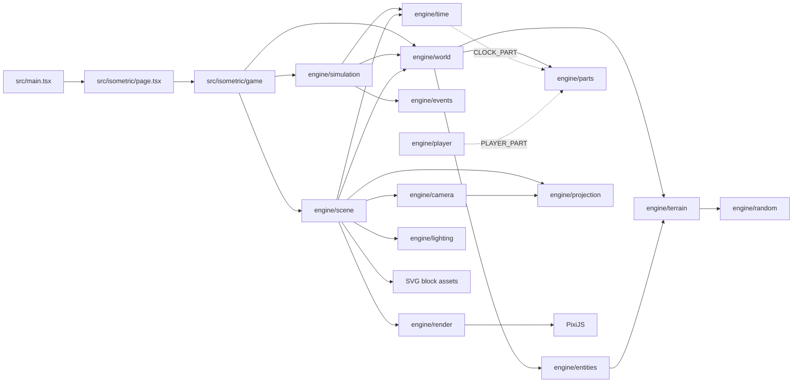

# Arquitectura de Armada Engine

## Propósito

Armada Engine dibuja un terreno discreto en una vista isométrica. El terreno se modela como columnas de bloques; cada columna tiene una coordenada de cuadrícula `(x, y)` y una elevación entera. La escena convierte esas columnas en sprites PixiJS ordenados por profundidad.

El flujo principal es:



## Sistema de coordenadas

Todo el motor (dominio, proyección, luz y render) usa **un único sistema de ejes del mundo**. Esta sección es la referencia; las demás la enlazan. `projection.test.ts` («keeps the documented axes») falla si la proyección deja de cumplirla.

### Ejes del mundo

| Eje               | Unidad            | Qué es                                                                              | En pantalla                                |
| ----------------- | ----------------- | ----------------------------------------------------------------------------------- | ------------------------------------------ |
| `x`               | columnas (entero) | primer índice de la columna                                                         | hacia **arriba a la derecha** (noreste)    |
| `y`               | columnas (entero) | segundo índice de la columna                                                        | hacia **arriba a la izquierda** (noroeste) |
| `z` = `elevation` | bloques (entero)  | nivel del bloque; `0` es el nivel del mar (la arena de la orilla), negativo es agua | hacia **arriba**, en vertical              |

**El punto `(0, 0)` es la columna más cercana a la cámara**: el vértice inferior del rombo que forma el mundo en pantalla. Al crecer `x + y` la columna se aleja de la cámara (sube en pantalla y se dibuja antes). El mundo generado ocupa `x ∈ [0, width)` e `y ∈ [0, height)` (por defecto 32 × 32, `TERRAIN_WIDTH`/`TERRAIN_HEIGHT`), pero las coordenadas pueden ser negativas: `engine/grid` admite ±`MAX_GRID_COORD` por eje para el mundo por chunks.

```text
                         ◆ (W−1, H−1)        ← columna más lejana
                       ╱   ╲
                     ╱       ╲
        (0, H−1) ◆             ◆ (W−1, 0)
                   ╲         ╱
                +y  ↖       ↗  +x
                     ╲     ╱
                       ◆ (0, 0)              ← origen: columna más cercana a la cámara

                  z (elevation): ↑ en vertical
```

### Direcciones y puntos cardinales

La cámara es fija y mira al **norte**, que es la parte de arriba de la pantalla. El sol (`engine/time`), las sombras (`engine/lighting`) y la ocultación de bloques (`removeHiddenBlocks()`) usan estas mismas direcciones.

| Paso en la rejilla  | Píxeles (`TILE_WIDTH` = 40)       | Dirección en pantalla | Punto cardinal                |
| ------------------- | --------------------------------- | --------------------- | ----------------------------- |
| `+x`                | `(+20, −10)`                      | arriba a la derecha   | noreste                       |
| `+y`                | `(−20, −10)`                      | arriba a la izquierda | noroeste                      |
| `+x +y`             | `(0, −20)`                        | arriba                | norte (se aleja de la cámara) |
| `+x −y`             | `(+40, 0)`                        | derecha               | este (sale el sol)            |
| `−x −y`             | `(0, +20)`                        | abajo                 | sur (lado de la cámara)       |
| `−x +y`             | `(−40, 0)`                        | izquierda             | oeste (se pone el sol)        |
| `+1` de `elevation` | `(0, −BOX_HEIGHT)` ≈ `(0, −13.3)` | arriba                | —                             |

### Dentro de una columna

Una columna entera `(x, y)` es el cuadrado que va de `(x, y)` a `(x + 1, y + 1)`. Cuando un cálculo necesita un punto dentro de ella (oclusión ambiental, mapas de sombra) usa la fracción `(u, v)` en `[0, 1]`, con los mismos ejes:

```text
                 (x+1, y+1)   esquina norte (arriba)
                     ◆
                   ╱   ╲
       (x, y+1) ◆    ·    ◆ (x+1, y)       · centro (x+0.5, y+0.5) = (screenX, screenY)
                   ╲   ╱
                     ◆
                   (x, y)     esquina sur (abajo, la más cercana a la cámara); (u, v) = (0, 0)
```

### Espacios de coordenadas

| Espacio                    | Tipo                                     | Origen y ejes                                                                                                                                                                                                                                                                          |
| -------------------------- | ---------------------------------------- | -------------------------------------------------------------------------------------------------------------------------------------------------------------------------------------------------------------------------------------------------------------------------------------- |
| Mundo                      | `WorldCoord` (`x`, `y`) + `elevation`    | El de arriba. Es el único que se guarda (`serializeWorld()`).                                                                                                                                                                                                                          |
| Chunk                      | `ChunkCoord` (`cx`, `cy`)                | Chunk `(0, 0)` = columnas `0…31` en ambos ejes; mismos sentidos que el mundo. `toChunkCoord()` usa división hacia abajo: la columna `−1` está en el chunk `−1`.                                                                                                                        |
| Local                      | `LocalCoord` (`lx`, `ly`)                | `(0, 0)` = esquina sur del chunk; siempre en `[0, CHUNK_SIZE)`.                                                                                                                                                                                                                        |
| Pantalla                   | `screenX`, `screenY`, `baseScreenY` (px) | Los de PixiJS: origen arriba a la izquierda del canvas, `x` hacia la derecha e **`y` hacia abajo**.                                                                                                                                                                                    |
| Mapas de sombra y oclusión | texel `(u, v)`                           | Texel `(0, 0)` en la esquina sur de la columna mínima del mundo; `u` a lo largo de `+x` y `v` a lo largo de `+y`. Se ven «desde arriba», no en isométrico.                                                                                                                             |
| Assets SVG (`data-tiles`)  | —                                        | **Otro convenio**: en los assets `+x` va abajo a la derecha y `+y` abajo a la izquierda, al revés que en el motor. Por eso `lengthAxis: "x"` usa `data-tiles="1xN"` y `lengthAxis: "y"` usa `"Nx1"` (ver [Estado actual de entidades y assets](#estado-actual-de-entidades-y-assets)). |

### De la rejilla a la pantalla

`projectBoxesToIsometric()` (ver [Proyección isométrica](#proyección-isométrica)) convierte `(x, y, elevation)` en el punto de pantalla del **centro de la cara superior** del bloque. `originX`/`originY` son el punto de pantalla de la columna `(0, 0)` a elevación `0`; la escena los elige para centrar el mundo en el canvas, así que el `(0, 0)` del mundo **no** es el `(0, 0)` del canvas.

## Arranque de la aplicación

`src/main.tsx` obtiene el elemento `#app` y monta `IsometricWorld`.

`src/isometric/page.tsx` es declarativa: un `<section>` a pantalla completa con el contenedor del canvas y la etiqueta de hora, y un único `useEffect(() => mountGame(contenedor, { window, onClockChange: setClockLabel }).destroy, [])`. No importa Pixi ni el core. La etiqueta de hora está siempre montada después del contenedor del canvas: si fuera un primer hijo condicional, Preact reutilizaría el elemento del contenedor y movería el canvas dentro de la etiqueta.

`mountGame(container, options)` (`src/isometric/game`) es la capa de aplicación entre la página y el core: junta el core, el contenido y la entrada, y es la única parte imperativa del arranque. Crea una instancia de `Application` de PixiJS y la configura con:

- `resizeTo: window`: el canvas llena la ventana y sigue su tamaño (el `ResizePlugin` de Pixi llama a `renderer.resize()`, y la escena re-centra la cámara y vuelve a cullear en cada evento `resize` del renderer). `WIDTH` ya solo es el ancho de referencia del que sale `TILE_WIDTH`; el core sigue sin leer `window`;
- resolución del dispositivo;
- densidad automática;
- fondo oscuro.

Cuando `app.init()` termina, añade `app.canvas` al contenedor y lee las opciones de arranque de la URL con `resolveLaunchOptions(location.search, random)` (`game/launch.ts`): la semilla (`resolveWorldSeed()`, parámetro `?seed=` o una semilla nueva de `random`, por defecto `Math.random`), la hora inicial (`?hour=`) y la escala de tiempo (`?timeScale=`). Muestra la semilla en consola, genera el mundo con `generateWorld({ seed, entityDefinitions: ENTITY_CONFIG, parts: createWorldParts(startTick) })`, crea el bucle de simulación con `createSimulation(world, { timeScale, systems: createWorldSystems(disabledModules) })` y renderiza el mundo con `createScene(app, world, createSceneModules(disabledModules), { terrain: TERRAIN_APPEARANCE, interpolation: () => getInterpolationAlpha(simulation.stepper) })` (ver [Escena modular](#escena-modular)). `game/modules.ts` es la lista de módulos del juego: `createSceneModules()` (terreno, entidades, sombras, luz ambiente, jugador y cámara, en ese orden), `createWorldParts(startTick)` (el reloj y el jugador; ver [Partes del mundo](#partes-del-mundo)) y `createWorldSystems()` (el jugador). `?modules=-shadows,-player` deja fuera los módulos y sistemas con esos ids (`resolveDisabledModules()`), para depurar uno sin los demás. Con la escena lista conecta los controles: si la escena tiene cámara (`scene.services.camera`), `bindCameraControls(app.stage, app.renderer.screen, camera)` para arrastrar, hacer zoom con la rueda y pellizcar (ver [Cámara](#cámara)); y `bindKeyboardControls(window, { walk, zoom })` (`src/isometric/input`, fuera del core, porque el core no lee el teclado): flechas o WASD **mueven al personaje** (ver [Jugador](#jugador)) y `+`/`-` hacen zoom en el centro (`KEYBOARD_ZOOM_STEP`, ×1,25). Cada pulsación o suelta de una tecla de movimiento llama a `walk(direcciones)`, que `mountGame()` pasa a `setPlayerWalk(world.parts.get(PLAYER_PART), direcciones)`; la simulación lo mueve en sus siguientes ticks y la cámara lo sigue. Las teclas con Alt, Ctrl o Meta siguen siendo atajos del navegador, y al perder el foco la ventana se sueltan todas. Por debajo, `bindKeyboard(target, bindings)` reparte las teclas entre `KeyBinding`s (`press`: una vez por pulsación; `hold`: las teclas suyas que siguen pulsadas, cada vez que cambian); caminar (`walkBinding()`) y el zoom (`zoomBinding()`) son dos bindings, y una acción nueva es un binding nuevo, sin tocar los demás. Después registra la simulación en `app.ticker` con prioridad `UPDATE_PRIORITY.HIGH` (ver [Bucle de simulación](#bucle-de-simulación)); al arrancar y en cada frame que avanza el reloj llama a `onClockChange(formatClockLabel(tick, timeScale))` (`Día N · HH:MM`, más `· ×S` si el tiempo no corre a velocidad real), y la página pinta esa etiqueta sobre el canvas. La capa `game` es el único lugar donde se usan `Math.random()` y `window`, que recibe de la página (los tests le pasan un `window` falso).

`mountGame()` devuelve `{ ready, destroy }`. Cada paso del arranque registra su desmontaje en cuanto existe, y `destroy()` los deshace en orden inverso: listener del ticker, teclado, controles de puntero, escena y aplicación. Si se llama mientras el juego arranca, espera a que termine el paso en curso (`app.init()` o la carga de la escena) y entonces desmonta lo creado sin seguir arrancando: así nunca se destruye una `Application` que aún no ha inicializado (en Pixi 8.22 eso lanza, porque sus plugins no existen todavía) ni se crea una escena o un bucle sobre una aplicación destruida. `ready` se resuelve al terminar de arrancar (o de parar) y se rechaza si el arranque falla. `destroy()` se puede llamar varias veces.

## Organización de módulos

Cada responsabilidad tiene una carpeta y un barrel `index.ts`:

```text
src/isometric/core/
  engine/
    ambient-light/       # módulo de escena: tinte del sol en el render group
      ambient-light.ts
      ambient-light.test.ts
      index.ts
    camera/
      camera.ts
      camera.test.ts
      index.ts
    camera-view/         # módulo de escena: cámara (mueve el contenedor y cullea) y controles de puntero
      camera.ts
      camera.test.ts
      camera-view.ts
      camera-view.test.ts
      controls.ts
      controls.test.ts
      index.ts
    constants/
      constants.ts
      constants.test.ts
      index.ts
    grid/
      coords.ts
      coords.test.ts
      cell-map.ts
      cell-map.test.ts
      spatial-index.ts
      spatial-index.test.ts
      index.ts
    entity-view/         # módulo de escena: sprites de las entidades
      entity-view.ts
      entity-view.test.ts
      index.ts
    entities/
      entities.ts
      entities.test.ts
      formation.ts
      formation.test.ts
      validation.ts
      validation.test.ts
      variants.ts
      variants.test.ts
      index.ts
    lighting/
      shadow.ts
      shadow.test.ts
      index.ts
    parts/
      parts.ts           # WorldParts: estado de cada parte del mundo, guardado y restauración
      parts.test.ts
      index.ts
    player/
      player.ts          # sistema del jugador: aparición, marcha, colisiones, interpolación
      player.test.ts
      player-part.ts     # createPlayerPart(): el jugador como parte del mundo
      player-part.test.ts
      index.ts
    player-view/         # módulo de escena: sprite del jugador, interpolado y seguido por la cámara
      player-view.ts
      player-view.test.ts
      index.ts
    projection/
      projection.ts
      projection.test.ts
      index.ts
    random/
      random.ts
      random.test.ts
      index.ts
    render/              # primitivas Pixi: sprites, profundidad, SVG y color
      color.ts
      color.test.ts
      render.ts
      render.test.ts
      svg.ts
      svg.test.ts
      index.ts
    scene/               # compositor: contrato SceneModule, orden de dibujo, frames y destroy
      module.ts          # tipos del contrato
      module.test.ts     # comprobaciones de tipos del contrato
      scene.ts
      scene.test.ts
      index.ts
    shadows/             # módulo de escena: mapas de sombra, oclusión y sombras recibidas
      received-shadow.ts
      received-shadow.test.ts
      shadows.ts
      shadows.test.ts
      silhouette.ts
      silhouette.test.ts
      index.ts
    time/
      clock.ts
      clock.test.ts
      clock-part.ts      # createClockPart(): el reloj como parte del mundo
      clock-part.test.ts
      sun.ts
      sun.test.ts
      index.ts
    events/
      bus.ts
      bus.test.ts
      index.ts
    simulation/
      simulation.ts
      simulation.test.ts
      stepper.ts
      stepper.test.ts
      index.ts
    terrain/
      box.ts
      box.test.ts
      columns.ts
      columns.test.ts
      terrain.ts
      terrain.test.ts
      surfaces.ts
      surfaces.test.ts
      index.ts
    terrain-view/        # módulo de escena: bloques de terreno con textura y tinte por material
      terrain-view.ts
      terrain-view.test.ts
      index.ts
    world/
      world.ts
      world.test.ts
      index.ts
    flow-check/          # comprobaciones de varios módulos a la vez y soporte de tests
      architecture.test.ts      # capas, barrels, Pixi, módulos de escena y tests al lado de su archivo
      simulation-events.test.ts # orden de los eventos del reloj a través de la simulación
      scene-harness.ts          # mocks de Pixi y del render, app falsa y mundos para tests de módulos
    index.ts
  types/
    camera.ts
    entities.ts
    events.ts
    grid.ts
    iso.ts
    lighting.ts
    parts.ts
    player.ts
    simulation.ts
    terrain.ts
    time.ts
    index.ts
src/isometric/game/
  game.ts            # mountGame(): arranca y desmonta el juego (Pixi, mundo, simulación, escena, controles)
  game.test.ts
  launch.ts          # resolveLaunchOptions() de la URL y formatClockLabel()
  launch.test.ts
  modules.ts         # createSceneModules(), createWorldParts() y createWorldSystems(): de qué está hecho el juego
  modules.test.ts
  index.ts
src/isometric/input/
  keyboard.ts        # teclado del juego: bindings de teclas; caminar (flechas/WASD) y zoom (+/-)
  keyboard.test.ts
  index.ts
src/isometric/content/
  entities.ts        # ENTITY_CONFIG: datos de juego, fuera del motor
  entities.test.ts
  player.ts          # PLAYER_APPEARANCE: cómo se dibuja el personaje
  player.test.ts
  terrain.ts         # TERRAIN_APPEARANCE: SVG, tinte y hundimiento de cada material
  terrain.test.ts
  index.ts
```

La capa de aplicación (`src/isometric/game`) une el core, el contenido y la entrada; el motor no la importa y la página solo la monta. La lógica imperativa del arranque (crear la `Application`, generar el mundo, el bucle, los controles y su desmontaje) va aquí, probada con mocks de Pixi, y no en `page.tsx`.

La entrada del navegador que no pasa por Pixi (`src/isometric/input`, hoy el teclado) es de la aplicación: el motor no la importa, recibe `window` (o cualquier objetivo de eventos) desde `mountGame()` y solo importa tipos del core.

El contenido del juego (`src/isometric/content`) son datos: el motor no lo importa. `mountGame()` lo pasa a `generateWorld({ entityDefinitions: ENTITY_CONFIG })`, que lo valida antes de generar, a la escena (`TERRAIN_APPEARANCE`) y a sus módulos (`createPlayerView(PLAYER_APPEARANCE)`).

Responsabilidades y dependencias permitidas (entre módulos solo a través de su barrel):

| Módulo          | Responsabilidad                                                                                                                                                        | Puede importar                                                                  |
| --------------- | ---------------------------------------------------------------------------------------------------------------------------------------------------------------------- | ------------------------------------------------------------------------------- |
| `constants`     | Medidas de la vista (`WIDTH`, `TILE_*`, `BOX_HEIGHT`, `TILE_METRICS`)                                                                                                  | —                                                                               |
| `random`        | Aleatoriedad con semilla                                                                                                                                               | —                                                                               |
| `grid`          | Coordenadas (mundo, chunk, local), `CHUNK_SIZE`, claves numéricas, `CellMap` y `SpatialIndex`                                                                          | —                                                                               |
| `terrain`       | `Box`, ruido y sus valores por defecto, relleno de columnas (`fillElevations`), bloques visibles (`removeHiddenBlocks`) y superficies                                  | `grid`, `random`                                                                |
| `entities`      | `Entity`, huellas, colocación, formaciones, variantes de color y validación de definiciones                                                                            | `grid`, `random`, `terrain`                                                     |
| `parts`         | `WorldParts`: el estado de cada parte del mundo registrada, leído por clave, y su guardado y restauración con versión propia                                           | —                                                                               |
| `time`          | Reloj de juego (ticks) y su parte del mundo (`CLOCK_PART`), hora del día y estado del sol                                                                              | —                                                                               |
| `events`        | Bus de eventos tipado y síncrono entre sistemas (`createEventBus`)                                                                                                     | —                                                                               |
| `lighting`      | Proyección de las sombras: dirección, alargamiento y opacidad según el sol; silueta tumbada en el suelo o llevada a otra entidad                                       | `constants`                                                                     |
| `player`        | Sistema del jugador: aparición, dirección de marcha, movimiento por tick con colisiones e interpolación (`createPlayerSystem()`), y su parte del mundo (`PLAYER_PART`) | `grid`, `time`                                                                  |
| `world`         | Modelo `World`, tamaño por defecto, generación y guardado; no nombra ninguna parte                                                                                     | `entities`, `grid`, `parts`, `random`, `terrain`                                |
| `projection`    | Rejilla → coordenadas de pantalla isométricas (`projectBoxesToIsometric`, `projectGridPoint`) y su inversa en el suelo (`unprojectScreenDelta`)                        | —                                                                               |
| `camera`        | Cámara como datos: punto del suelo y zoom, límites, desplazamiento, zoom en un punto, seguimiento, transformación y cuándo cullear                                     | `projection`                                                                    |
| `render`        | Primitivas Pixi: sprites con profundidad (`createBlockViews`, `getBlockDepth`, `addInDepthOrder`), recoloreado y resolución SVG, tinte de luz                          | —                                                                               |
| `simulation`    | Bucle de paso fijo: convierte tiempo real en ticks, ejecuta los sistemas de juego que recibe, avanza el reloj y emite sus eventos                                      | `events`, `time`, `world`                                                       |
| `scene`         | Compositor: contrato `SceneModule`, contenedor del mundo, orden de dibujo, servicios, frames y destrucción. No dibuja nada                                             | `camera`, `constants`, `entities`, `grid`, `render`, `terrain`, `time`, `world` |
| `terrain-view`  | Módulo de escena: bloques de terreno visibles con la textura y el tinte de su material                                                                                 | `projection`, `render`, `scene`, `terrain`                                      |
| `entity-view`   | Módulo de escena: sprites de las entidades, una textura por (tipo, variación); servicio `entityViews`                                                                  | `entities`, `projection`, `render`, `scene`                                     |
| `shadows`       | Módulo de escena: siluetas, mapas de sombra por elevación con oclusión ambiental, sombras recibidas y su ritmo de redibujado                                           | `lighting`, `projection`, `render`, `scene`, `time`                             |
| `ambient-light` | Módulo de escena: tinte del render group con la luz ambiente del sol                                                                                                   | `render`, `scene`, `time`                                                       |
| `player-view`   | Módulo de escena: sprite del jugador, interpolado entre ticks y movido en el orden de dibujo; servicio `focus`                                                         | `camera`, `player`, `projection`, `render`, `scene`                             |
| `camera-view`   | Módulo de escena: cámara de la escena (mueve el contenedor, cullea y sigue) y controles de puntero; servicio `camera`                                                  | `camera`, `scene`                                                               |

Fuera del motor, sus módulos solo pueden importar los tipos compartidos (`../../types`), nunca el contenido; el contenido solo importa tipos del core. Solo `render`, `scene` y los módulos de escena importan Pixi, y ningún módulo del motor lee `window`, `document` ni `localStorage`. Un módulo de escena nunca importa a otro, y `scene` no importa a ninguno: se comunican por servicios. `engine/flow-check/architecture.test.ts` comprueba estas reglas sobre el código fuente: un import no permitido, saltarse un barrel, que un módulo de escena dependa de otro o usar Pixi o el navegador en otro módulo hace fallar la suite.

Cada archivo de `src` tiene su test al lado (`foo.ts` y `foo.test.ts`), y cada test está al lado del archivo que prueba. Quedan fuera los barrels (`index.ts`), los tipos compartidos de `core/types` (TypeScript valida esos contratos) y la entrada `main.tsx`. Un archivo que solo declara tipos dentro de un módulo, como `scene/module.ts`, también tiene su test, con comprobaciones de tipos (`expectTypeOf`) que fallan al compilar si el contrato cambia. Lo que no prueba un único archivo (las reglas de arquitectura, un flujo que cruza varios módulos) y el soporte compartido de los tests viven en `engine/flow-check/`, la única carpeta exenta; `flow-check/architecture.test.ts` hace cumplir esta regla.

## Escena modular

La escena no dibuja nada por sí misma: compone **módulos de escena**, cada uno en su carpeta del motor, con su barrel y su test. Así se puede trabajar en las sombras, la luz o el jugador a la vez sin tocar el mismo archivo, y quitar un módulo sin romper los demás.

`createScene(app, world, modules, { terrain, interpolation? })` (`engine/scene`):

1. Rechaza dos módulos con el mismo `id` (antes de crear nada). Crea el contenedor del mundo (un render group con `eventMode = "none"`) y lo añade al `stage`.
2. Prepara el `SceneContext` común: `app`, `world` (solo lectura), `root`, `projection` (suelo `(0, 0)` en escena `(0, 0)`), `metrics` (`TILE_METRICS`), `bounds` (rectángulo de columnas), `columnAt` (`CellMap` de las cimas), `terrain` (la apariencia de cada material, contenido del juego), `topInsetAt(x, y)` (cuánto se hunde la cima de una columna: `topInset` de su material), `assets.loadSvg(src)` (carga a la resolución de la vista con el zoom máximo, con mipmaps, y descarga al destruir la escena) y `services`.
3. Llama a `setup(context)` de cada módulo **en el orden de la lista**. Un módulo devuelve un `SceneModulePart`: `views` (vistas con `depth` y `layer`), `provides` (servicios para los módulos siguientes), `start(built)`, `update(frame)` y `destroy()`. Si un módulo `requires` un servicio que ningún módulo anterior da, da uno que ya dio otro (cada servicio tiene un solo dueño: dos módulos que lo dieran se pisarían en silencio), o si un `setup()` falla, la escena destruye lo ya creado, descarga sus assets y lanza.
4. Junta todas las vistas, las ordena **por profundidad y después por capa** (`SCENE_LAYER`: `terrain` 0, `ground` 1 —lo que yace en la cima: sombras—, `object` 2 —entidades—, `onObject` 3 —sombras recibidas—; a igual profundidad y capa, el orden de creación), las marca `cullable` y las añade una vez con `addInDepthOrder()`.
5. Llama a `start(built)` de cada módulo; `built.placeAt(view, depth)` inserta una vista que se mueve (el jugador) justo después de todo lo que está a esa profundidad o detrás.
6. Registra **un único** listener en `app.ticker` con `UPDATE_PRIORITY.NORMAL` (tras la simulación y antes del render) que llama a `update({ tick, elapsedMs, alpha })` de cada módulo en orden.

Devuelve `{ services, destroy }`; `destroy()` quita el listener, destruye los módulos en orden inverso, el contenedor con sus hijos y descarga los assets.

Los módulos colaboran solo por **servicios** con nombre (`SceneServices`): `entityViews` (lo da `entity-view`; lo usa `shadows` para las siluetas), `focus` (lo da `player-view`; la cámara empieza en él) y `camera` (lo da `camera-view`; el jugador le pide que lo siga y la app le conecta los controles). Un servicio que falta degrada en lugar de romper: sin `entityViews` los mapas de sombra solo llevan oclusión; sin `focus` la cámara empieza en el centro; sin `camera` el jugador camina sin cámara que lo siga y la app no conecta los controles de puntero.

Módulos del juego (`game/modules.ts`, en este orden): `createTerrainView()`, `createEntityView()`, `createShadows()`, `createAmbientLight()`, `createPlayerView(PLAYER_APPEARANCE)` y `createCameraView()`. `modules.test.ts` monta la escena real quitando cada uno y comprueba que el resto dibuja, avanza frames y se destruye. Si `?modules=` nombra un id que no es de ningún módulo ni sistema (una errata), `mountGame()` lo avisa en el log (`findUnknownModules()`).

Para añadir un módulo de escena: crea `engine/<nombre>/` con su `createX(): SceneModule`, su barrel y su test (con `flow-check/scene-harness.ts`: `mockPixi()`, `mockRender()`, `mountScene(world, [módulo])`), añádelo a `ALLOWED_DEPENDENCIES` y a `SCENE_MODULES` en `flow-check/architecture.test.ts` (y a la tabla de arriba), y a la lista de `game/modules.ts`. Si comparte algo con otros módulos, declara el servicio en `SceneServices`. Nunca importes otro módulo de escena.

## Coordenadas e índice espacial

`engine/grid` es la base de todas las búsquedas por posición. Los tipos viven en `core/types/grid.ts`:

- `WorldCoord` (`x`, `y`): columna absoluta del mundo. `ChunkCoord` (`cx`, `cy`) y `LocalCoord` (`lx`, `ly`): chunk de `CHUNK_SIZE` × `CHUNK_SIZE` columnas (32, en `grid`) y posición dentro de él. Cada espacio usa nombres de campo propios, así que TypeScript no deja mezclarlos. `WorldRect` es un rectángulo inclusivo de columnas.
- `toChunkCoord()`, `toLocalCoord()`, `toWorldCoord()` y `chunkRect()` convierten entre espacios con división entera hacia abajo, correcta también con coordenadas negativas.
- `cellKey(x, y)` y `chunkKey(cx, cy)` devuelven claves numéricas con marca de tipo (`CellKey`, `ChunkKey`) que cubren ±`MAX_GRID_COORD` (2²⁰ − 1) por eje; lanzan `RangeError` fuera de rango o con decimales. Sustituyen a las claves de texto `"x:y"`, que el test de arquitectura prohíbe en el motor.
- `CellMap<T>`: un valor por columna (`get/set/has/delete(x, y)`, `forEach`, `entries`), en orden de inserción. `classifyColumnSurfaces()` devuelve un `CellMap<TerrainSurface>`.
- `SpatialIndex<T>`: qué elementos ocupan cada columna, con huellas de varias celdas y varias cosas por celda. `insert`, `remove`, `move`, `at`, `isOccupied`, `cellsOf`, `queryRect`, `anyInRect` y `queryRadius` (distancia de Chebyshev). Las consultas devuelven elementos en orden de inserción, así que el resultado es determinista; según el tamaño del rectángulo recorre sus celdas o los elementos indexados. Es un dato derivado: se reconstruye, nunca se guarda.

`createEntitiesFromConfig()` usa un `SpatialIndex` de las entidades ya colocadas para la ocupación y para `gap` (`anyInRect` filtrando por tipo), y `getFootprint()`/`getEntityFootprint()` calculan las celdas de una huella. `indexEntities(entities)` construye el índice de cualquier lista de entidades.

## Modelo World

`engine/world` define `World`, el estado del juego como datos de dominio sin Pixi ni `window`: `seed`, `width`, `height`, `columns` (un `Box` por columna con su elevación superior y, como `type`, la superficie de la columna, clasificada una vez al generar), `columnIndex` (`CellMap` de `columns` por celda, derivado: no se guarda), `entities`, `occupancy` (`SpatialIndex` de las entidades sobre sus huellas, derivado: no se guarda y `restoreWorld()` lo reconstruye) y `parts` (el estado de los sistemas, ver [Partes del mundo](#partes-del-mundo): el reloj y el jugador). Es la única fuente de verdad: los sistemas lo simulan, el guardado lo serializa y la escena solo lo lee.

- `generateWorld(options)` valida `entityDefinitions` con `validateEntityDefinitions()` (lanza `EntityConfigError` con todos los problemas a la vez), genera el terreno (`generatePerlinTerrain()` con la semilla, sin retoques), crea las columnas tipadas con su superficie (`createTerrainColumns()`), crea entidades con `createEntitiesFromConfig()` usando flujos derivados (`"entities"` para la colocación y `"entity-color-variants"` para la variación de color) y por último crea el estado de cada parte de `options.parts`, en orden. Opciones: `seed`, `width`, `height`, `entityDefinitions` (obligatoria: el motor no trae contenido propio) y `parts` (por defecto ninguna; el juego pasa `createWorldParts(startTick)`). Las partes no alteran nada del terreno ni de las entidades.
- `serializeWorld(world)` produce un `WorldSnapshot` JSON: `version` 5 (la del sobre), `seed`, tamaño, entidades como `{ x, y, data }` y `parts`, un mapa `id → { version, data }` con lo que guarda cada parte. El terreno no se guarda: se regenera desde la semilla.
- `restoreWorld(snapshot, parts)` regenera el terreno, restaura las entidades con `Entity.fromData()` (conservando ids, variaciones, metadata y los cambios hechos en partida) y restaura cada parte de `parts` desde lo guardado (`WorldParts.restore()`); hay que pasarle las mismas partes con las que se generó. Rechaza versiones del sobre distintas de `WORLD_SNAPSHOT_VERSION`: la 1 incluía la meseta de aparición, la 2 no guardaba la hora, la 3 no guardaba al jugador y la 4 guardaba reloj y jugador como campos fijos (`tick`, `player`) en vez de partes.

## Partes del mundo

Cada sistema con estado es dueño de una **parte del mundo** (`WorldPart`, tipos en `core/types/parts.ts`) en vez de un campo de `World`: así un sistema nuevo (clima, necesidades, inventario) no edita `World`, `serializeWorld()`/`restoreWorld()` ni `WORLD_SNAPSHOT_VERSION`, y dos sistemas desarrollados a la vez no chocan en esos archivos.

- `WorldPart<TState, TSaved, TContext>`: `id` único, `version` de lo que guarda, `create(context)` para un mundo nuevo, `serialize(state)` a JSON (sin lo derivado ni lo transitorio, como la entrada) y `restore(saved, context)`. `context` es el resto del mundo (`WorldPartContext`: terreno y entidades), nunca otras partes. Como todo el dominio, sin reloj del sistema, sin `Math.random()` (si necesita azar, `deriveSeed(context.seed, id)`) y sin Pixi.
- `WorldPartKey<TState>` nombra una parte y el tipo de su estado: `world.parts.get(CLOCK_PART)` devuelve un `WorldClock` sin casts. Cada parte exporta su clave (`CLOCK_PART` en `time`, `PLAYER_PART` en `player`) y una factoría (`createClockPart(startTick)`, `createPlayerPart()`); la clave basta para leerla, así que los lectores no dependen de cómo se crea.
- `WorldParts` (`engine/parts`) es el contenedor de `world.parts`: `get(key)` (lanza `The world has no "<id>" part` si no está registrada), `find(key)` (`undefined` si no está), `has(key)`, `ids` y `serialize()`. `WorldParts.create(parts, context)` y `WorldParts.restore(parts, saved, context)` rechazan dos partes con el mismo id antes de crear nada. Al restaurar, una parte sin datos guardados (añadida después del guardado) se crea como en un mundo nuevo, así que las partidas viejas siguen cargando; una parte guardada en otra `version` se rechaza nombrando la parte y ambas versiones; y lo guardado de una parte que nadie registra se conserva tal cual y se vuelve a guardar, sin perderlo.
- Los módulos que solo leen una parte usan `WorldPartReader` (`{ get(key) }`, que `world.parts` cumple), como `createPlayerSystem()`, sin depender de `world` ni de `parts`.
- El juego registra sus partes en `createWorldParts(startTick)` (`game/modules.ts`): el reloj y el jugador. No se desactivan con `?modules=`: un sistema apagado conserva su estado y el guardado no lo pierde.
- La escena necesita el reloj (`createScene()` lanza si el mundo no tiene `CLOCK_PART`) y `stepWorld()` también; `player-view` no dibuja nada si el mundo no tiene jugador.

## Jugador

El personaje jugable es **estado del juego**: es la parte del mundo `PLAYER_PART` (`world.parts.get(PLAYER_PART)`, un `PlayerState`, tipos en `core/types/player.ts`), lo mueve solo la simulación y la escena solo lo dibuja. `engine/player` es dominio puro (sin Pixi ni `window`), depende de `grid` y `time` y no importa `world`: trabaja sobre un `PlayerGround` (`columnIndex` y `occupancy`), que el propio `World` cumple.

- Parte del mundo: `createPlayerPart()` crea el jugador de un mundo nuevo en la columna transitable más cercana al centro (`findPlayerSpawn()`), guarda solo `{ x, y }` (versión 1) y al restaurar lo deja quieto donde estaba, a la elevación de su columna.

- Posición: `x`/`y` es un punto del suelo en columnas, fraccionario; la columna `(x, y)` está centrada en los enteros, así que el jugador pertenece a la columna más cercana (`getPlayerColumn()`). `elevation` es la cima de esa columna. `previous` guarda la posición del tick anterior para interpolar en render, y `walk` la dirección de marcha (vector unitario o `(0, 0)`); ninguno de los dos se guarda.
- Aparición: `findPlayerSpawn(ground, centre)` elige la columna transitable más cercana al centro del mundo (desempate por `x` y luego `y`), así que la misma semilla pone al jugador en el mismo sitio. Sin columnas transitables usa la más cercana, y sin columnas, el propio centro a elevación `0`. `createPlayer(ground, at)` lo crea quieto.
- Entrada: `getWalkDirection(directions)` convierte las direcciones de pantalla mantenidas (`ScreenDirections`) en una dirección del mundo: arriba es el norte (`+x +y`), derecha el este (`+x −y`); las diagonales de pantalla siguen un eje del mundo a la misma velocidad y las opuestas se anulan. `setPlayerWalk(player, directions)` la guarda en `player.walk`; la página la llama en cada cambio de teclas.
- Movimiento: `stepPlayer(player, ground, ticks = 1)` mueve al jugador; `createPlayerSystem()` lo envuelve como `WorldSystem` (sobre un `PlayerWorld`: `columnIndex`, `occupancy` y `parts`, de donde lee `PLAYER_PART`; `World` lo cumple) para la lista de sistemas de la simulación. Cada tick avanza `PLAYER_STEP` (= `PLAYER_SPEED` / `TICKS_PER_SECOND`, 4 columnas por segundo de simulación) si los pies caben: el cuadrado de lado `2 · PLAYER_RADIUS` (0.2) alrededor del punto solo puede pisar columnas que existan, no sean agua, estén a lo sumo `PLAYER_MAX_CLIMB` (1) bloques más arriba o más abajo y no tengan ocupantes no transitables (`walkable: false`, hoy todas las entidades). Si no cabe, prueba cada eje por separado para deslizarse contra la pared, o se queda. Quieto, solo iguala `previous`. Es determinista: la misma marcha sobre el mismo terreno da el mismo camino. Como va en ticks, `?timeScale=` también acelera al jugador.
- Render: `getPlayerRenderPosition(player, alpha)` interpola entre `previous` y la posición actual (`alpha` de `getInterpolationAlpha()`, recortado a `[0, 1]`).

En la escena lo dibuja el módulo `player-view` (`createPlayerView(appearance)`, con `PlayerAppearance`: `textureSource` y `height`, contenido en `content/player.ts` como `PLAYER_APPEARANCE`; ver [Escena modular](#escena-modular)): un sprite creado con `createBlockViews({ surfaceAligned: true })`, no cullable (la cámara lo mantiene en pantalla y el culler solo corre bajo demanda). En cada frame (`update(frame)`), el módulo coloca el sprite en `getPlayerRenderPosition(player, frame.alpha)` (hundido el `topInsetAt()` de su columna, como la cima) y, si se movió, pide a la cámara que lo siga (`services.get("camera")?.follow()`: sin cámara, solo se dibuja). Provee el servicio `focus`, donde arranca la cámara. Solo recalcula su profundidad cuando entra en otra columna o cambia la cima de la columna, y solo cambia su lugar en el orden de dibujo si esa profundidad cambió: `scene.placeAt(sprite, getBlockDepth(…))`, el índice que esa profundidad ocupa entre las vistas del mundo, ordenadas una vez al construir. Nunca usa `zIndex`. El asset es `public/assets/player/block.svg` (1×1, un bloque, sin sombra propia); su generador es `Claude outputs/player.py` (con `iso_lib.py`, como los demás assets). El jugador aún no proyecta sombra (ver `CORE_REVIEW.md`). PixiJS no trae cámara ni viewport: la cámara mueve el render group del mundo, que es lo que recomienda su guía. Cuando el jugador tenga animaciones, sus fotogramas irán en un spritesheet con `AnimatedSprite`.

## Tiempo de juego y sol

`engine/time` no depende de ningún otro módulo (tipos en `core/types/time.ts`). El tiempo es un **contador entero de ticks**, la parte del mundo `CLOCK_PART` (`world.parts.get(CLOCK_PART)`, un `WorldClock`: `{ tick }`); todo lo demás se deriva de él con funciones puras.

- `createClockPart(startTick = WORLD_START_TICK)` es el reloj como parte del mundo: un mundo nuevo arranca en `startTick` (validado al crear la parte: `RangeError` si no es un entero seguro no negativo) y uno restaurado conserva su tick (versión 1, guarda `{ tick }`). La hora inicial no altera nada de lo generado.

- `TICKS_PER_SECOND` (20) fija el paso de simulación: cada paso avanza un tick. `TICKS_PER_DAY` (24 000) da días de 20 minutos reales; una hora de juego son 1 000 ticks. `WORLD_START_TICK` es las 08:00 del día 0.
- `createWorldClock(tick?)` crea el reloj y `advanceClock(clock, ticks = 1)` lo avanza; ambos lanzan `RangeError` con ticks negativos, decimales o fuera del rango seguro (el reloj no cambia). Solo el paso fijo de simulación avanza el reloj, nunca el frame de render, así que la hora es la misma en cualquier máquina y se reproduce al cargar.
- `getTimeOfDay(tick)` devuelve la fracción del día en `[0, 1)` (`0` medianoche, `0.25` amanecer, `0.5` mediodía, `0.75` atardecer) y `getClockTime(tick)` la lectura `{ day, hour, minute }` para UI y depuración.
- `getSunState(tick, palette?)` devuelve un `SunState`:
  - `direction`: vector unitario hacia el sol en ejes del mundo (ver [Sistema de coordenadas](#sistema-de-coordenadas); `z` hacia arriba). El norte es la parte de arriba de la pantalla (`+x +y`), así que la cámara mira al norte. El sol recorre un círculo inclinado: sale por el este (derecha de la pantalla, `+x −y`) a las 06:00, culmina al sur (el lado de la cámara, `−x −y`) a `SUN_MAX_ALTITUDE` (60°) al mediodía y se pone por el oeste (izquierda, `−x +y`) a las 18:00. Nunca ilumina la escena desde detrás: las sombras caen de lado al amanecer y al atardecer y alejándose de la cámara al mediodía.
  - `elevation`: seno de la altitud (`direction.z`), negativo de noche.
  - `daylight`: `0` de noche, `1` de día, con transición suave (`smoothstep`) entre `NIGHT_ELEVATION` (−0.1) y `DAY_ELEVATION` (0.15).
  - `ambient`: color de luz ambiente (`Rgb` en `[0, 1]`) muestreado de una paleta por elevación con `sampleSkyPalette()`. `DEFAULT_SKY_PALETTE` va de una noche azulada y tenue a un horizonte anaranjado y a blanco puro (sin tinte) de media mañana a media tarde. Un juego puede pasar su propia paleta; debe tener al menos una clave y elevaciones estrictamente crecientes (si no, `RangeError`).

El estado del sol es presentación: la lógica de juego que dependa de la hora (por ejemplo, la noche) debe decidir con el `tick` entero, no con los flotantes del sol. La escena lo usa para la luz ambiente (ver [Luz ambiente](#luz-ambiente)). `formatClockTime(time)` formatea la hora como `HH:MM` y `resolveStartTick(search)` lee `?hour=` de la URL (`?hour=17.5` arranca a las 17:30 del día 0; con `?timeScale=0` la hora queda fija) para depurar luz y sombras.

## Bucle de simulación

PixiJS marca los frames; el dominio decide cuántos pasos de simulación tocan. `engine/simulation` depende solo de `events`, `time` y `world` (tipos en `core/types/simulation.ts`) y no usa Pixi ni temporizadores: se prueba en Node.

- `createFixedStepper(options?)` crea un acumulador de paso fijo (`FixedStepper`): `stepMs` (por defecto `STEP_MS` = 50 ms, un tick a `TICKS_PER_SECOND`), `maxFrameMs` (por defecto `DEFAULT_MAX_FRAME_MS` = 250) y `timeScale` (por defecto `1`). Valores no válidos lanzan `RangeError`.
- `consumeFrame(stepper, elapsedMs)` recorta el tiempo real del frame a `maxFrameMs`, lo multiplica por `timeScale`, lo suma al acumulador y devuelve los pasos enteros que caben; el resto queda para el siguiente frame. Así el número de pasos no depende de los FPS, y tras una pausa larga (pestaña oculta, depurador) la simulación continúa sin una ráfaga de pasos: ese tiempo de juego se pierde a propósito. El recorte se aplica al tiempo real, no al escalado, para que `timeScale` alto siga siendo rápido. Con `paused = true`, o con tiempos no válidos (cero, negativos, `NaN`, infinitos), no hay pasos ni acumulación.
- `setTimeScale(stepper, scale)` cambia la velocidad (`0` congela el tiempo) y `getInterpolationAlpha(stepper)` da la fracción del siguiente paso ya transcurrida, para interpolar en render lo que se mueva.
- `stepWorld(world, ticks, { systems, events })` es el único punto de entrada de la simulación: en cada tick ejecuta los `systems` en su orden (`WorldSystem<TWorld>`: `{ id, step(world, events?) }`, tipo en `core/types/simulation.ts`), avanza el reloj del mundo (`CLOCK_PART`; sin él lanza antes de ejecutar nada) y, con `events`, emite los eventos del reloj (ver [Eventos entre sistemas](#eventos-entre-sistemas)), con los sistemas ya aplicados a ese tick. La simulación no conoce ningún sistema concreto: el jugador es `createPlayerSystem()` (ver [Jugador](#jugador)) y la lista la decide el juego (`createWorldSystems()` en `game/modules.ts`). Un sistema nuevo (clima, necesidades, IA) es un `WorldSystem` más en esa lista, sin tocar `simulation`. Un número de ticks no válido se rechaza entero (`assertClockStep()`), sin cambiar el mundo ni emitir.
- `createSimulation(world, { systems, ...opciones del stepper })` une ambos: `simulation.frame(elapsedMs)` consume el frame, ejecuta `stepWorld()` con sus sistemas y los pasos debidos y devuelve `{ steps, alpha, tick }`. `simulation.stepper` permite pausar o cambiar la velocidad, y `simulation.events` es el bus de la simulación.
- `resolveTimeScale(search)` lee `?timeScale=` de la URL para depurar el ciclo del día (`?timeScale=60`: un día en 20 s); valores ausentes, negativos o no numéricos dan `1`.

`mountGame()` (`src/isometric/game`) llama a `simulation.frame(ticker.elapsedMS)` en un listener de `app.ticker` con prioridad `UPDATE_PRIORITY.HIGH`. `elapsedMS` es el tiempo real sin recortar ni escalar por el ticker (el recorte y la escala son del acumulador). `Application` dibuja desde el mismo ticker con prioridad `LOW` (`TickerPlugin` de PixiJS 8.22), así que la simulación siempre corre antes del render del mismo frame.

## Eventos entre sistemas

Los sistemas de juego no se llaman ni se leen entre sí: anuncian lo que pasó en un bus de eventos tipado y los interesados se suscriben. `engine/events` no depende de ningún otro módulo del motor (tipos en `core/types/events.ts`).

- `createEventBus<Events>()` crea un `EventBus` tipado por un mapa `nombre → payload`: `on(type, listener)` devuelve la función para darse de baja, `off`, `emit`, `has` y `clear`. TypeScript rechaza nombres de evento desconocidos y payloads que no coinciden.
- Es **síncrono** y sin colas ni temporizadores: un evento se atiende dentro del tick que lo emite, así que los mismos ticks producen las mismas llamadas en el mismo orden (determinismo). Los listeners se llaman en orden de suscripción; altas y bajas hechas durante un `emit` cuentan desde el siguiente; un evento emitido desde un listener se atiende en el momento (en profundidad); si un listener lanza, el error llega al emisor y el resto no se llama.
- El bus guarda funciones, no estado: no forma parte del guardado. Tras cargar un `WorldSnapshot`, los sistemas se suscriben de nuevo.
- `SimulationEvents` son los eventos de `simulation.events`. Tras cada tick, en este orden: `hourChanged` `{ tick, day, hour }` al entrar en una hora, `dayChanged` `{ tick, day }` a las 00:00 y `tick` `{ tick }`. Cada listener ve el mundo exactamente en ese tick. El payload de `tick` solo se crea si alguien escucha (`has("tick")`).
- Un sistema nuevo define sus eventos como un tipo en `core/types/events.ts` y recibe el bus que necesita; no importa el módulo de otro sistema para enterarse de sus cambios.

## Determinismo y semilla del mundo

Todo el mundo se deriva de una sola semilla numérica. `engine/random` expone:

- `createSeededRandom(seed)`: generador determinista (mulberry32) que devuelve un `RandomSource` en `[0, 1)`.
- `deriveSeed(seed, label)`: sub-semilla independiente por sistema (`"entities"`, `"entity-color-variants"` y, en el futuro, `"chunk:x:y"`, etc.); `generateWorld()` es quien las deriva. Cada sistema consume su propio flujo, así que añadir tiradas en uno no altera lo que genera otro.
- `DEFAULT_WORLD_SEED`: semilla usada cuando no se proporciona ninguna (tests y herramientas).
- `resolveWorldSeed(search, random)`: resuelve la semilla en el punto de entrada.

La lógica de dominio y generación nunca llama a `Math.random()` ni usa el reloj: recibe un `RandomSource` creado a partir de la semilla. Con la misma semilla, terreno, entidades, IDs y variantes de color son idénticos, lo que es requisito para guardar y cargar partidas.

## Modelo de terreno y entidades

`Box` (`engine/terrain/box.ts`) representa exclusivamente una celda materializada de terreno. Sus coordenadas `x` e `y` son inmutables; sus datos (`type`, `walkable`, `elevation` y `metadata`) pueden actualizarse mediante `update()`. `type` (`BoxType`, igual a `TerrainMaterial`: `grass`, `water`, `sand` o `ground`) es el material del bloque y se asigna **una sola vez**, al crearlo: sin `type`, toma el de su elevación inicial (`getElevationMaterial()`: `water` bajo cero, si no `grass`); la arena y el `ground` dependen de las vecinas y de la columna, así que los asignan `createTerrainColumns()` y `fillElevations()`. El resto del motor lee `box.type` y no vuelve a clasificar.

La clase aplica datos por defecto y combina metadata de forma superficial. `getData()` devuelve una copia de los datos y una copia de `metadata`, de modo que el consumidor no puede modificar el estado interno accidentalmente.

Las entidades no son subtipos de `Box`. `Entity` implementa el contrato espacial común y contiene un `id` de instancia estable y único (`<tipo>@<x>,<y>` del ancla al crearse, mediante `createEntityId()`; se guarda en sus datos y no se recalcula), una variación de color `colorVariant` cuando la definición tiene `colorReplacements` (elegida al crearla con `pickColorVariation()` y guardada en sus datos; el constructor acepta `{ id, colorVariant }` y `Entity.fromData(x, y, data)` restaura una entidad guardada), su tipo (`type`, el `id` de la definición), asset, altura, longitud, orientación de longitud y elevación. Las definiciones viven en `src/isometric/content/entities.ts`; `createEntitiesFromConfig()` filtra columnas por superficie y, cuando existe, por `surfaceElevation` (un número exige esa elevación exacta; una lista acepta cualquiera de sus valores), exige que todas las celdas de una huella multi-bloque compartan la elevación de la celda de origen (el sprite se coloca a esa altura, así que un escalón bajo la huella sería visible), valida todas las celdas de una huella multi-bloque y las registra en un `SpatialIndex` para evitar solapamientos. Si la definición declara `gap`, descarta además cualquier huella que quede a menos de `gap` bloques (diagonales incluidas, distancia de Chebyshev) de otra instancia de la misma definición. La primera definición que reserva una coordenada tiene prioridad. `footprintSurfaces` permite exigir una superficie distinta bajo cada bloque de la huella, en orden desde la celda de origen a lo largo de `lengthAxis`; los bloques que no lista usan `surface`. Si una huella combina agua con otras superficies (una entidad que avanza sobre el agua), sus casillas de agua quedan exentas de la regla de huella plana y de `surfaceElevation`: solo las casillas de tierra deben estar a la misma elevación, y esa elevación es la de la entidad aunque la casilla de origen sea agua. Las huellas solo de agua (barcos) siguen exigiendo ambas reglas en todas sus casillas. Los muelles (`pier_x_reverse` y `pier_y_reverse`, con los SVG `block_1x3_over_water.svg` y `block_3x1_over_water.svg` en `public/assets/pier/`) usan `footprintSurfaces: ["water", "sand", "grass"]`: avanzan desde el borde del pasto, sobre la arena, hasta una casilla de agua. Como el agua está en la casilla de origen, solo encajan en costas cuya agua queda hacia el espectador; la orientación opuesta (pasto en la casilla de origen) está desactivada temporalmente. Los SVG `block_*_land_start.svg` y `block_*_land_end.svg` son de la versión anterior (`grass, sand, sand`) y no se usan. Su pasarela queda a la altura del pasto y sus pilotes bajan hasta la arena (medio bloque más baja) y hasta el agua (un bloque más baja); para eso el SVG alarga el lienzo hacia abajo. `createBlockViews()` coloca los sprites desde su borde superior y, en entidades de varias casillas, toma la altura de la imagen de la proporción del SVG, así que ese espacio extra no altera la posición. Para incorporar una entidad nueva se añade una entrada de configuración y su SVG, sin modificar `scene.ts`.

### Formaciones

Por defecto cada columna válida tira `spawnChance` por separado, así que las instancias quedan dispersas al azar. Una definición puede declarar `formation` para que aparezcan agrupadas. La lógica vive en `engine/entities/formation.ts`, sin dependencias de Pixi:

```ts
formation: {
  map: ["XX", "X."], // filas a lo largo de y, columnas a lo largo de x
  minMembers: 3,     // opcional; por defecto, todos los miembros
  rotate: true,      // opcional; un cuarto de vuelta aleatorio por grupo
}
```

1. `parseFormationMap()` convierte el mapa en desplazamientos de cuadrícula. `X` marca un miembro y `.` una celda vacía; cualquier otro carácter, o un mapa sin miembros, lanza un error. El primer `X` en orden de lectura es el ancla `(0, 0)` y siempre va primero.
2. `resolveFormation()` precalcula las orientaciones (cuatro con `rotate`, girando alrededor del ancla con `rotateFormation()`) y limita `minMembers` entre `1` y el número de miembros. Sin `formation`, devuelve un único ancla: las entidades sin agrupar recorren el mismo camino y su consumo de `random` no cambia.
3. En `createEntitiesFromConfig()`, cuando una columna es válida como ancla y supera la tirada de `spawnChance`, `pickFormationOffsets()` elige la orientación (solo consume `random` si hay más de una) y cada miembro se valida con las mismas reglas que una entidad suelta: superficie, `footprintSurfaces`, elevación plana, `surfaceElevation`, celdas libres y `gap`. Los miembros que no encajan se omiten; si quedan menos de `minMembers`, el grupo se descarta sin reservar nada.
4. Los miembros de un grupo no pueden solaparse entre sí (importa en entidades de varias casillas), cada uno toma la elevación de su propia columna y `gap` se mide entre grupos, no entre miembros del mismo grupo. Las huellas multi-bloque no se giran: `rotate` solo gira la disposición del grupo, no el asset.

Como la tirada es por grupo, una definición agrupada en tríos debe usar aproximadamente un tercio del `spawnChance` que tendría suelta para conservar la densidad. Los árboles de dos bloques de alto (`tree_3`, `tree_7`, `tree_8`) usan `TREE_GROVE_FORMATION`: arboledas de tres en L, giradas al azar.

## Generación del terreno

`generatePerlinTerrain(options)` produce una lista ordenada por `x` y después por `y`:

1. Normaliza `width` y `height` a enteros no negativos.
2. Usa un generador pseudoaleatorio determinista a partir de `seed`.
3. Muestrea `simplex-noise` en varias octavas.
4. Combina amplitud con `persistence` y frecuencia con `lacunarity`.
5. Normaliza el ruido a `[0, 1]` y lo convierte al rango `[minElevation, maxElevation]`.

`generatePerlinTerrain()` es una función pura: no hay caché de módulo. El mundo lo genera `generateWorld()` y lo conserva en el objeto `World`.

## Construcción de columnas

`generateWorld()` convierte cada punto del terreno en un `Box` con su elevación, sin modificar ninguna zona.

La escena materializa las columnas para dibujarlas:

`fillElevations(boxes, minElevation)` (`engine/terrain/columns.ts`) materializa todos los niveles entre `minElevation` y la elevación de cada caja. Por ejemplo:

```text
elevación final: 2
mínimo:         -3
columna:        [-3, -2, -1, 0, 1, 2]
```

Esto garantiza que una columna alta no aparezca flotando y que cada nivel pueda recibir su propio bloque visual.

Desde la cámara isométrica fija solo se ve la cáscara de ese terreno relleno. `removeHiddenBlocks(blocks, fillsCell?)` (`engine/terrain/columns.ts`, pura, sin Pixi) quita los bloques tapados por completo: los que tienen un bloque encima y, hacia la cámara (`−x`, `−y` y su diagonal), bloques en su nivel y en el siguiente. Se exige también el nivel siguiente porque el arte de los bloques tiene bordes redondeados: al pie de un escalón la junta bajo el bloque más alto deja ver el de detrás. `fillsCell` dice qué bloques tapan; la escena excluye las cimas de arena, que están medio bloque más bajas. Con `?seed=1337` pasan de 4878 a ~1370 bloques dibujados. Si llega el terreno editable o la cámara gira, hay que recalcularlo para las columnas afectadas (cada bloque depende de su columna y de las tres vecinas hacia la cámara).

## Proyección isométrica

`projectBoxesToIsometric()` (`engine/projection`) conserva la caja original y añade sus coordenadas de pantalla.

Los ejes y el origen se describen en [Sistema de coordenadas](#sistema-de-coordenadas). Con ancho `tw`, alto `th`, origen `(ox, oy)` (punto de pantalla del centro de la cara superior de la columna `(0, 0)` a elevación `0`) y paso vertical `e`, las fórmulas son:

```text
screenX    = ox + (x - y) * (tw / 2)
baseScreenY = oy - (x + y) * (th / 2)
screenY    = baseScreenY - elevation * e
```

`(screenX, screenY)` es el centro de la cara superior del bloque, en píxeles de PixiJS (`y` crece hacia abajo, por eso `x + y` y la elevación **restan**). `baseScreenY` es ese punto sin desplazar por elevación: menor significa más lejos de la cámara, y se usa para ordenar sprites de forma estable. Si no se especifica `elevationStep`, se usa `th / 2`; la escena pasa `BOX_HEIGHT`.

`projectGridPoint(point, config)` proyecta un punto del suelo (elevación `0`, columnas fraccionarias) con las mismas fórmulas, y `unprojectScreenDelta(delta, config)` es su inversa para un desplazamiento: `Δx = dx / tw − dy / th`, `Δy = −dx / tw − dy / th` (a la derecha es `+x −y`; arriba, `+x +y`). La cámara los usa para pasar de píxeles a columnas.

La escena proyecta con origen `(0, 0)`: el punto del suelo `(0, 0)` es el `(0, 0)` del contenedor del mundo, y la cámara (ver [Cámara](#cámara)) decide qué parte se ve moviendo y escalando ese contenedor. Crea las vistas de **todas** las cajas visibles (`removeHiddenBlocks()`) y entidades, también las que quedan fuera de pantalla, y las marca con `cullable = true`. El culling se hace **bajo demanda**: la cámara llama a `Culler.shared.cull(scene, getCullRect(screen), false)` al construirse la escena, en cada evento `resize` del renderer y cuando se ha movido más allá de su margen, no en cada frame. No se registra el `CullerPlugin`: recorría y calculaba los bounds de las miles de vistas en cada frame aunque nada se moviera, y era ~80 % del coste de CPU por frame. Ya no existe un filtro propio de viewport (el antiguo `isWithinViewport` no creaba lo que quedaba fuera al construir).

Los SVG se rasterizan a la resolución con la que se ven con el **mayor zoom**, no a la de su lienzo: `getSvgResolution(TILE_WIDTH × CAMERA_MAX_ZOOM, renderer.resolution)` (`render/svg.ts`) devuelve `min(1, ancho en pantalla × resolución del dispositivo × SVG_DETAIL / SVG_TILE_WIDTH)` (`SVG_DETAIL = 1.5`, `SVG_TILE_WIDTH = 1024`) y la escena la pasa a todas sus cargas con `Assets.load({ src, data: { resolution, autoGenerateMipmaps: true } })` (el cargador SVG de Pixi pasa `data` a la `ImageSource`). Los mipmaps evitan los bordes dentados al alejar el zoom y la textura se dibuja más pequeña que su rasterizado. Rasterizar a 1024 px un bloque que se dibuja a 40 px ocupaba ~217 MB de texturas; con `CAMERA_MAX_ZOOM` = 4, las fuentes SVG de terreno y entidades ocupan unos 16 MB con resolución 1 y unos 63 MB con resolución 2 (estimado, mipmaps incluidos; las variantes de color suman más). La memoria crece con el cuadrado de `CAMERA_MAX_ZOOM`.

## Cámara

La cámara es **estado de vista**, no del juego: no vive en `World`, no se guarda y no la avanza la simulación (se mueve con el tiempo real del frame). `engine/camera` (tipos en `core/types/camera.ts`) es dominio puro, sin Pixi ni `window`, y depende solo de `projection`.

- `Camera` es `{ x, y, zoom }`: `x`/`y` es el **punto del suelo** (elevación `0`, en columnas del mundo, fraccionario) que se ve en el centro del viewport, en los ejes de [Sistema de coordenadas](#sistema-de-coordenadas). Así la cámara dice qué parte del mundo (y, con chunks, qué chunks) está a la vista. `zoom` es cuántos píxeles de pantalla ocupa un píxel de la escena.
- `CameraLimits` fija el rango de zoom y el rectángulo de columnas en el que se queda el centro. Al limitar en columnas (no en píxeles de la escena) el centro nunca sale del rombo del mundo; en los bordes se ve el vacío más allá de la última columna, pero nunca solo vacío. `createCamera(limits, start?)` empieza en el centro de los límites con `CAMERA_START_ZOOM` (3) y lanza `RangeError` con límites no válidos; `clampCamera()` aplica los límites.
- `panCamera(camera, delta, limits, projection)` mueve la escena `delta` píxeles de pantalla (un arrastre): el suelo bajo el puntero lo sigue. `zoomCameraAt(camera, factor, anchor, viewport, limits, projection)` multiplica el zoom manteniendo fijo el punto del suelo bajo `anchor` (el cursor). `screenToGround()` da el punto del suelo que se ve en un punto de pantalla y `getCameraTransform()` la posición y escala del contenedor del mundo.
- Entrada: `getWheelZoomFactor(deltaY, deltaMode)` convierte la rueda (píxeles, líneas o páginas) en un factor (`CAMERA_WHEEL_SENSITIVITY`). `getPinchGesture(from, to)` convierte lo que hicieron dos dedos entre dos frames en un `PinchGesture`: `pan` (lo que se movió su punto medio, para `panCamera()`), `factor` (cuánto se separaron) y `anchor` (su punto medio nuevo, para `zoomCameraAt()` después del desplazamiento); aplicados en ese orden, el suelo bajo los dedos se queda bajo ellos. Si los dedos empezaron o acabaron en el mismo punto no hay zoom. El teclado no mueve la cámara: mueve al jugador, y la cámara lo sigue.
- Seguimiento: `followCamera(camera, target, elapsedMs, limits)` acerca el centro al punto `target` recorriendo la mitad de la distancia que falta cada `CAMERA_FOLLOW_HALF_LIFE_MS` (90 ms) reales, igual a cualquier FPS, y se ajusta encima al quedar a menos de una milésima de columna. `getGroundPointBelow(point, elevation, projection)` da el punto del suelo que se dibuja donde está `point` elevado `elevation` bloques: lo que la cámara debe mirar para centrar algo sobre una columna alta.
- Culling: `getCullRect(viewport)` es el viewport ampliado `CAMERA_CULL_MARGIN` (un 25 %) por cada lado, y `needsCull(culledFor, camera, viewport, projection)` dice si hay que volver a cullear: siempre que cambia el zoom, y cuando la escena se ha movido en pantalla más que ese margen. Así un desplazamiento no recorre las miles de vistas en cada frame; en PixiJS 8.22 cambiar `culled` también marca `structureDidChange` en el render group, así que cullear menos evita reconstruir sus instrucciones.
- Zoom: de `CAMERA_MIN_ZOOM` (1, el mundo de 32 × 32 cabe entero en una ventana de 1300 px de ancho) a `CAMERA_MAX_ZOOM` (4).

En la escena, `createSceneCamera(container, screen, limits, projection, start?)` (`camera-view/camera.ts`) aplica la cámara al contenedor del mundo (`position` y `scale` del render group: un uniforme en GPU, sin tocar a sus hijos) y cullea cuando toca; lee `screen` (el `renderer.screen`) en cada cambio, así que `resize()` re-centra tras redimensionar. `follow(target)` hace que `update(elapsedMs)` deslice la cámara hacia `target` en cada frame (`followCamera()`), hasta el siguiente `pan()`: arrastrar suelta al jugador y la cámara vuelve a seguirlo en cuanto camina. El módulo `camera-view` (`createCameraView({ start? })`) la crea con los límites en las columnas del mundo y la cámara en `start`, en el servicio `focus` (el jugador) si existe, o en el centro; desliza la cámara en cada frame (`camera.update(frame.elapsedMs)`), la re-centra en el `resize` del renderer y la provee como servicio `camera`, que el juego lee de `scene.services`. El contenedor del mundo tiene `eventMode = "none"`: las vistas no participan en el hit testing de Pixi.

`bindCameraControls(stage, screen, camera)` (`camera-view/controls.ts`) usa el sistema de eventos de PixiJS en el `stage` (`eventMode = "static"`, `hitArea` = la pantalla): arrastrar con el botón principal (o un dedo) desplaza, la rueda hace zoom en el cursor y dos dedos pellizcan (`camera.pan()` y luego `camera.zoomAt()` con `getPinchGesture()`); devuelve una función que quita los controles. Guarda los punteros pulsados por `pointerId`: pellizcan los dos primeros, un tercero espera a que se levante uno de ellos, y el dedo que queda tras un pellizco sigue arrastrando desde donde está. Pixi ya pone `touch-action: none` en el canvas, así que el navegador no desplaza ni amplía la página bajo el gesto. Pixi no emite `pointercancel` (no escucha el `pointercancel` nativo), así que un toque cancelado por el sistema puede quedar registrado hasta el siguiente `pointerup` de ese id. El teclado lo lee `bindKeyboardControls()` (`src/isometric/input`).

## Selección de materiales y entidades

El módulo `terrain-view` carga una textura SVG por material, la de `textureSource` en `TERRAIN_APPEARANCE` (`content/terrain.ts`):

```text
public/assets/grass/block.svg
public/assets/ground/block.svg
public/assets/water/block.svg
public/assets/sand/block.svg
```

La selección vive en `engine/terrain/surfaces.ts`, sin dependencias de Pixi, se hace en dos pasos y cada uno se ejecuta una sola vez:

1. `classifyColumnSurfaces(boxes)` decide la superficie de cada columna (un `CellMap`) a partir de su bloque más alto y del de sus vecinas. `createTerrainColumns(points)` la llama al generar el mundo y guarda el resultado como `type` de cada columna:
   - cima negativa: `water`;
   - cima exactamente en `SAND_ELEVATION` (`0`) en una orilla: al menos una vecina directa de agua y, entre sus ocho vecinas (diagonales incluidas, para que las esquinas de la playa sigan siendo arena), alguna de interior, es decir, tierra más alta o tierra a `0` que no toque agua: `sand`. Así los islotes y las franjas sueltas en medio del agua no se vuelven arena;
   - cualquier otra: `grass`.
2. `getBlockMaterial(elevation, topElevation, surface)` elige el material de cada bloque; `fillElevations()` lo aplica al materializar cada nivel y lo guarda como `type` del bloque, que la escena usa directamente para elegir textura y tinte:
   - elevación negativa: `water`;
   - bloque superior de la columna: la superficie de la columna (`grass` o `sand`);
   - cualquier bloque inferior no negativo: `ground`.

El SVG de arena ocupa la mitad del alto del bloque (su cima está a z = 170 de 341 dentro del mismo lienzo `1024×853`), de modo que la orilla baja en dos escalones suaves: agua → arena (medio bloque) → pasto (bloque completo). El renderer no cambia, porque la geometría reducida vive en el asset. Las entidades se siguen alineando a la altura completa del bloque, así que una entidad con `surface: "sand"` necesitará desplazarse medio bloque hacia abajo cuando se añada la primera. La arena recibe el mismo oscurecimiento por altura que el pasto, pero con un tinte neutro en lugar del verdoso, y declara `topInset: 0.5` (su cima medio bloque más baja), que las sombras, la oclusión y el jugador leen con `topInsetAt()`. `createEntitiesFromConfig()` compara `surface` con el `type` de cada columna (sin volver a clasificar), por lo que las entidades de `grass` no aparecen sobre arena y existe la superficie `"sand"` para entidades de playa.

El agua reutiliza la misma textura SVG para todos sus niveles. Cada material declara su tinte en `TERRAIN_APPEARANCE` (`TerrainTint`: `depth`, más oscuro cuanto mayor es `Math.abs(elevation)`, para el agua; `height`, más oscuro cuanto más bajo respecto a la cima más alta, para pasto, tierra y arena), y `getTerrainTint()` (`terrain-view`) lo aplica. No se generan texturas nuevas para cada profundidad.

El módulo `entity-view` proyecta y renderiza las entidades creadas por la factory, y las provee como servicio `entityViews` (para las sombras). Sus texturas, alturas, longitudes y debug se resuelven mediante la configuración; la escena no contiene reglas por entidad.

Las variantes de color SVG se comparten: cada entidad con `colorReplacements` guarda su `colorVariant`, y `entity-view` crea una sola textura por par (tipo de entidad, variación) con `createSvgColorVariant(source, replacements, variationIndex)`. Cada clave de color puede tener un color o una lista; el índice se aplica a todas las listas del SVG, que se codifica como fuente `data:image/svg+xml`. El número de texturas recoloreadas depende de los tipos y variaciones, no del número de instancias.

## Renderizado de bloques

`createBlockViews(options)` crea las vistas de un bloque o entidad a partir de una textura ya cargada, sin añadirlas a ningún contenedor, y devuelve cada una con su profundidad de dibujo (`DepthView`: `view` y `depth`). `options` (`RenderBlockOptions`) lleva `texture`, `box` (posición proyectada) y `metrics` (`TileMetrics`: `tileWidth`, `tileHeight`, `boxHeight`; la escena pasa `TILE_METRICS`), y opcionalmente `tint`, `height` (1), `surfaceAligned` (`false`), `length` (1), `lengthAxis` (`"x"`) y `debug` (`false`). Una opción nueva del renderer se añade como campo opcional con valor por defecto, sin tocar las llamadas existentes. Pasos:

1. Ajusta el tamaño a `TILE_WIDTH` y a la proporción del SVG cuando la entidad ocupa varios bloques.
2. Coloca el ancla en `(0.5, 0)` para alinear el centro horizontal y el borde superior.
3. Posiciona el sprite según `lengthAxis`; el eje `y` desplaza la huella hacia el lado inferior izquierdo de la proyección.
4. Aplica tint opcional.
5. Calcula la profundidad usando `baseScreenY`, elevación y una pequeña corrección por `x`. En entidades de varias casillas, el sprite se corta en `length + 1` franjas verticales de media casilla, que comparten la textura mediante recortes (`frame`) cacheados por textura. Cada franja recibe la profundidad de su propia casilla, y las que quedan entre dos casillas, el de la más cercana a la cámara (`getFootprintSliceTiles()`). Sin esto, todo el sprite tomaría la profundidad de la casilla de origen y taparía lo que está delante de su otro extremo (por ejemplo, un árbol junto al extremo de tierra de un muelle). `createBlockViews()` devuelve todas las vistas con su profundidad, sin añadirlas.
6. Si `debug` está activo, añade al final un `Graphics` con un rombo fino por bloque ocupado en los niveles inferior y superior, justo por delante del sprite.

La escena junta las vistas de todos sus módulos, las ordena por profundidad y luego por capa (`sortViews()`, estable) y llama una vez a `addInDepthOrder(container, views)`, que las añade de atrás hacia delante. La profundidad **no** se guarda en `zIndex`: en PixiJS v8 asignar `zIndex` activa `sortableChildren` en el padre, que reordena todos sus hijos cada vez que algo cambia. El contenedor de la escena no usa `sortableChildren`. Cuando una entidad se mueva, habrá que recolocar solo su vista según su nueva profundidad, no reordenar el mundo entero.

Los SVG representan el bloque completo. No se deben volver a componer caras `top`, `left` y `right` en runtime.

## Luz ambiente

El contenedor del mundo que crea la escena es un render group (`new Container({ isRenderGroup: true })`). En PixiJS 8.22 el tinte de la raíz de un render group pasa a ser el `worldColor` del grupo y se aplica en GPU como uniforme global, sin recalcular sus miles de hijos; los tintes propios de cada vista (agua por profundidad, oscurecimiento por altura) se multiplican dentro del grupo, así que se conservan. El mismo grupo es el que mueve y escala la cámara en GPU.

El módulo `ambient-light` (`createAmbientLight()`) asigna `root.tint = rgbToTint(getSunState(tick).ambient)` (el tick de `CLOCK_PART`) al arrancar y en su `update()`, solo en los frames en que el tick cambió; la escena llama a los `update()` desde su único listener de `app.ticker` (prioridad `UPDATE_PRIORITY.NORMAL`: tras la simulación, en `HIGH`, y antes del render de `Application`, en `LOW`). `rgbToTint()` (`engine/render/color.ts`) convierte un `Rgb` en `[0, 1]` a `0xRRGGBB`, recortando canales fuera de rango. De día el ambiente es blanco, así que el mundo se ve exactamente como antes. Sin el módulo (`?modules=-ambient-light`) el mundo se ve siempre de día.

El tinte es multiplicativo: oscurece y colorea, pero no desatura. De noche el pasto, muy saturado, queda verde oliva oscuro más que azul; ajustar `DEFAULT_SKY_PALETTE` (o pasar otra paleta) es el primer recurso, y una desaturación real requeriría un filtro sobre el mundo, con su coste por frame.

## Sombras

Los assets no llevan sombra proyectada propia: la dibuja el motor sobre el terreno y sobre las demás entidades, con la silueta de cada objeto, y sigue al sol. Todo lo de Pixi vive en el módulo de escena `shadows` (`createShadows()`): lee las entidades del servicio `entityViews` (sin él, los mapas solo llevan la oclusión) y la altura de cada cima con `topInsetAt()`.

- **Proyección (dominio).** `getShadowProjection(sun)` (`engine/lighting`, tipos en `core/types/lighting.ts`) devuelve un `ShadowProjection`: dirección de las sombras en el suelo (opuesta al sol), `stretch` (casillas de suelo por casilla de altura, `1 / tan(altitud)`, con tope `MAX_SHADOW_STRETCH` = 4) y `alpha` (de `0` en el horizonte a `SHADOW_ALPHA` = 0.32 en `SHADOW_FADE_ELEVATION`); `null` de noche. `getSilhouetteMatrix(projection, foot, lift, metrics)` devuelve la transformación afín que tumba en el suelo los píxeles de un sprite, relativos a su pie: trata el sprite como un recorte vertical sobre su pie y **girado hacia el sol** (los objetos tienen volumen: una copa proyecta todo su ancho venga de donde venga el sol, mientras que una cartulina de canto proyectaría una línea). Un píxel a lo ancho del sprite se pone de través a la sombra (`√2 / tileWidth` casillas por píxel); un píxel `h` por encima del pie, a `h × √(5/2) / tileWidth` casillas de altura × `stretch` en la dirección de la sombra. `lift` son los bloques entre el suelo de quien proyecta y el plano que recibe la sombra: cuanto más bajo el plano, más lejos cae. `BLOCK_HEIGHT_IN_TILES` (≈ 0.53) es la altura de un bloque en casillas.
- **Siluetas (render).** `createSilhouettes(views, box, metrics, length, lengthAxis)` (`shadows/silhouette.ts`) crea, por cada sprite de una entidad tal como lo devuelve `createBlockViews()`, una copia negra recortada a la altura de su pie (solo proyecta lo que está por encima del suelo). Las franjas de una entidad de varias casillas usan cada una el pie de su propia casilla (`getFootprintSliceTiles()`). Los recortes se cachean por textura.
- **Mapas de sombra (`shadows`).** El módulo crea un `RenderTexture` por elevación de cima del terreno, en espacio del mundo visto desde arriba: `SHADOW_MAP_PIXELS_PER_TILE` (16) texels por columna, texel `(0, 0)` en la esquina de la columna mínima. Cada mapa se dibuja desde una capa fija: primero el sprite de la **oclusión ambiental** de ese nivel (ver [Oclusión ambiental](#oclusión-ambiental)), luego, si alguna entidad llega a él, su contenedor de siluetas: las de las entidades a esa elevación o más arriba, cada una con su `lift` (bloques hasta ese nivel). Nunca se cambia `visible` ni `renderable` de una silueta: en PixiJS 8.22 ese cambio marca `structureDidChange` en el render group, que entonces reconstruye todas sus instrucciones de dibujo. Para dibujar un mapa, `placeSilhouette()` coloca cada silueta (matriz `getSilhouetteMapMatrix()` = píxeles de la textura → píxeles relativos al pie → casillas del mundo por `getSilhouetteMatrix(…, lift)` → texels) y `app.renderer.render({ container, target, clear: true, clearColor: [0, 0, 0, 0] })` lo pinta. Las siluetas llevan dos filtros compartidos: `BlurFilter` (`SHADOW_BLUR` = 2) para bordes suaves y `AlphaFilter`, que aplica la opacidad del sol (`projection.alpha`) al grupo entero, así que las sombras que se solapan no se oscurecen doble. El contenedor de siluetas tiene `filterArea` igual al rectángulo del mapa, conocido al construir, para que Pixi no mida las siluetas en cada redibujado. De noche el contenedor de siluetas se oculta (una vez, al anochecer) y el mapa solo lleva la oclusión.
- **Ritmo de redibujado.** Al crear la escena, al amanecer y al anochecer se dibujan todos los mapas (y el atlas de sombras recibidas) a la vez. De día, cada mapa con siluetas (y el atlas) recuerda el tick para el que se dibujó y en cada frame (el listener de luz corre aunque el reloj no avance) se redibuja **un solo mapa: el más desactualizado**, si tiene al menos `SHADOW_REFRESH_TICKS` (10) ticks de antigüedad, con el sol de ese frame. Así ningún frame paga todos los mapas y, por turnos, todos siguen moviéndose aunque el refresco venza en cada frame (tiempo acelerado o pocos FPS). Los mapas sin siluetas solo contienen la oclusión, que no cambia, y no se redibujan.
- **Sobre otras entidades (dominio).** `getCastShadowOffset(projection, casterFoot, receiverFoot, lift, metrics)` (`engine/lighting`) dice dónde cae la silueta de una entidad sobre otra. Las dos se tratan como el recorte vertical girado hacia el sol de `getSilhouetteMatrix()`: un rayo de sol que pasa por el que proyecta a `u` píxeles de través y `h` de altura llega al receptor `along` casillas más adelante en la dirección de la sombra y `along / stretch` casillas de altura más abajo, con el mismo desplazamiento de través. Así toda la silueta, relativa al pie de quien proyecta, cae sobre el receptor desplazada un mismo vector de píxeles de pantalla: `x` = distancia de través (`√2 / tileWidth` casillas por píxel) e `y` = `along / (stretch × √(5/2) / tileWidth) − lift × boxHeight`, con `lift` los bloques que quien proyecta está por encima del receptor. Las filas que el desplazamiento baja por debajo del pie del receptor ya cayeron al suelo antes de llegar. `null` si el receptor no está sombra abajo (`along ≤ 0`) o el sol está en el cénit. `getShadowReach(height, lift, metrics)` es la distancia máxima a la que llega la sombra de algo de `height` píxeles con el sol más bajo (`MAX_SHADOW_STRETCH`): la escena solo empareja entidades a esa distancia más una casilla (`RECEIVER_SPAN`).
- **Sobre otras entidades (render).** `createReceivedShadows(receivers, renderer, filters)` (`shadows/received-shadow.ts`) recibe cada sprite de entidad que alguna otra puede sombrear (`ShadowReceiver`: su propia silueta, que lleva el sprite de la escena en `source` y su profundidad en `depth`, y sus `casters` con su `lift`). Reserva para cada receptor un cuadrado de **un único atlas** (`RenderTexture`, empaquetado por filas de hasta `RECEIVED_SHADOW_ATLAS_WIDTH` = 2048 texels, separados `RECEIVED_SHADOW_PADDING` = 16), en su propio espacio de pantalla a `RECEIVED_SHADOW_RESOLUTION` = 2 texels por píxel, y una vista que muestra ese cuadrado sobre el sprite, con su misma profundidad y añadida justo después: lo que está delante sigue tapando la sombra y la escena no vuelve a tocar la vista. Al crearse dibuja una sola vez una **máscara** opaca salvo donde hay receptores (cada sprite con `blendMode = "erase"` sobre un fondo `[0, 0, 0, 1]`, o sea `1 − alpha` del receptor). Cada par (quien proyecta, receptor) tiene su sprite negro con una textura propia `dynamic` sobre la de la silueta; en cada dibujo `draw(offsetOf)` lo coloca con el desplazamiento y **recorta su `frame`** al cuadrado del receptor más `RECEIVED_SHADOW_BLEED` = 4 texels (así nunca invade el cuadrado vecino), lo oculta si no lo sombrea (`visible` solo se escribe al cambiar) y hace un único render a textura: el contenedor de siluetas, con los mismos `BlurFilter` y `AlphaFilter` de los mapas de sombra y `filterArea` = el atlas, y encima la máscara con `blendMode = "erase"`, que deja la sombra solo donde el receptor es opaco. En la escena el atlas es un destino más del reparto por turnos (ver abajo): se dibuja al crearla, al amanecer y al anochecer (de noche vacío, con las siluetas ocultas) y de día cuando es el más desactualizado. Sin pares no se crea.
- **Sobre el terreno.** Cada cima de columna recibe una vista `createGroundShadowView()`: un sprite con su cuadrado del mapa de su elevación, colocado sobre su rombo superior con `getGroundShadowMatrix()` (la cima de la arena, medio bloque más baja), añadido justo después del bloque superior con su misma profundidad. Queda encima de su casilla y debajo de lo que está sobre ella o delante, así que **ninguna casilla corta una sombra**, y en un escalón la sombra se interrumpe y sigue desplazada en el nivel inferior. Estas vistas están siempre visibles con opacidad 1 y la escena no vuelve a tocarlas: lo que muestran (oclusión, sombras, su opacidad) lo decide el mapa.

Límites conocidos: las sombras caen sobre las cimas del terreno y sobre otras entidades, no sobre las caras laterales de los bloques ni sobre terreno más alto que quien las proyecta. Sobre otra entidad, ambas son recortes verticales girados hacia el sol: la sombra no sigue el volumen del receptor (sus caras y su tejado se sombrean igual), y el jugador ni proyecta ni recibe. El sprite tratado como recorte vertical alarga un poco las sombras (la cara superior del objeto cuenta como altura). El terreno (acantilados) no proyecta sombra. Coste: un `RenderTexture` por elevación (8 con el terreno actual, 528 × 528) y una textura de oclusión por elevación (256 × 256), una vista por columna y, por refresco, un render a textura con desenfoque por cada mapa al que llega alguna entidad, repartidos de uno en uno entre frames. Las sombras recibidas añaden un atlas, su máscara (con `?seed=1337`: 344 receptores, 13 129 pares, 2032 × 1855 texels, unos 15 MB cada uno), una vista por receptor y, en su turno, el recorrido de todos los pares y un render a textura de los que sombrean (300–1 700 según la hora).

## Oclusión ambiental

La oscuridad donde llega menos cielo al suelo, al pie de las paredes (bloques más altos). Solo el terreno ocluye: las entidades no dejan sombra de contacto; su única sombra es la del sol. El terreno y las entidades son estáticos, así que se calcula **una sola vez** al crear la escena y no cuesta nada por frame.

- **Cálculo (dominio).** `getOcclusion(terrain, x, y, u, v)` (`engine/lighting/occlusion.ts`) da la oclusión en un punto `(u, v)` de la cima de la columna `(x, y)`. Cada columna vecina más alta oscurece el suelo a su pie según el desnivel (completo desde un bloque; la arena, medio bloque más baja, cuenta medio), con `AO_WALL_ALPHA` (0.12) que se desvanece en `AO_WALL_RADIUS` (0.5 casillas) desde la columna; así quedan bandas a lo largo de los escalones y esquinas más oscuras donde se juntan dos paredes. Las cimas de los acantilados no se oscurecen. Las aportaciones se combinan como sombras apiladas, `1 − Π(1 − oᵢ)`, sin llegar nunca a negro. `OcclusionTerrain` describe el terreno con funciones (`topHeightAt`, `levelAt`), así que el cálculo no depende de `World` ni de Pixi.
- **Mapa.** `buildOcclusionMap(terrain, level, AO_PIXELS_PER_TILE)` devuelve un `Uint8ClampedArray` RGBA negro con la oclusión en alfa, muestreada en el centro de cada texel, con la misma disposición que los mapas de sombra pero a `AO_PIXELS_PER_TILE` (8) texels por casilla: la oclusión es suave y el filtrado lineal la interpola. Solo escribe las columnas de ese nivel.
- **Escena (`shadows`).** Para cada elevación crea una textura con `BufferImageSource` a partir de ese mapa (`topHeightAt` a partir de la elevación y la superficie) y la pone, escalada ×2, al fondo de la capa de su mapa de sombras. Así aparece en las mismas vistas de suelo, de día y de noche, sin sprites nuevos en la escena; las sombras del sol se componen encima. Si en el futuro el terreno cambia, habrá que recalcular la oclusión de las columnas afectadas.

## Ciclo de vida de recursos

`createScene(app, world, modules, options)` no genera ni modifica el mundo: sus módulos leen columnas, superficies y entidades, y cargan sus assets con `context.assets.loadSvg()` (`Assets.load()` a la resolución de pantalla), que registra cada fuente. Devuelve `{ services, destroy }`. Las instancias comparten la textura de su (tipo, variación); las fuentes originales sin recolor también se reutilizan. Si un módulo falla al montarse, la escena destruye los ya montados y descarga lo cargado antes de propagar el error. `destroy()` quita su listener del ticker, llama al `destroy()` de cada módulo en orden inverso (la cámara quita el de `resize`; las sombras destruyen capas, texturas de oclusión y mapas con `destroy(true)`), destruye el container y llama a `Assets.unload()` para cada fuente cargada. Pixi gestiona las texturas; no se debe llamar a `destroy(true)` sobre una textura administrada por `Assets`.

## Testing y calidad

Vitest corre en Node sin shim de `window`: si un módulo del core lo leyera al importarse, la suite fallaría. Los tests de generación comprueban el determinismo: la misma semilla produce el mismo terreno, las mismas entidades e IDs, y `Math.random()` no se llama.

Vitest ejecuta tests co-localizados mediante `src/**/*.test.ts`. La cobertura se mide con V8 y tiene umbrales obligatorios de `100%` para:

- statements;
- branches;
- functions;
- lines.

Los tests de renderer y escena mockean PixiJS. Esto permite probar selección de materiales, carga/unload, geometría y tintado sin WebGL ni navegador. Cada módulo de escena se prueba solo, montado con `mountScene(world, [módulo])` de `engine/flow-check/scene-harness.ts` (mocks de Pixi, del render y de las sombras, app y ticker falsos, mundos de prueba); `flow-check/` queda fuera de la cobertura porque no es código de producción. `game/modules.test.ts` monta la escena real sin cada módulo, uno a uno, para demostrar que el juego sigue en pie.

El flujo completo de validación es:

```bash
pnpm lint
pnpm test:coverage
pnpm build
```

El coverage HTML se genera en `coverage/` y el build en `dist/`; ambos directorios son artefactos generados y no deben editarse manualmente.

## Puntos de extensión

Para añadir un nuevo material de terreno:

1. Crear `public/assets/<material>/block.svg` con la misma geometría del bloque.
2. Añadir el material a `TerrainMaterial` (y a `TerrainSurface` si puede ser la cima de una columna) y su regla en `engine/terrain/surfaces.ts` (`classifyColumnSurfaces()` o `getBlockMaterial()`): llega a cada bloque como `type`.
3. Añadir su apariencia (`textureSource`, `tint`, `topInset` si su cima es más baja) a `TERRAIN_APPEARANCE` en `content/terrain.ts`: el tipo `TerrainAppearance` exige una entrada por material, así que olvidarla no compila. `terrain-view` la carga sin cambios.
4. Actualizar o crear el test de `terrain` para demostrar la selección.
5. Ejecutar lint, coverage y build.

Para añadir una entidad:

1. Crear su SVG en `public/assets/<entidad>/block.svg`.
2. Añadir una entrada en `src/isometric/content/entities.ts` (`ENTITY_CONFIG`) con `id`, `textureSource`, `height`, `spawnChance` y `surface`; si ocupa más de un bloque, añadir `length` y `lengthAxis` según `data-tiles`, y si mide varios bloques de alto, `height` igual al tercer valor de `data-tiles` (`1x1x3` → `height: 3`).
3. Añadir o actualizar el test de la factory para demostrar la regla de colocación.
4. No añadir condiciones específicas de la entidad en la escena ni en sus módulos, `Box` o `render.ts`.
5. Ejecutar lint, coverage y build.

Para añadir un módulo de escena (algo que se dibuja), ver [Escena modular](#escena-modular). Para añadir un sistema de juego (algo que cambia el mundo cada tick): crea su `createXSystem(): WorldSystem<…>` en su módulo de `engine/`, con test, y añádelo a `createWorldSystems()` en `game/modules.ts`; si avisa a otros sistemas, declara sus eventos en `core/types/events.ts`. Si tiene estado propio que guardar, no lo añadas a `World`: crea su parte del mundo (`createXPart(): WorldPart<…>` y su clave `X_PART`, con test de guardado y restauración) y añádela a `createWorldParts()` (ver [Partes del mundo](#partes-del-mundo)); cuando cambie la forma de lo que guarda, sube la `version` de la parte, no `WORLD_SNAPSHOT_VERSION`.

Para añadir una nueva regla de elevación, modificar primero `terrain` (relleno de columnas y superficies) o la selección de materiales, según dónde pertenezca la decisión. No introducir esa lógica dentro de `render`, porque el renderer solo debe convertir una decisión ya tomada en un Sprite.

## Estado actual de entidades y assets

Las definiciones de entidad pueden exigir `surfaceElevation` (número o lista de elevaciones válidas), declarar una huella con `length` y `lengthAxis`, imponer una separación mínima con `gap`, agrupar instancias con `formation` (ver [Formaciones](#formaciones)), activar `debug` y proporcionar `colorReplacements`. La factory valida todas las celdas de la huella, las registra en un `SpatialIndex` y evita solapamientos entre entidades; la primera definición que reserva una coordenada tiene prioridad.

`gap` indica cuántos bloques libres como mínimo deben separar dos instancias del mismo `id`; se mide desde toda la huella e incluye las diagonales. `gap: 1` impide colocar dos instancias contiguas. No afecta a entidades de otras definiciones (por ejemplo, `house` y `house_2x1` se tratan por separado). Valores ausentes, `0` o negativos no imponen separación.

Correspondencia de ejes (ver [Sistema de coordenadas](#sistema-de-coordenadas)): el eje `x` del motor avanza hacia arriba a la derecha en pantalla y el eje `y` hacia arriba a la izquierda, mientras que los assets usan `+x` hacia abajo a la derecha y `+y` hacia abajo a la izquierda. Por eso `lengthAxis: "x"` usa un asset `data-tiles="1xN"` y `lengthAxis: "y"` un asset `data-tiles="Nx1"` (como `boat` y `apartments_y`). `content/entities.test.ts` comprueba esta correspondencia, y la de `height`, para cada entrada de `ENTITY_CONFIG`.

Los árboles de dos bloques de alto (`data-tiles="1x1x2"`, `height: 2`) son `tree_3` (pino), `tree_7` (ciprés columnar) y `tree_8` (abedul de otoño), además de `tree_2`, cuyo SVG ocupa dos bloques pero no declara `data-tiles`. Las casas y edificios de varios pisos viven en `public/assets/house/` y `public/assets/building/`: `house_2x1` y `house_balcony` (1×1, 2 bloques), `tower` (1×1, 3 bloques) y `apartments_x`/`apartments_y` (2 celdas, 3 bloques, con `gap`). Los edificios grandes (4–6 bloques, `gap: 2`) son `skyscraper` (1×1, 6 bloques), `hotel_x`/`hotel_y` (2 celdas, 4 bloques) y `office_x`/`office_y` (3 celdas, 5 bloques; assets `data-tiles="1x3x5"` y `"3x1x5"`), con techos recoloreables mediante `SKYSCRAPER_ROOF_COLOR_REPLACEMENTS`, `HOTEL_ROOF_COLOR_REPLACEMENTS` y `OFFICE_ROOF_COLOR_REPLACEMENTS`. El renderer escala cualquier altura con `TILE_HEIGHT + BOX_HEIGHT * height`, por lo que no requiere cambios para nuevas alturas. Cada uno declara `colorReplacements` para su techo (`HOUSE_BALCONY_ROOF_COLOR_REPLACEMENTS`, `TOWER_ROOF_COLOR_REPLACEMENTS`, `APARTMENTS_ROOF_COLOR_REPLACEMENTS` en `content/entities.ts`): cada tono sombreado del techo en el SVG se asocia a la misma lista de cuatro variantes, y la primera conserva el color original del asset. El techo de los apartamentos usa un material propio (pizarra) para que el recoloreado no afecte a las franjas de hormigón entre pisos.

`lengthAxis: "x"` es el valor por defecto. `lengthAxis: "y"` orienta el asset hacia el eje `y` y se aplica de forma coherente a la reserva de celdas, al posicionamiento del sprite y a los rombos de debug. Los assets multi-bloque deben reflejar su atributo SVG `data-tiles` en esta configuración.

Cuando una entidad define `colorReplacements`, cada instancia recibe una variación elegida con la semilla del mundo y comparte la textura de esa variación con las demás instancias de su tipo. Cada clave acepta un color o una lista; se selecciona una variante coherente para todas las apariciones de esa clave dentro del SVG. `debug: true` dibuja un rombo fino por bloque ocupado en las superficies inferior y superior.

## Regla de sincronización

Todo cambio que modifique el funcionamiento del core, sus contratos, el renderizado o el flujo de assets debe actualizar en el mismo cambio los Markdown afectados. `ARCHITECTURE.md` documenta el runtime y `CONTRIBUTING.md` el flujo práctico; las reglas de generación e integración de SVG viven en la skill `iso-asset-generator`.
